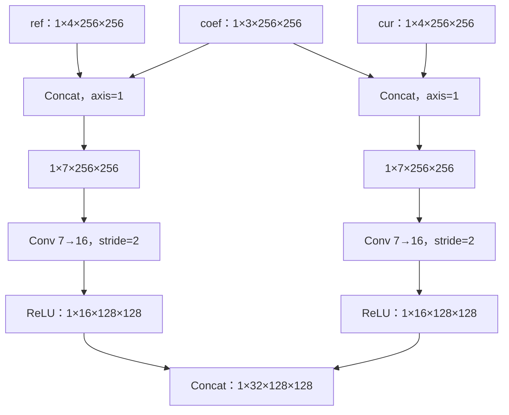
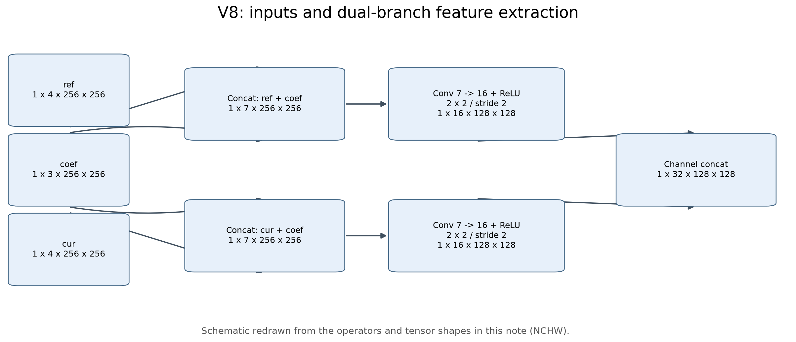
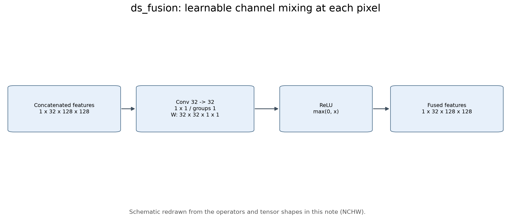
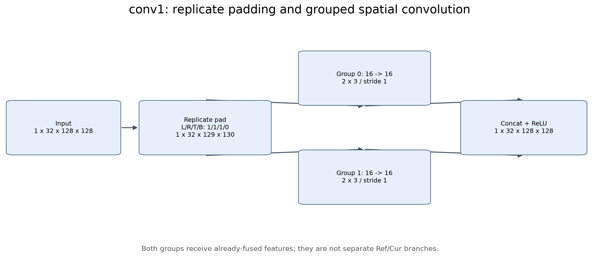
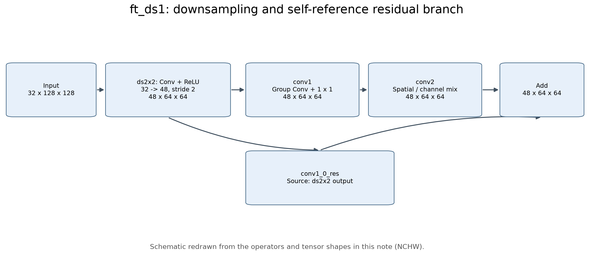
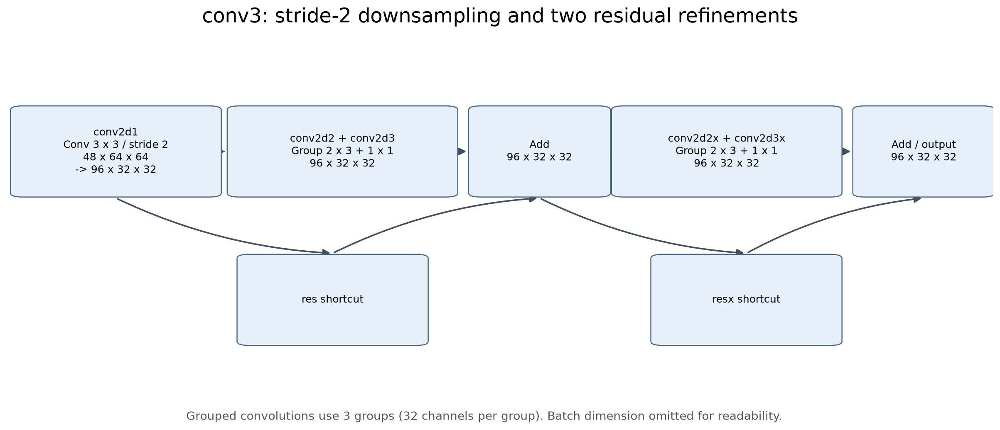
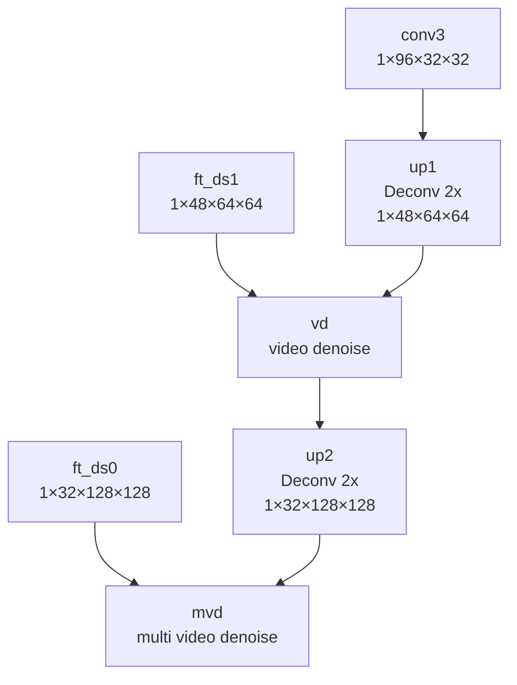
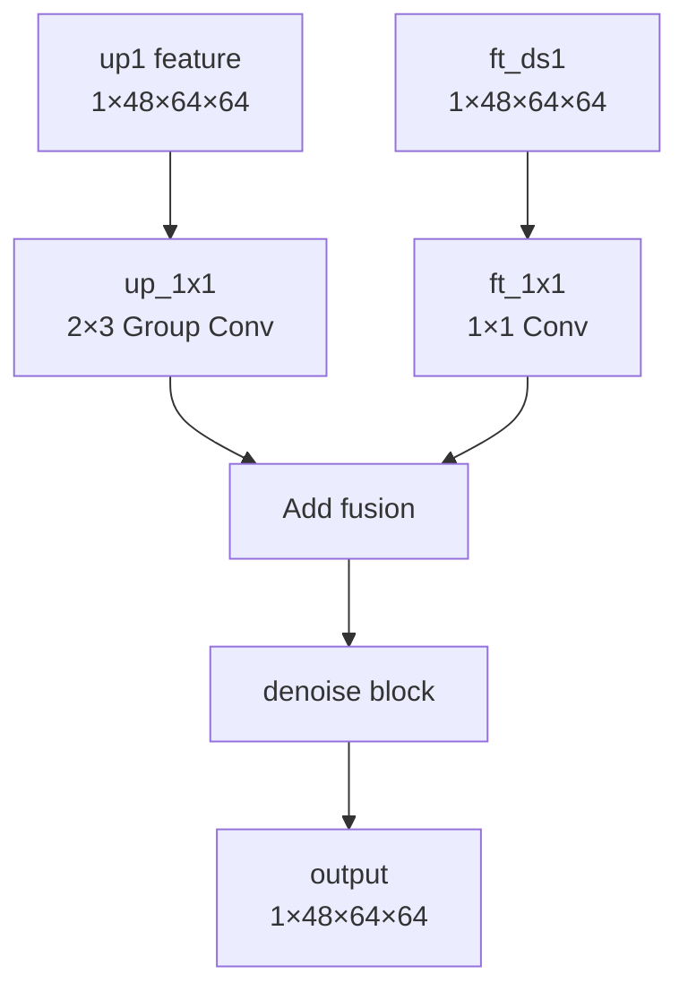
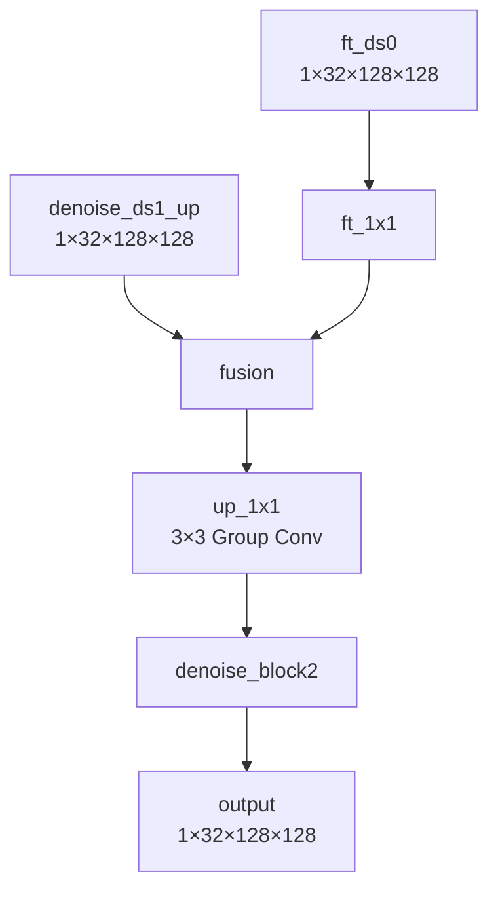
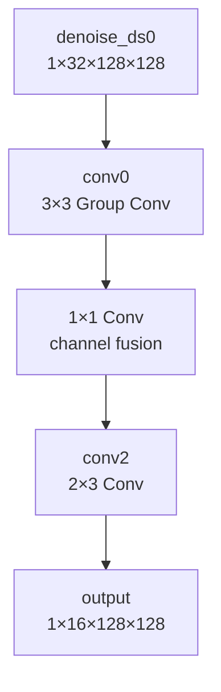

# 6 一种具有更优整体图像质量的 Encoder-Decoder SNR 网络（8）

> 本文五张结构图根据各节已有源码和 Tensor 形状重新绘制，属于结构示意图。原始截图未随 Vault 同步；文末代码可重新生成这些图片。

## 1 网络整体结构


## 2 网络输入

### 2.1 模型输入



网络的主要输入为 `ref`、`cur`、`coef`，输出为去噪后的 RAW。

| 输入 | Tensor 形状 | 含义 |
|---|---|---|
| ref | 1×4×256×256 | 参考帧，通常是上一帧去噪结果 |
| cur | 1×4×256×256 | 当前帧待去噪 RAW |
| coef | 1×3×256×256 | 噪声相关参数 k、b、sfs |

其中，RAW 采用 Bayer-packed 格式，图像为 4 通道。

V8 原生网络直接接收三个输入，不需要将三个输入拼成一个 11 通道 Tensor。网络单次 forward 处理一帧，连续多帧的递归过程由外部代码控制。



### 2.2 输入拼接

源码：

`x0 = torch.cat([ref, coef], dim=1)`

`x1 = torch.cat([cur, coef], dim=1)`

因此：

- ref（4 通道）+ coef（3 通道）→ x0（7 通道）
- cur（4 通道）+ coef（3 通道）→ x1（7 通道）

两路输出均为：`1×7×256×256`

### 2.3 输入层分析

拼接后的两路 7 通道 Tensor，分别经过独立的 Conv 和 ReLU。

**（1）第一层卷积**

两个 Conv 的结构相同，权重独立。Conv 配置如下：

| 属性 | 数值 | 含义 |
| --- | --- | --- |
| Weight | 16×7×2×2 | 16 个输出通道，每个处理 7 个输入通道，卷积核 2×2 |
| Bias | 16 | 每个输出通道一个偏置 |
| kernel_shape | 2×2 | 卷积窗口大小 |
| group | 1 | 普通卷积，非分组卷积 |
| dilation | 1×1 | 连续采样，无扩张间隔 |
| pads | 0,0,0,0 | 不进行 Padding |
| strides | 2×2 | 卷积窗口每次移动 2 个位置 |

计算过程：

1. 从 7 个输入通道分别取出 2×2 区域；
2. 与对应卷积权重相乘并求和；
3. 加上 Bias，得到一个输出值；
4. 卷积窗口每次移动 2 个位置，计算整个输出特征图；
5. 使用 16 组不同的卷积权重，得到 16 个输出通道。

因此每路 Tensor 变化为：

`1×7×256×256 → Conv → 1×16×128×128`

通道数从 7 变成 16，由卷积核的输出通道数决定。宽高从 256 变成 128，是因为 kernel=2、stride=2、padding=0。

**（2）ReLU 激活**

Conv 之后经过 ReLU：负数变为 0，正数保持不变。


**（3）两路特征拼接**

Ref 分支和 Cur 分支经过各自的 Conv+ReLU 后，分别得到 16 通道特征。两路特征沿通道维度再次 Concat：

`16ch + 16ch = 32ch`

得到：

`1×32×128×128`

到这里，两路特征第一次合并到同一个 Tensor 中，但 Concat 本身只是拼接，真正的跨通道融合要靠后续卷积完成。


### 2.4 **输入层设计理解**

V8 首先对 Ref+Coef 和 Cur+Coef 分别进行 7→16 通道的卷积特征提取。通过 stride=2 将空间分辨率降低一半，以减少后续计算量，同时使用更多特征通道表达局部图像信息。两路独立卷积使参考帧和当前帧可以学习不同的特征，随后通过 Concat 形成 32 通道特征，为后续融合提供输入。这里的 Concat 只是拼接，尚未执行可学习的 Ref/Cur 融合。

`ReLU 的作用`：ReLU(x)=max(0,x)，它不改变 Tensor 形状，只将负数置 0。主要目的是引入非线性，使网络能够学习更复杂的特征表达。

`V8 的激活顺序`：Ref 和 Cur 分别经过 Conv+ReLU，然后 Concat，接着由 1×1 Fusion Conv 学习两路特征的融合。如果只是将两路 ReLU 移到 Concat 之后、Fusion Conv 之前，数学上完全等价；但如果把 ReLU 移到 Fusion Conv 之后，则会改变网络计算，因为两路卷积的负响应也能够参与融合。

## 3 网络前端特征提取与融合

前面 Cur 和 Ref 分别与 Coef 拼接，得到两路 `1×7×256×256` 的输入。各自经过 **Conv + ReLU**，得到 `1×16×128×128` 的特征图，最后沿通道维度 Concat，合并为一路 `1×32×128×128`。

### 3.1 前端模块 transeform_group

主网络中通过 `self.ft_ds0` 调用 `transeform_group` 模块，其中包含 `ds2x20`、`ds2x21`、`ds_fusion` 和 `conv1`。

**（1）ds2x20、ds2x21：双分支特征提取**

- `ds2x20`：处理 Ref + Coef。
- `ds2x21`：处理 Cur + Coef。

两者均由 `Conv2d + ReLU` 构成，使用 `7→16` 通道、`kernel=2×2`、`stride=2` 的卷积。两路结构相同，但卷积权重独立，可以分别学习参考帧与当前帧的特征。输出分别为 `1×16×128×128`，Concat 后得到 `1×32×128×128`。

**（2）ds_fusion：双分支特征融合**



对应代码：

```
self.ds_fusion = nn.Sequential(
    nn.Conv2d(out_channels, out_channels, kernel_size=1, stride=1, padding=0, groups=1),
    get_act_func(act_pwl=act_pwl, init='relu', channel_num=out_channels),
)
```

因为 `out_channels=32`，实际上是一个 **1×1 卷积 + ReLU**：

```
nn.Conv2d(32, 32, kernel_size=1, stride=1, padding=0, groups=1)
```

在 ONNX 中对应 `W<32×32×1×1> B<32>`。

**1×1 卷积如何计算：**

- 输入有 32 个通道，其中前 16 个来自 Ref，后 16 个来自 Cur。
- 在每个空间位置，取出 32 个输入通道的值。
- 每个输出通道使用 32 个独立权重，对这 32 个值进行加权求和，再加 Bias。
- 共有 32 组权重，因此输出仍为 32 通道。

即每个输出值可以表示为：

`y = w₀x₀ + w₁x₁ + ... + w₃₁x₃₁ + b`

> **为什么需要这个 1×1 卷积？**
>
> 前面的 Concat 只是将 Ref 和 Cur 的特征拼接在一起，并没有进行可学习的融合。
>
> 而 1×1 卷积可以同时利用两路的全部 32 个通道，学习如何组合参考帧和当前帧的信息。它只混合**同一空间位置的通道信息**，不直接读取相邻位置。由于输入输出通道均为 32，且 `kernel=1`、`stride=1`，所以 Tensor 形状不变：
>
> `1×32×128×128 → Conv1×1 → ReLU → 1×32×128×128`

**本部分总结：**

`ds2x20`、`ds2x21` 负责分别提取 Ref 和 Cur 特征；Concat 保留两路特征；`ds_fusion` 利用 1×1 卷积进行可学习的通道融合。此时两路信息已经混合，但网络并没有在这一层显式进行运动对齐或参考帧可信度判断。

**（3）conv1：Padding + Group Conv + ReLU**



对应源码：

```python
self.conv1 = nn.Sequential(
    nn.Conv2d(out_channels, out_channels, kernel_size=(2,3), padding=0, groups=2),
    get_act_func(act_pwl=act_pwl, init='relu', channel_num=out_channels),
)
```

forward 中调用：

```python
conv0 = self.conv1(F.pad(conv0, [1,1,1,0], 'replicate'))
```

这行代码先执行 Padding，然后执行 Group Conv 和 ReLU。

**① Padding**

`F.pad(conv0, [1,1,1,0], 'replicate')`

- `[1,1,1,0]` 按照 `[左,右,上,下]` 排列，表示左 1 列、右 1 列、上 1 行、下 0 行。
- `replicate` 表示复制边界数值，而不是填 0。
- ONNX 中的 `mode=edge` 与 PyTorch 的 `replicate` 对应。
- ONNX 中的 `pads=[0,0,1,1,0,0,0,1]` 表示在 NCHW 四个维度的起点和终点分别添加多少数据。

输入为 `1×32×128×128`，Padding 后变为 `1×32×129×130`。

之所以需要 Padding，是因为后面的 2×3 卷积会缩小特征图。提前填充可以使卷积后的空间尺寸继续保持 128×128，同时规定边界如何参与计算。

**② Group Conv**

实际卷积：

`Conv2d(32,32,kernel_size=(2,3),stride=1,padding=0,groups=2)`

ONNX 权重：

`W<32×16×2×3> B<32>`

`groups=2` 表示将 32 个输入通道分成两组：

- 第一组：16 个输入通道，产生 16 个输出通道。
- 第二组：另外 16 个输入通道，产生另外 16 个输出通道。

每个输出通道只读取所属组的 16 个输入通道，每个通道读取 2×3 的局部区域。因此计算一个输出位置的数值时，需要 `16×2×3=96` 个输入值，对应 96 个可学习权重和 1 个 Bias。相比普通卷积，分组卷积减少了参数量和计算量，但每组不能直接访问其他组的输入通道。注意：这里的两组不是 Ref 组和 Cur 组，因为经过前面的 `ds_fusion` 后，两路信息已经融合。

**③ ReLU**

**④ 最终 Tensor 变化**

`1×32×128×128 → Pad → 1×32×129×130 → Group Conv(2×3) → 1×32×128×128 → ReLU`

**本模块总结**

`transeform_group` 完成以下过程：

1. `ds2x20`、`ds2x21`：分别提取 Ref 和 Cur 的初始特征，并将空间尺寸降低一半。
2. Concat：拼接两路 16 通道特征，得到 32 通道。
3. `ds_fusion`：使用 1×1 普通卷积进行跨通道、跨分支的特征融合。
4. `conv1`：通过 Padding 和 2×3 分组卷积，进一步提取局部空间特征，同时保持特征图的空间尺寸。

最终输出为 `1×32×128×128`，在主网络中记为 `ft_ds0`。

**conv1 的设计理解**

`ds_fusion` 使用 1×1 普通卷积融合 Ref 和 Cur 的通道特征，但它只处理同一个空间位置的信息，无法直接利用相邻位置。因此后面使用 2×3 Group Conv 进一步提取局部空间特征。

- `kernel=(2,3)`：每次读取 2 行、3 列的局部区域，水平覆盖 3 列、垂直覆盖 2 行。
- `groups=2`：32 个通道分为两组，每组 16 通道独立卷积，以减少计算量。
- `F.pad([1,1,1,0], 'replicate')`：左 1、右 1、上 1、下 0，复制边界值，保证卷积后宽高保持 128×128。
- 对于内部输出位置 (h,w)，卷积读取输入的第 h-1、h 行和第 w-1、w、w+1 列。

**为什么使用 2×3，而不是 3×3？**

2×3 相比 3×3 少三分之一的卷积权重和主要乘加计算，同时能够读取一定的局部空间信息，但垂直方向的感受野更小、对齐也不对称。源码尚未明确说明选择 2×3 的具体原因。

**为什么先 1×1 融合，再 2×3 分组卷积？**

当前结构先将 Ref/Cur 特征混合，再对融合后的特征进行局部空间卷积。如果交换顺序，则 Group Conv 会先分别处理 Ref 和 Cur 的空间特征，最后再通过 1×1 卷积融合。两种方式的计算量大致相当，但特征融合顺序及表达方式不同。当前无法仅凭结构判断哪种方式更有利于弱纹理保留。

### 3.2 前端模块 transeform_with_self_ref_group



主网络中通过 `self.ft_ds1` 调用 `transeform_with_self_ref_group` 模块。

源码：

```python
self.ft_ds1 = transeform_with_self_ref_group(32, 48, chn_per_group=16)
```

输入：`1×32×128×128`

输出：`1×48×64×64`

模块结构：

```text
ds2x2
 |
conv1
 |
conv2 + residual
 |
output
```

**（1）ds2x2：特征降采样**

对应代码：

```python
self.ds2x2 = nn.Sequential(
    nn.Conv2d(in_channels, out_channels, kernel_size=2, stride=2),
    ReLU
)
```

实际参数：

```text
Conv2d(32, 48, kernel_size=2, stride=2)
```

Tensor 变化：

```text
1×32×128×128
↓
Conv 2×2 stride=2
↓
1×48×64×64
```

作用：

- 降低空间分辨率，减少后续计算量；
- 增加 feature channel，提高特征表达能力。

**（2）conv1：Group Conv + 1×1 Channel Fusion**

对应代码：

```python
self.conv1 = nn.Sequential(
    nn.Conv2d(out_channels, out_channels, kernel_size=(2,3), stride=1, padding=0, groups=groups),
    get_act_func(act_pwl=act_pwl, init='relu', channel_num=out_channels),
    nn.Conv2d(out_channels, out_channels, kernel_size=1, stride=1, padding=0, groups=1),
    get_act_func(act_pwl=act_pwl, init='relu', channel_num=out_channels),
)
```

其中：

```text
out_channels = 48
chn_per_group = 16
groups = 48 / 16 = 3
```

因此第一层卷积为：

```text
Conv2d(48, 48, kernel=(2,3), groups=3)
```

**① Group Conv**

输入：`1×48×64×64`

由于：`groups=3`

48 个 channel 被分成 3 组：

```text
Group0: channel 0~15
Group1: channel 16~31
Group2: channel 32~47
```

每组独立进行：

```text
16 input channel
↓
2×3 spatial convolution
↓
16 output channel
```

因此：

```text
Group0: 16 → 16
Group1: 16 → 16
Group2: 16 → 16
```

最后重新拼接：

```text
16 + 16 + 16 = 48 channel
```

Tensor channel 数量不变。


**② Padding**

由于 2×3 卷积：

```text
kernel=(2,3)
stride=1
padding=0
```

会导致空间尺寸缩小。

因此 forward 中提前：

```python
F.pad(x, [1,1,1,0], 'replicate')
```

其中：

```text
[left,right,top,bottom] = [1,1,1,0] # 左右上下
```

输入：`1×48×64×64`

Padding 后：`1×48×65×66`

经过 2×3 卷积：

```text
H: 65-2+1=64
W: 66-3+1=64
```

输出恢复：`1×48×64×64`

**③ 1×1 Conv**

Group Conv 之后，由于每个 group 之间没有信息交换，需要通过 1×1 卷积重新融合 channel。

代码：

```python
nn.Conv2d(48, 48, kernel_size=1, groups=1)
```

作用：每个空间位置：

```text
48个输入channel
↓
48个输出channel
```

每个输出 channel 可以访问全部 48 个输入 channel。因此：

- Group Conv 负责局部空间特征提取；
- 1×1 Conv 负责跨 group channel 融合。

最终：`1×48×64×64`

**（3）conv2：进一步 Feature Refinement**

conv2 结构与 conv1 相同：

```text
2×3 Group Conv(groups=3)
↓
ReLU
↓
1×1 Conv(groups=1)
↓
ReLU
```

输入：`1×48×64×64`

输出：`1×48×64×64`

作用：

- 在 conv1 提取的 feature 基础上继续进行空间建模；
- 两个连续 2×3 卷积扩大有效感受野；
- 通过 1×1 卷积保持跨 channel 信息融合。

**（4）Residual 分支**

对应代码：

```python
res = self.conv1_0_res(conv0)
conv2 = self.conv2(...) + res
```

注意：`conv1_0_res` 不是来自 conv2，而是来自 `ds2x2` 输出。

结构：

```text
             conv1_0_res
                  |
                  |
conv0 ------------+
 |
 |
conv1
 |
conv2
 |
 +--------------- Add
```

其中：

```text
self.conv1_0_res
```

实际为：

```text
1×1 Conv
```

作用：

- 保留 ds2x2 后的原始 feature；
- 避免连续卷积导致信息损失；
- 通过可学习的 1×1 Conv 调整 shortcut channel。

最终：

```text
conv2 feature
+
res feature
↓
ft_ds1 output
```

输出：`1×48×64×64`

**本模块总结**

`transeform_with_self_ref_group` 完成第二阶段 encoder 特征提取：

1. `ds2x2`：
   - 将 32 通道特征降采样；
   - 输出 48 通道、64×64 空间特征。
2. `conv1`：
   - 使用 groups=3 的 2×3 Group Conv 进行空间特征提取；
   - 使用 1×1 Conv 恢复跨 channel 融合。
3. `conv2`：
   - 继续进行空间 feature refinement；
   - 扩大感受野。
4. `conv1_0_res`：
   - 提供 shortcut 路径；
   - 与 conv2 输出相加。

最终输出：

```text
1×32×128×128
↓
ft_ds1
↓
1×48×64×64
```

相比 ft_ds0，ft_ds1 进一步压缩空间尺寸，同时通过 Group Conv 和 Residual 结构保持特征表达能力。

### 3.3 conv3：down_block_add_NoRelu2_stride2



源码：

``` python
self.conv3 = down_block_add_NoRelu2_stride2(48, 96, act_pwl=act_pwl)
```

输入：`1×48×64×64`

输出：`1×96×32×32`

`conv3` 是 encoder 第三阶段特征提取模块，主要完成一次空间降采样，并通过两次 residual refinement 保持深层 feature 表达能力。

#### （1）模块结构

`down_block_add_NoRelu2_stride2` 结构：

``` text
input
 |
conv2d1 (stride=2)
 |
conv2d2 + conv2d3
 |
Add(res)
 |
conv2d2x + conv2d3x
 |
Add(res)
 |
output
```

其中：

- `conv2d1` 负责降采样；
- `conv2d2/conv2d2x` 负责 2×3 Group Conv 空间特征提取；
- `conv2d3/conv2d3x` 负责 1×1 channel fusion；
- `res` 提供 shortcut。

#### （2）conv2d1：降采样

代码：

``` python
Conv2d(48,96,kernel_size=3,stride=2,padding=1)
```

Tensor 变化：

``` text
1×48×64×64
↓
1×96×32×32
```

作用：

- 空间尺寸降低一半；
- 通道数增加，提高深层 feature 表达能力。

#### （3）Group Conv Feature Refinement

conv2d2 和 conv2d2x 结构相同：

``` python
Conv2d(96,96,kernel_size=(2,3),groups=3)
```

因为：

``` text
96 channel
groups=3
```

所以：

``` text
Group0: 32 → 32
Group1: 32 → 32
Group2: 32 → 32
```

每个 group 独立进行 2×3 空间卷积。输出保持：

`1×96×32×32`

随后：

``` python
Conv2d(96,96,kernel_size=1)
```

进行跨 group channel 融合。因此：

- Group Conv 负责空间特征提取；
- 1×1 Conv 负责 channel 重新组合。

#### （4）Residual 结构

res 分支：

``` python
res = self.res(conv1)
```

对应：

``` text
1×96×32×32
↓
1×1 Conv
↓
res
```

第一次：

``` text
conv2d3输出 + res
```

第二次：

``` text
conv2d3x输出 + res
```

共使用同一个 res 两次。作用：

- 保留降采样后的基础 feature；
- 避免连续 Group Conv 导致 feature 损失；
- 提升深层 feature 稳定性。

#### （5）弱纹理影响

conv3 进一步将 feature 压缩到：

`32×32`

优点：

- 更大的感受野，有利于判断噪声和真实纹理；
- 深层 feature 可以学习复杂降噪模式。

风险：

- stride=2 会丢失部分空间细节；
- 弱纹理 feature 响应较小，容易在深层 feature 中减弱；
- QAT 量化可能进一步损失低幅度 activation。

因此 conv3 对弱纹理的影响需要结合以下因素一起判断：

- encoder 前端降采样；
- residual 保留能力；
- decoder 恢复能力。


## 4 Decoder 阶段：Feature Upsampling 与多尺度降噪融合

encoder 输出：

`conv3: 1×96×32×32`

decoder 通过逐级上采样，并结合 encoder 浅层 feature 进行降噪恢复。整体结构：



------------------------------------------------------------------------

### 4.1 up1：第一次特征恢复

源码：

``` python
self.up1 = upsample_deconv(96,48)
```

结构：

``` text
ConvTranspose2d(96→48,kernel=2,stride=2)
+
ReLU
```

Tensor 变化：

`1×96×32×32 → 1×48×64×64`

作用：

- 恢复 encoder 压缩后的空间分辨率；
- 降低 channel，为后续 video denoise 模块提供 motion feature。

up1 只负责上采样，不直接进行降噪。

### 4.2 vd：第一阶段视频降噪融合

源码：

``` python
self.vd = videodenoise(48,48,48)
```

输入：

- `ft_ds1: 1×48×64×64`
- `up1: 1×48×64×64`

结构：



核心：

1. `up_1x1`：`Conv2d(48,48,kernel=(2,3),groups=3)` 负责处理 decoder 上采样 feature。
2. `ft_1x1`：`Conv2d(48,48,kernel=1)` 将 encoder feature 映射到同一空间。
3. 两路相加：

`up feature + ft_ds1 feature`

完成 encoder-decoder 融合。
4. `denoise_block` 继续进行局部降噪。

作用：

- 利用深层 feature 提供降噪结果；
- 利用 ft_ds1 提供空间细节和运动相关信息。

### 4.3 up2：第二次特征恢复

源码：

``` python
self.up2 = upsample_deconv(48,32)
```

结构：

``` text
ConvTranspose2d(48→32,kernel=2,stride=2)
+
ReLU
```

Tensor 变化：

`1×48×64×64 → 1×32×128×128`

作用：恢复到 ft_ds0 尺度，为第二阶段多尺度融合准备。

### 4.4 mvd：第二阶段多尺度视频降噪融合

源码：

``` python
self.mvd = mutivideodenoise(32,32,32)
```

输入：

- `ft_ds0: 1×32×128×128`
- `denoise_ds1_up: 1×32×128×128`

结构：



核心：

1. 先融合：

`feat_up + ft_1x1(ft_ds0)`

2. 使用：

`up_1x1`

进行局部 feature refinement。

3. 使用：

`denoise_block2`

进一步降噪。

与 vd 相比：

- vd 处理 64×64 feature；
- mvd 处理 128×128 feature。

因此 mvd 更接近最终图像空间，对纹理恢复更重要。

### 4.5 up3：最终 RAW 恢复前的特征重建

源码：

``` python
self.up3 = upsample_d2s_refine(32, out_chns)
```

输入：

`1×32×128×128`

输出：

`1×(out_chns×4)×128×128`

对于 V8：

`out_chns=4`

因此：

`1×32×128×128 → 1×16×128×128`

up3 不是直接上采样，而是在 DepthToSpace 前生成 4 倍 channel 的 pixel shuffle feature。

### （1）模块结构



### （2）conv0：浅层 feature refinement

代码：

``` python
Conv2d(32,32,kernel_size=3,groups=2)
```

输入：

`1×32×128×128`

输出：

`1×32×128×128`

前面通过：

`F.pad(x,[1,1,1,1],'replicate')`

保持空间尺寸。作用：

- 在最终输出前再次提取局部空间信息；
- 为 DepthToSpace 生成 pixel 对应 feature。

### （3）1×1 Conv channel fusion

代码：

``` python
Conv2d(32,32,kernel_size=1)
```

作用：

- Group Conv 后重新融合 channel；
- 让不同 group 之间交换信息。

### （4）conv2：生成 DepthToSpace 输入

代码：

``` python
Conv2d(32,out_channels*4,kernel_size=(2,3))
```

V8：

``` text
out_channels=4

所以：

32 → 16
```

输出：

`1×16×128×128`

其中 16 个 channel 对应：

`4 个 RAW 输出 channel × 2×2 空间扩展`

即：

`4 × block_size² = 4×4 = 16`

### （5）弱纹理影响

up3 位于网络最后阶段。它不再负责大尺度降噪，而负责：

- 将 feature 转换为最终 RAW 像素；
- 保留 mvd 输出中的纹理信息。

影响：

优点：

- 使用最后一次 feature refinement，在输出前重新利用局部空间信息；
- DepthToSpace 前保持高分辨率 feature，有利于纹理恢复。

风险：

- 如果 mvd 阶段已经丢失弱纹理，up3 无法重新生成真实细节；
- QAT 如果影响 16 通道输出 feature，可能直接影响 RAW 输出。

## 5 DepthToSpace：RAW 输出重排

源码：

``` python
out = self.d2s(out)
```

其中：

``` python
CustomDepthToSpace(block_size=2)
```

输入：

`1×16×128×128`

输出：

`1×4×256×256`

### （1）功能

DepthToSpace 将 channel 维度转换为空间分辨率。

转换关系：

`C × r² → C`

其中：

`r=2`

所以：

`16 → 4`

空间：

`128×128 → 256×256`

### （2）Tensor 变化

输入：

``` text
N=1
C=16
H=128
W=128
```

reshape：

``` text
1×4×2×2×128×128
```

permute：

``` text
1×4×128×2×128×2
```

reshape：

``` text
1×4×256×256
```

### （3）为什么最后使用 DepthToSpace

网络内部一直使用降采样 feature：

``` text
256×256
 ↓
128×128
 ↓
64×64
 ↓
32×32
```

如果一直保持 256×256 计算，计算量过高。因此：

- encoder/decoder 在低分辨率 feature 空间处理；
- 最后通过 DepthToSpace 恢复 RAW 分辨率。

### （4）与 RAW 输出的关系

输出：

`1×4×256×256`

对应 RAW Bayer packed 格式。

DepthToSpace 完成：

- 空间恢复；
- Bayer 四通道排列。

它本身不进行降噪，只负责 feature 到 pixel 的重排。

### （5）弱纹理影响

DepthToSpace 本身不会创造信息。最终弱纹理效果主要取决于：

- ft_ds0 浅层 feature 是否保留；
- vd/mvd 融合是否有效；
- up3 生成 pixel feature 是否损失小响应；
- QAT 是否影响最后输出 channel activation。

因此弱纹理问题重点仍在：

`ft_ds0 → mvd → up3`

这一条恢复路径。