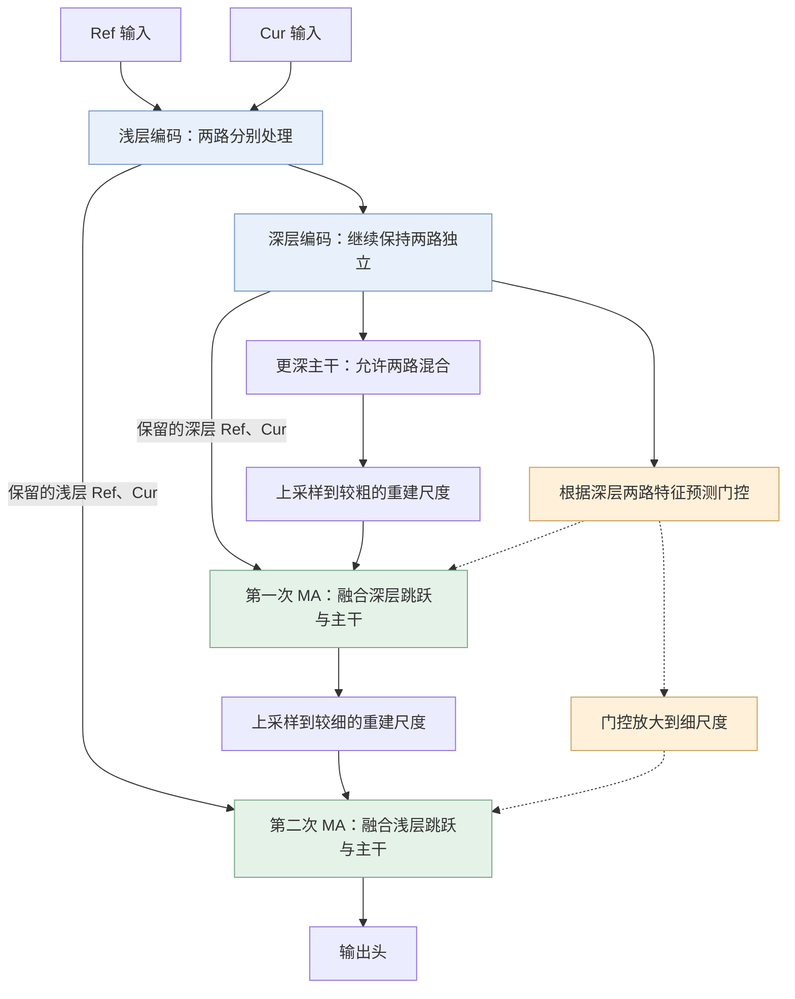

# 7 CNN网络中的Motion Attention

## 1. 为什么需要 MA 结构，可以解决什么问题？

**MA 要解决的问题是：历史参考和当前帧都可能有用，但它们在不同位置的价值并不相同，网络需要能够根据内容调节融合。** 当前帧保留最新的画面，却可能噪声较大；历史参考提供另一次观测，可能包含较稳定的内容，也可能带有旧位置、旧遮挡关系或此前处理产生的误差。这里把送入网络的历史参考称为 Ref，当前帧称为 Cur；Ref 不一定是未经处理的上一帧。

例如，画面里有一面带细纹理的墙，前面有一个移动物体。未发生变化的墙面可以从两次观测中获得互补信息；物体移动后刚露出的墙面，在 Ref 的相同位置却可能仍然是物体。如果融合没有处理这种差异，就可能出现残影、模糊，或削弱当前帧中的真实细节。因此，增加一帧输入并不自动等于更好的结果，还需要解决“怎样使用这两路信息”。

普通 CNN 也能通过非线性处理学习融合。本文研究的 MA 结构进一步把一部分调节机制显式写进网络：**先保留来源明确的 Ref、Cur 特征，再预测一张随空间位置变化的权重图，用它调节 Cur 特征的直接贡献。** 这张图称为门控。与此同时，网络还保留一条允许两路联合处理的深层主干，使“共同加工”和“分别调节”能够同时存在。

这样设计，为改善运动或遮挡变化引起的融合冲突、补充当前细节提供了结构上的可能性；具体效果仍取决于训练。接下来要理解的，就是两路输入如何一步步变成这两类特征，门控又在什么时候、对哪条路径发挥作用。
## 2. MA 结构长什么样：两路信息怎样一步步形成输出？

**这套网络要同时保留两种能力：让 Ref、Cur 共同参与深层处理，也让解码器仍能分别使用它们。** 因此，两路先独立编码；到更深处，一条主干开始联合处理，同时保留两级独立特征；重建时，再把这些特征逐级接回，并用门控调节其中的 Cur 分支。

先看下面的整体图。此时只需要认清连接关系：中间是向下编码、再向上重建的主路径；编码器到两次 MA 的长线，送来先前保留的两路特征；虚线则传递门控。后面的讲解就沿这张图，从输入走到输出。

网络从 Ref 和 Cur 两路输入开始。这里首先需要做的，是分别提取它们的局部特征，为后面保留两种可以单独使用的内容。如果立刻让所有输出通道都同时读取两帧，后面虽然仍能处理融合结果，却不能直接把其中一半解释为 Ref、另一半解释为 Cur。因此，第一段编码先保持来源分离。

以空间大小为 $256\times256$ 的输入为例，两路各自经过降采样和特征提取后，在第一级完整编码结束时，分别得到 16 通道、$128\times128$ 的特征。把它们记为 $R_0$ 和 $C_0$：$R$ 表示来自 Ref，$C$ 表示来自 Cur，下标 0 表示这个较浅的尺度。

实现时，两路可以先沿通道拼接成一个 32 通道张量，再使用 groups=2 的分组卷积处理。拼接只是把两路放在一起；分组连接让前半输出只读取 Ref 通道，后半输出只读取 Cur 通道，因此来源仍然分开。相关残差路径也维持分组，才能保证整段处理后仍可分别取出 $R_0,C_0$。

得到这对浅层特征后，网络将它们保留下来，再继续向下编码。保留的原因是：接下来空间尺寸还会减小，较细的布局信息不容易只靠深层往返完整恢复。后面重建回到这个尺度时，可以直接读取它们。图中从浅层编码跨到第二次 MA 的长线，就是这条跳跃连接；它的作用是把现在得到的内容留到后面使用。

接着，第二级编码继续分别处理两路，把空间尺寸从 $128\times128$ 降到 $64\times64$，每路通道数由 16 增加到 32。处理后的两路记为 $R_1,C_1$，下标 1 表示较深的尺度。由于这里继续使用保持来源边界的分组计算，它们仍然可以分别解释为 Ref 特征和 Cur 特征。

**到这里，深层编码结果开始承担三个相互配合的用途。** 它会继续进入更深主干，让两路共同加工；它本身也被保留下来，供第一次 MA 直接使用；同时，门控预测器会读取这两路特征，判断后面应该怎样调节 Cur 的直接贡献。先把这三个去向认清，后面出现的主干、跳跃和门控，就都有了明确来源。

先沿主干向下走。网络将 $R_1,C_1$ 拼接，送入允许跨分支连接的普通卷积，进一步降采样到 $32\times32$，形成 64 通道的联合表示。此时一个输出通道可以同时读取两路内容，所以这份主干特征已经不能再简单分成“前半 Ref、后半 Cur”。

为什么前面保持独立，这里又允许混合？因为两路信息除了需要分别调节，也需要共同形成重建特征。独立编码为解码器保留了可分别读取的入口，联合主干则提供共同加工的结果。二者能够同时存在，是因为此前保存的 $R_1,C_1$ 仍然可用，并没有被这次混合覆盖。

到达最低分辨率后，网络开始向上重建。它用可学习的上采样，将联合主干恢复到 $64\times64$，得到 32 通道的特征 $U_1$。此时，$U_1$ 与之前保存的 $R_1,C_1$ 处于同一空间尺度，第一次 MA 的内容输入便到齐了。

这三份输入提供的内容不同：$U_1$ 已经过更深处的联合处理，$R_1,C_1$ 则是同尺度、来源明确的直接输入。把它们接到一起，可以让重建同时利用这两类信息。但在相加前，还需要回答第一章留下的问题：不同位置的 Cur 特征，应该以多大程度加入？

现在就用到深层编码结果的第三个去向。门控预测器同时观察 $R_1,C_1$，为每个位置输出一个调节值。具体地，它将两路拼接后的 64 通道依次经过 1×1 卷积、ReLU、2×2 卷积和 Sigmoid，通道数从 64 变为 16，再变为 1；经过相应填充，空间大小保持为 $64\times64$。生成的门控记为 $\gamma_1$：

$$
\gamma_1=\sigma\!\left(G\!\left(\operatorname{Concat}(R_1,C_1)\right)\right).
$$

其中，$G$ 表示上述卷积与 ReLU，$\sigma$ 表示 Sigmoid。$\gamma_1$ 是一张单通道空间图，而不是控制整幅图的单个数。它直接根据两路深层编码预测，没有再读取 $U_1$。从整个计算图看，门控预测与联合主干是从同一位置分出的两条路径，在第一次 MA 处共同使用。

在这里预测门控，可以利用前面两级编码积累的邻域信息，同时在较小的特征图上完成计算。它给后面的两级融合提供一个共同依据；这个依据能否充分区分细小变化，则还要看特征、门控分辨率和训练结果。

门控可以通过最终重建误差学会有用的调节，但“数值在 0 到 1 之间”并不自动使它成为运动概率。这里先把它理解为服务于融合的空间权重：网络根据两路内容，预测各位置的 Cur 跳跃项应当怎样参与。

接下来才真正开始融合两路跳跃。网络先用两套独立的 1×3 卷积，分别变换 $R_1,C_1$。这些变换称为投影，记为 $P_{r,1}$、$P_{c,1}$。它们都输出 32 通道，让两路在相加前分别学习合适的融合表示；投影同时会处理水平方向的邻域，并不只是修改通道数。

有了投影结果，门控乘在 Cur 这一项上，再与 Ref 项相加：

$$
F_1=P_{r,1}(R_1)+\gamma_1\odot P_{c,1}(C_1).
$$

这里 $\odot$ 表示逐元素乘法。Cur 投影有 32 个通道，而门控只有 1 个通道，所以同一位置的门控值会广播给全部 32 个通道；不同位置则可以使用不同值。这就是这次 MA 对内容的实际调节方式。

例如，固定某个位置的 Ref 投影为 $a$、Cur 投影为 $v$，门控为 0.2 时得到 $a+0.2v$，提高到 0.8 时得到 $a+0.8v$。变化的是 Cur 项的直接贡献，Ref 项没有随之减小。因此，这个融合不是两帧的归一化平均，也不是二选一。两路投影是特征而非像素，Cur 项加入后既可能加强响应，也可能抵消响应。

这也解释了门控的控制范围：即使人为将这条 Cur 跳跃项关闭，Cur 仍然通过联合主干 $U_1$ 影响结果；增大门控也不会直接排除 Ref。它调节的是一条明确的特征路径，而不是某一帧对整个网络的总权重。

得到 $F_1$ 后，两路独立跳跃完成了融合，接下来要把它接到主干。网络用 1×1 卷积变换 $F_1$，用另一套 1×3 卷积变换 $U_1$，再将两份 32 通道、$64\times64$ 的结果相加，经过卷积与残差细化，得到粗尺度解码结果 $D_1$。

至此，第一次 MA 完成了一个完整过程：深层两路特征提供门控依据和独立内容，门控调节 Cur 投影，两路跳跃相加，再与联合主干汇合。输出的 $D_1$ 已经包含这些路径的信息，可以继续送往下一尺度。

网络于是再次上采样，将 $D_1$ 恢复到 $128\times128$，得到 32 通道的 $U_0$。不过，上采样只是把当前重建推进到更细的空间网格，网络还可以利用早先留下的浅层内容。现在保存的 $R_0,C_0$ 正好与 $U_0$ 同尺度，因此它们在这里接回，提供更细的直接编码信息。

为了在这一尺度继续调节 Cur，门控也需要变成 $128\times128$。参考结构没有重新预测一张图，而是把已有的深层门控最近邻放大两倍：

$$
\gamma_0=\operatorname{Nearest}_{\times2}(\gamma_1).
$$

粗尺度一个值会复制到对应的 2×2 细位置。例如，某个粗位置为 0.8，对应的四个细位置就都为 0.8。因此，两次 MA 使用的是同一来源的调节判断，只是作用的空间大小不同。这样省去了另一套预测器，也要求细尺度接受粗尺度的基础判断；放大本身不会产生新的细边界判断。

接着，第二次 MA 用自己的两套 1×3 投影，将浅层 $R_0,C_0$ 各从 16 通道变换到 32 通道。与第一次同样，先调节 Cur 投影，再加入 Ref 投影：

$$
F_0=P_{r,0}(R_0)+\gamma_0\odot P_{c,0}(C_0).
$$

这里使用的是另一组特征和另一套投影参数。两级之间沿用的是门控来源，并没有把深层内容简单复制为浅层内容。即使一个 2×2 区域内门控相同，各位置的浅层特征与主干特征仍然可以不同，输出也不必呈块状。

随后，网络再次把跳跃融合结果接到主干：分别变换 $F_0$ 和 $U_0$，相加，再经过这一尺度的卷积与残差细化，得到 $D_0$。第二次 MA 因而延续了第一次的处理方式，但接入的是更细尺度的信息。两级独立特征至此全部参与了重建。

最后，$D_0$ 经过输出头变成预测内容。参考实现返回的是通道化预测；若要恢复相应图像尺寸，还需要按约定执行空间重排。这属于输出布局，不再改变前面的两路融合关系。

现在回看整体图，网络的安排就形成了一条连续的逻辑：**先分别编码，为后面保留可调节的来源；再联合处理，形成更深的重建主干；重建向上进行时，用同一来源的门控，依次把深层和浅层独立特征接回。** MA 就发生在这两次汇合中。它提供按位置调节特征贡献的能力，整个过程没有预测位移或搬动特征坐标，因此不能把这种调节直接等同于几何对齐。