### 论文基本信息
- **标题**：Efficient Multi-Stage Video Denoising with Recurrent Spatio-Temporal Fusion
- **作者**：Matteo Maggioni 等（华为诺亚方舟实验室）
- **发表**：CVPR 2021
- **简介**：用递归融合 + 单帧去噪 + 细节恢复的三阶段架构，在变换域中完成视频去噪，复杂度比 SOTA 低几个数量级，但性能不降甚至更好。

# 1. 问题背景与已有方法的困境

这篇论文要解决的核心问题不是单纯提高视频降噪效果，而是：**如何充分利用视频中的时域信息，在保证降噪质量的同时，大幅降低计算复杂度，使 RAW 视频降噪能够在移动端实时运行？**

理解这个问题，需要先弄清楚三个问题：视频为什么比单帧更容易降噪？为什么多帧处理会变得昂贵？递归结构又解决了什么、留下了什么问题？

## 1.1 时域相关性让视频降噪优于单帧降噪

单帧降噪只能利用当前图像中的空间信息，例如附近像素的亮度、边缘和纹理。但在低光 RAW 中，**微弱的真实纹理与随机噪声可能非常相似**，如果降噪过强，就可能把真实细节一起抹掉。

视频相比单帧多了一个重要信息来源：**时间维度（Temporal Dimension）**。

自然视频中，相邻帧通常具有较强的时间相关性（Temporal Correlation）：同一个物体的真实纹理往往持续存在，而随机噪声在不同帧之间通常会发生变化。

例如，连续拍摄一面静止的墙壁，某个像素的真实信号为 100：

| 帧 | 真实信号 | 随机噪声 | 观测值 |
|---|---:|---:|---:|
| Frame 1 | 100 | +10 | 110 |
| Frame 2 | 100 | -10 | 90 |

如果只看 Frame 1，无法确定 110 中有多少是真实信号、有多少是噪声。但把两帧平均：

$$
\frac{110+90}{2}=100
$$

就能利用不同帧噪声的随机性，得到更接近真实值的结果。

如果场景静止，且各帧噪声独立、零均值、方差相同，那么平均 $N$ 帧可以使噪声方差降低到单帧的 $1/N$。

**这就是视频降噪利用时域信息的根本原因：跨帧重复出现的真实信号可以累积，而独立随机噪声能够相互抵消。**

但是，这里隐藏了一个非常重要的前提：**参与平均的像素必须对应同一场景位置或同一物体。**

## 1.2 运动对齐与多帧联合处理带来高计算成本

真实视频并不总是静止的。

假设一个人正在画面中移动，同一个像素位置在上一帧对应背景，在当前帧却对应人物。

**因此，视频降噪不能简单地把多帧像素平均，否则运动区域可能出现重影、拖尾或模糊。**

为了解决这个问题，已有视频降噪方法主要有两种运动处理思路。

**第一种：显式运动对齐（Explicit Motion Alignment）。**

例如通过 Block Matching（块匹配）、Optical Flow（光流）、Deformable Convolution（可变形卷积）等方法，寻找不同帧中对应的场景位置，先完成对齐，再利用多帧信息降噪。

它的优势是可以更有针对性地融合相同场景内容，但运动估计本身具有计算成本，而且在遮挡、快速运动和低信噪比场景中，对应关系也可能不准确。

**第二种：隐式运动处理（Implicit Motion Handling）。**

不一定显式计算光流，而是通过 CNN、时空注意力或学习得到的融合权重，让网络判断哪些历史信息值得利用。

这样可以减少对显式运动估计的依赖，但网络仍然需要具备处理运动、判断历史可靠性和恢复图像的能力，也不意味着计算量天然很低。

除了运动处理方式，视频降噪还可以按照**历史帧信息如何组织**，分为 Multi-frame 和 Recurrent 两种结构：

| 方法 | 历史信息的使用方式 | 主要特点 |
|---|---|---|
| Multi-frame | 同时输入多个相邻帧，联合处理 | 可以直接利用固定窗口内的多帧信息，但输入、计算和访存开销通常更大 |
| Recurrent | 利用当前帧和上一时刻保留的状态 | 不需要每次显式输入全部历史帧，但依赖历史状态的质量 |

注意，这两种分类并不互斥：**显式/隐式描述如何处理运动，Multi-frame/Recurrent 描述如何组织时域信息。**

已有方法通过大型 CNN、多帧特征提取、运动估计或复杂时空交互获得较好的降噪效果，但这些计算和内存需求，使得高质量视频降噪很难直接满足移动设备的实时处理约束。

论文 Figure 1 给出了这种矛盾的直观例子：

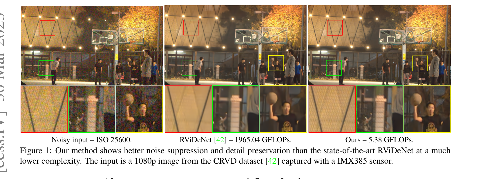

*图 1-1｜论文 Figure 1：ISO 25600 的真实 RAW 视频降噪对比。作者展示了 EMVD 与 RViDeNet 的画质及计算复杂度差异；若无法获取原图，文末脚本会生成仅包含计算量信息的替代图。*

在图中的设置下，RViDeNet 的计算复杂度为 **1965.04 GFLOPs**，而轻量 EMVD 仅为 **5.38 GFLOPs**。作者报告在大幅降低计算量的同时仍保持了有竞争力的降噪效果。

这组对比说明论文关注的并不是“如何用更多计算换更好画质”，而是**如何重新设计视频降噪的处理方式，以更低成本利用时空信息**。

## 1.3 递归结构用有限状态积累长时域信息

既然同时处理多帧的成本较高，一个自然的想法是：**能不能不反复输入所有历史帧，而是把过去已经提取出的有用信息保存下来？**

这就是递归处理（Recurrent Processing）的基本思路。

假设视频包含连续帧 $z_0,z_1,z_2,\ldots$。

传统固定窗口多帧处理通常是：

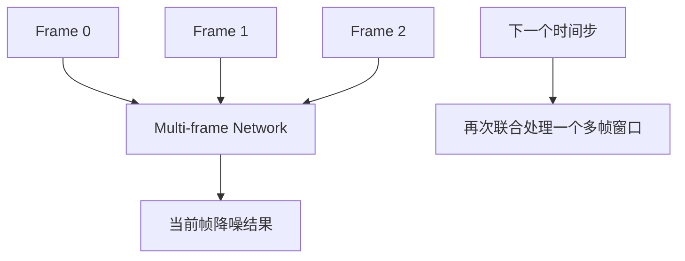

递归方法则维护一个历史状态，每次只结合当前帧更新：

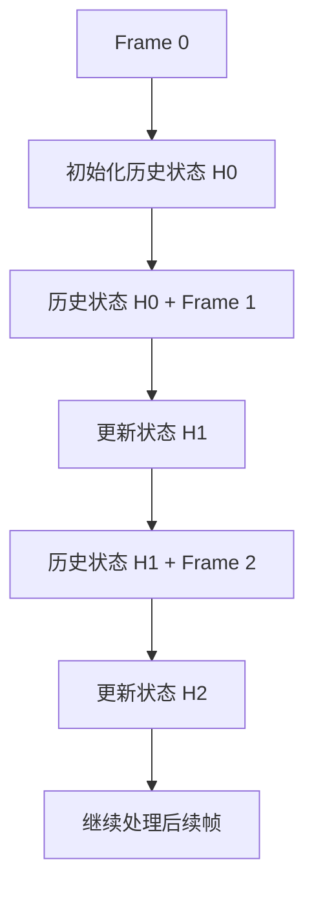

这里的 $H_t$ 只是用于解释递归概念的通用记号，并不是 EMVD 的具体历史状态定义。

**递归结构的核心是：用上一时刻的状态概括过去的信息，而不是每处理一帧都重新读取和联合计算全部历史帧。**

它主要有两个潜在优势：
1. **降低重复计算与存储需求**：每个时间步只处理当前帧和有限的历史状态，开销不必随已处理视频长度持续增加。
2. **利用更长的时间信息**：历史状态可以逐步累积来自更早帧的信息，而不受固定输入窗口长度直接限制。

但递归不代表问题已经解决。

假设历史状态中已经包含错误的运动信息，或者某些细节在前几次降噪过程中被抹掉，那么这些错误可能随着递归继续传播。

因此，递归视频降噪必须面对三个问题：
- **历史信息是否可靠？** 静止区域适合利用历史，运动区域却可能发生错位。
- **历史信息是否足够干净？** 递归融合可以降低噪声，但未必能完全去除残余噪声。
- **历史信息是否保留了真实细节？** 过度融合或空间降噪可能逐渐损失微弱纹理。

这也引出了 EMVD 的核心设计方向：作者没有要求一个大型 CNN 同时完成所有任务，而是将视频恢复分解成具有明确职责的三个阶段：

**Fusion（时域融合）→ Denoising（空间降噪）→ Refinement（细节恢复）。**

三个阶段分别处理前一阶段没有完全解决的问题，并通过递归状态持续利用历史信息。

不过，在真正介绍这三个阶段之前，还存在一个基础问题：**如果希望每个阶段都由很小的网络完成，能否先把 RAW 转换到更容易区分颜色、频率和噪声的表示空间中，同时避免丢失可恢复的信息？**

# 2. 变换域——为什么先变换再处理

第 1 章已经说明，视频降噪既需要利用时域信息，又必须控制计算复杂度。EMVD 的解决思路是将复杂任务拆成多个轻量阶段，但在介绍这些阶段之前，还有一个更基础的问题：**能不能先改变 RAW 数据的表示方式，让有用信号与噪声更容易区分，同时减少后续网络的计算量？**

作者采用两种可学习的线性变换：**Color Transform（颜色变换）** 和 **Frequency Transform（频率变换）**。前者处理颜色通道之间的相关性，后者处理图像的空间频率。两种变换都需要满足一个重要条件：**变换后的信息应当能够恢复到原始 RAW 域，而不是在变换过程中不可逆地丢失。**

## 2.1 RAW 噪声具有随信号变化的方差

在理解变换之前，需要先明确 EMVD 处理的输入是什么，以及噪声具有什么特点。

论文研究的是 Bayer RAW 视频。为了方便 CNN 处理，通常先将 Bayer 马赛克按 CFA 位置打包（Packed RAW），把原始二维 Bayer 数据组织成四个通道，例如 $RG_1G_2B$。

如果原始 Bayer 分辨率为 $H_0\times W_0$，Packed RAW 的形状通常为：

$$
\frac{H_0}{2}\times\frac{W_0}{2}\times4
$$

这里 $G_1$、$G_2$ 是 Bayer 中两种不同位置的绿色采样，并不是两种不同的绿色光谱。后续论文中的 $H,W$ 指 Packed RAW 的空间尺寸，通道数记为 $C=4$。

现在考虑视频中第 $t$ 帧、某个位置的 RAW 信号。我们观察到的带噪值可以理解为干净信号加上噪声，论文式（1）为：
$$
z_t(x)=y_t(x)+\eta_t(x)
$$

其中：
- $t$：视频帧索引。
- $x$：像素的空间位置。
- $z_t(x)$：实际观察到的带噪 RAW 值。
- $y_t(x)$：希望恢复的干净 RAW 值。
- $\eta_t(x)$：本次拍摄产生的随机噪声。

这个公式本身并不复杂，真正重要的是：**RAW 噪声并不是整张图像都具有相同强度的随机噪声。**

上一篇 Noise Modeling in One Hour 已经介绍过，RAW 噪声主要包含两部分：随光信号变化的散粒噪声，以及不直接由入射光信号决定的读出噪声。

EMVD 使用**异方差高斯噪声模型（Heteroskedastic Gaussian Noise Model）**描述它们：

$$
\eta_t(x)\sim\mathcal N\left(0,\sigma_t^2(y_t(x))\right)
$$
>公式含义：RAW 噪声是随机的，可以用均值为 0 的高斯分布近似描述；但噪声的强弱不是固定的，而是取决于该位置的干净信号有多大。
>这里的异方差指的是：**噪声的方差不是固定值，而是会随干净信号变化。**

论文进一步使用式（2）描述方差：

$$
\boxed{\sigma_t^2(y_t)=a_ty_t+b_t}
$$
其中：
- $a_t$：控制信号相关噪声的强度，主要对应散粒噪声。
- $b_t$：控制信号无关噪声的强度，主要对应读出噪声。
- $\sigma_t^2$：噪声方差，数值越大，噪声随机波动通常越明显。

可以看到，亮处的绝对噪声方差更大，但由于信号本身也更强，其相对噪声通常更小。

> **这与 Poisson-Gaussian 噪声模型是什么关系？**
> 散粒噪声在光子计数域通常服从泊松统计；经过增益转换后，其方差随信号强度变化。读出噪声则可以近似为另一项信号无关的随机噪声。
> EMVD 使用 $a_ty_t+b_t$ 统一描述二者，并用高斯分布近似最终 RAW 噪声。这是便于神经网络处理的统计模型，并不意味着真实散粒噪声原本就严格服从高斯分布。
> 另外，EMVD 假设给定 Sensor 和 ISO 的 $a_t,b_t$ 已知，**并不研究如何估计噪声模型参数**。

**这一节的核心结论：EMVD 不仅需要带噪 RAW，还需要知道噪声强度如何随信号变化。** 后续 Fusion 和 Denoising 都会使用噪声方差信息，判断应该相信多少历史信息，以及还需要进行多强的降噪。

不过，知道噪声方差还不够。原始 Packed RAW 的颜色通道之间存在相关信息，直接让小型 CNN 同时处理颜色与噪声，未必是最高效的方式。

## 2.2 颜色变换降低 Bayer 通道之间的相关性

Packed RAW 将 Bayer 排列转换成了四通道数据，但这种转换只是改变数据布局，并没有消除颜色通道之间的相关性。
例如，一个局部区域的四通道值可能是：
$$
[R,G_1,G_2,B]=[100,103,101,98]
$$

这四个值并不完全独立：它们可能共同包含相近的亮度信息，同时又存在颜色差异。
如果直接在这四个通道上降噪，网络需要自行学习如何区分它们之间的共同信息与差异信息。

一个自然的想法是：**能不能通过线性变换，把共同变化的部分与颜色差异尽量分开？**

这与传统 RGB 到 YUV 的颜色空间变换具有相似思想：把亮度相关信息与色度相关信息分离。

EMVD 使用 **Color Transform（颜色变换）** 完成这个任务。

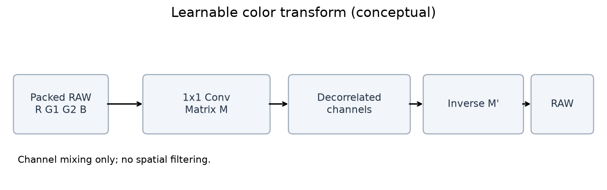

*图 2-1：颜色变换的概念示意。四通道 Packed RAW 通过可学习的矩阵变换，得到亮度/色度风格的表示，再通过逆矩阵恢复。图中的通道名称仅用于理解，并非实际学习到的固定矩阵。*

### 颜色变换具体如何实现？

论文没有直接使用固定的 YUV 变换矩阵，而是采用一个**可学习的 $1\times1$ 卷积**。
> 为什么是 $1\times1$？
> 因为这里要处理的是**同一个空间位置的四个颜色通道**，暂时不需要混合相邻位置的像素。

对于输入向量：
$$
\mathbf x=[R,G_1,G_2,B]^\top
$$

颜色变换可以写成：
$$
\mathbf u=M\mathbf x
$$
其中 $M$ 是一个 $4\times4$ 矩阵。每一行决定一个输出通道如何由四个输入通道加权组合得到。

例如，一种简单的亮度相关组合可能是四个通道的平均：
$$
L=\frac{R+G_1+G_2+B}{4}
$$

对于前面的数值，得到 $L=100.5$。其他输出通道可以描述不同颜色之间的差异。

> **这个例子只是用于理解颜色去相关，不代表论文实际学习得到的矩阵。**

实际 EMVD 让 $M$ 参与网络训练，从数据中学习更适合降噪任务的颜色表示。

这样做的潜在好处是：
- 颜色通道之间重复的亮度信息可以更加集中。
- 不同颜色之间的差异更容易与共同亮度变化区分。
- 小型 CNN 不必完全依靠自身去学习这些通道关系。

> **常见疑问：1×1 卷积为什么能够实现颜色变换？它是怎么把亮度和色度分开的？**
>
> **1. 首先，1×1 卷积长什么样？**
> 假设 Packed RAW 中某个位置有四个通道：
>
$$
[R,G_1,G_2,B]=[100,103,101,98]
$$
>
> 普通的 $3\times3$ 卷积会同时读取周围的空间像素，而 **1×1 卷积只读取当前位置的四个通道，再通过加权求和生成新的通道**。
>
> 例如，我们希望把四个输入通道变成四个输出通道，那么就需要四组权重，每组包含四个数：
>
$$
\begin{bmatrix} L\\C_1\\C_2\\C_3 \end{bmatrix} = \underbrace{ \begin{bmatrix} w_{11}&w_{12}&w_{13}&w_{14}\\ w_{21}&w_{22}&w_{23}&w_{24}\\ w_{31}&w_{32}&w_{33}&w_{34}\\ w_{41}&w_{42}&w_{43}&w_{44} \end{bmatrix}}_{\text{1×1 卷积的权重矩阵 }M} \begin{bmatrix} R\\G_1\\G_2\\B \end{bmatrix}
$$
>
> 也就是说，**一个 4 输入、4 输出的 1×1 卷积，本质上就是在每个空间位置执行一次 4×4 矩阵乘法**。所有像素位置共享同一组权重。
>
> **2. 为什么这样就能分离亮度和颜色差异？**
>
> 因为亮度相关信息与颜色差异，都可以通过不同通道的加权组合来描述。
>
> 例如，我们人为设计下面这个矩阵：
>
$$
M=\frac14 \begin{bmatrix} 1&1&1&1\\ 1&-1&-1&1\\ 1&-1&1&-1\\ 1&1&-1&-1 \end{bmatrix}
$$
>
> 第一行将四个通道相加取平均，提取它们共同的亮度变化：
>
$$
L=\frac{R+G_1+G_2+B}{4}=100.5
$$
>
> 第二行则计算颜色之间的差异：
>
$$
C_1=\frac{R+B-G_1-G_2}{4}=-1.5
$$
>
> 其余两行通过不同的加减组合，继续描述通道之间的差异。
>
> 对原始输入 $[100,103,101,98]$，完整变换结果为：
>
$$
[L,C_1,C_2,C_3]=[100.5,-1.5,0,1]
$$
>
> 可以发现：
>
> - **变换前**：四个通道都在 100 左右，包含大量共同信息。
> - **变换后**：共同变化集中到了 $L$，其余三个通道主要表示不同通道之间的差异。
>
> 这就是**颜色去相关（Color Decorrelation）**的基本思想：通过线性组合，让不同输出通道尽量承担不同的信息。
>
> 需要注意，以上只是一个人为设计、可逆的演示矩阵。$C_1,C_2,C_3$ 不一定是严格的物理色度，其中也可能包含 $G_1/G_2$ 不同空间采样位置造成的结构差异。
>
> **3. EMVD 的 1×1 卷积有什么不同？**
>
> 上面的矩阵 $M$ 是我们手动指定的，但 **EMVD 将矩阵中的 16 个权重作为可学习参数，由训练过程决定**。
>
> 作者希望网络学到一种类似亮度—色度分离、但更适合 RAW 降噪的表示，而不必固定使用某个传统 YUV 变换矩阵。
>
> 同时，由于最终还需要恢复原始 RAW，EMVD 还使用另一个 1×1 卷积执行逆颜色变换，并通过可逆性 Loss 约束两者尽量互逆。
>
> **核心理解：1×1 卷积不是通过空间滤波来区分亮度和色度，而是通过四个颜色通道之间的加权组合，把共同信息与差异信息重新组织。它本身不直接降噪，而是为后续 CNN 提供更容易处理的颜色表示。**

### 为什么颜色变换还需要逆变换？

EMVD 最终必须输出 RAW，而不能只输出变换后的颜色特征。

因此，网络处理结束后需要执行逆颜色变换：

$$
\hat{\mathbf x}=M'\mathbf u=M'M\mathbf x
$$

其中 $M'$ 是负责恢复原始通道的矩阵。

如果变换完全可逆，那么应该有：

$$
\hat{\mathbf x}=\mathbf x
$$

但这里存在一个问题：**$M$ 是可学习的，训练过程中它可能改变，甚至学到会丢失某些颜色信息的变换。**

例如，如果四个输出通道都只保存亮度平均值，那么原始的 R、G、B 差异就无法完整恢复。

所以，不能仅要求变换有利于降噪，还必须约束它能够被逆变换恢复。

论文使用两个分别学习的矩阵 $M$ 和 $M'$：逆矩阵初始化为 $M^\top$，但训练时二者参数不共享，以提供更大的学习自由度。

为了让它们保持近似互逆关系，引入式（3）：

$$
\boxed{\mathcal L_c=\left\|MM'-I_C\right\|_F^2}
$$

其中：
- $M$：正向颜色变换矩阵。
- $M'$：逆向颜色变换矩阵。
- $I_C$：$C\times C$ 单位矩阵，这里 $C=4$。
- $\|\cdot\|_F^2$：Frobenius 范数的平方，即矩阵各元素平方后求和。

为什么希望 $MM'$ 接近单位矩阵？

因为单位矩阵代表“不改变原始向量”。如果正向变换与逆向变换组合后的效果接近单位映射，就说明颜色信息能够被较好恢复。

**因此，$\mathcal L_c$ 的作用不是直接提升降噪强度，而是防止颜色变换在学习过程中失去重建能力。**

需要注意，论文使用的是可逆性正则约束，并没有在每一次参数更新后强制 $M'$ 精确等于 $M^{-1}$。因此，更准确的理解是：**通过 Loss 促使正逆变换接近互逆关系**。

到这里，颜色维度的问题得到了解决：网络可以学习一种更适合降噪的颜色表示，同时尽量保留恢复原始 RAW 的能力。

但是，图像中的空间信息仍然混合在一起。平滑区域、边缘、纹理以及噪声具有不同的频率特性，仅靠颜色变换无法将它们分离。

## 2.3 频率变换分离低频结构与高频细节

颜色变换只改变颜色通道之间的组合关系，不会改变图像的空间分辨率。

而图像降噪还有另一个重要矛盾：

**噪声和真实细节可能都表现为高频变化，但它们并不具有相同的空间结构。**

例如：
- 天空、大面积平滑墙面：主要包含低频信息。
- 建筑边缘、细密纹理：包含明显的高频信息。
- 随机噪声：通常也具有较多高频成分。

如果所有频率的信息都混在一起，小型 CNN 就必须同时判断哪些变化来自真实纹理、哪些变化来自噪声。

因此，作者借鉴小波变换（Wavelet Transform），将图像分解到不同的频率子带。

### 频率变换具体分解了什么？

对一张图像同时进行水平和垂直方向的低通、高通分析，可以得到四类子带：

| 子带  | 含义      | 主要描述的信息        |
| --- | ------- | -------------- |
| LL  | 低频 + 低频 | 平滑区域和整体结构      |
| LH  | 低频 + 高频 | 一个方向上的细节与变化    |
| HL  | 高频 + 低频 | 另一个方向上的细节与变化   |
| HH  | 高频 + 高频 | 两个方向上都较明显的高频变化 |

可以简单理解为：**LL 主要描述图像的整体结构，其他三个子带分别保存不同方向的高频变化。**

但要注意，高频子带中既可能有噪声，也可能有真实边缘和纹理。频率变换只是把信息分开，并不是将高频全部当作噪声删除。

### 用一个 2×2 例子理解频率分解

假设我们从 Packed RAW 的**同一个颜色通道**中取出一个 $2\times2$ 小块：

$$
X= \begin{bmatrix} 10&10\\ 10&18 \end{bmatrix}
$$

这里四个数属于同一颜色通道的不同空间位置，不能把它误认为包含 RGGB 四种颜色的 Bayer $2\times2$ 单元。

前三个数都是 10，右下角为 18，说明这个区域既包含共同的低频成分，也存在局部变化。

使用正交归一化的二维 Haar 变换，可以得到：

$$
\begin{aligned} LL&=\frac{10+10+10+18}{2}=24\\ LH&=\frac{10-10+10-18}{2}=-4\\ HL&=\frac{10+10-10-18}{2}=-4\\ HH&=\frac{10-10-10+18}{2}=4 \end{aligned}
$$

因此，原来的四个空间采样值，被转换为四个频率系数：

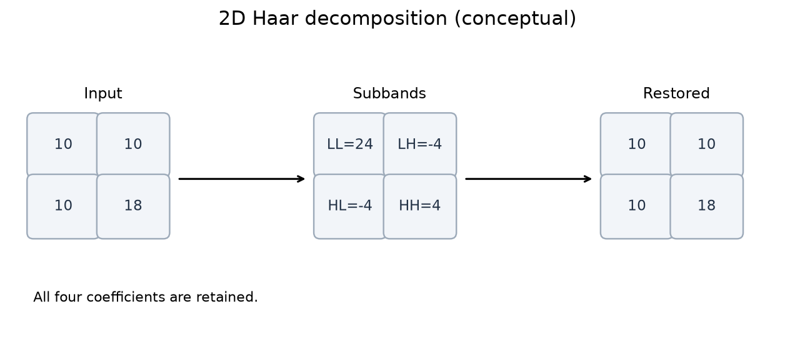

*图 2-2：二维 Haar 分解示例。原始 $2\times2$ 数据被分解为 LL、LH、HL、HH 四个系数，并可以通过逆变换恢复。LL 使用正交归一化，因此不直接等于四个像素的算术平均值。*

这里有一个容易误解的地方：

**频率分解并没有把原来四个数减少成一个数，而是用四个不同含义的系数保存了原来的信息。**

例如，如果四个系数都保留，就可以通过逆变换恢复原数据。右下角的 18 可以由：

$$
X_{1,1}=\frac{LL-LH-HL+HH}{2} =\frac{24+4+4+4}{2}=18
$$

恢复出来。

这个例子说明，**频率变换的目的不是直接删除高频，而是把图像从空间采样值转换成低频与高频系数，让后续网络更有针对性地处理不同成分。**

### 频率分解为什么会改变 Tensor Shape？

论文将频率变换定义为：
$$
T_f:\mathbb R^{H\times W\times C} \rightarrow \mathbb R^{H/2\times W/2\times4C}
$$

也就是说，经过一层频率分解：
- 空间高度变为原来的 $1/2$。
- 空间宽度变为原来的 $1/2$。
- 通道数增加到原来的 4 倍。

例如，输入 Packed RAW：
$$
64\times64\times4
$$

经过一层频率变换后：
$$
32\times32\times16
$$

这里的 16 个通道可以理解为四组频率子带，每组包含原来的四个颜色通道。

两个 Tensor 的元素总数分别为：
$$
64\times64\times4=16384
$$
$$
32\times32\times16=16384
$$

**所以，频率分解并不是直接压缩掉 $75\%$ 的数据，而是把空间尺寸转换成了更多通道。**

这一区别非常重要：空间分辨率下降，不等于信息总量或整个网络的 FLOPs 自动下降四倍。

### EMVD 如何实现可学习的频率变换？

传统 Haar 小波使用固定的低通和高通滤波器，但 EMVD 没有要求滤波器始终保持固定。

作者使用两组可学习的一维分析滤波器：

$$
\psi\in\mathbb R^{2\times n}
$$

其中两行分别对应低通和高通滤波器，$n$ 是滤波器长度。论文以 Haar 的 $n=2$ 为例进行初始化。

通过水平和垂直方向滤波器的外积，可以构造出四个二维卷积核，对应 LL、LH、HL、HH。

正向频率变换通过**步长为 2 的卷积（Strided Convolution）**完成滤波与下采样。

与之对应，逆频率变换使用另一组可学习的重建滤波器：

$$
\phi\in\mathbb R^{2\times n}
$$

并通过 **Transposed Convolution（转置卷积）**重建原空间分辨率。

这里的转置卷积是用于学习逆变换的运算，不应该简单理解为普通插值放大。

> **EMVD 的可学习频率变换没有单独的 GT。它不是在学习“正确的小波系数应该是多少”，而是通过最终的 RAW 降噪结果，端到端地学习一组更适合降噪的滤波器。**

> **为什么要使用可学习滤波器，而不是直接固定 Haar？**
>
> Haar 提供了一种简单、可逆的频率分解，但不代表它一定是当前 RAW 视频降噪任务的最优表示。
>
> 不同图像、噪声特性与网络结构，可能更适合不同的低通和高通滤波器。
>
> 因此，EMVD 用 Haar 等小波滤波器提供合理初始化，再让网络学习更适合降噪任务的变换。
>
> 代价是：滤波器经过训练后不一定继续满足传统小波的全部性质，因此必须额外约束正向和逆向滤波器的重建关系。

### 为什么频率变换也需要可逆性约束？

假设正向频率变换在训练中只保留了低频，丢弃所有高频。

这样虽然可能使降噪变得容易，但真实的边缘和细节也会随之丢失，逆变换无法凭空恢复这些信息。

因此，作者不仅要求滤波器适合降噪，还要求分析滤波器与重建滤波器能够相互配合。

论文使用式（4）约束这种关系：

$$
\boxed{\mathcal L_f=\left\|\psi\phi^\top-I_2\right\|_F^2}
$$

其中：
- $\psi$：正向分析滤波器，包括低通和高通。
- $\phi$：逆向重建滤波器。
- $I_2$：$2\times2$ 单位矩阵。
- $\mathcal L_f$：频率变换的可逆性正则项。

公式表达的目标是：**分析滤波器与重建滤波器的组合应尽可能接近恒等关系，避免学习过程中破坏有效信息的恢复。**

不过，对于一般长度的滤波器，完整的无损重建还涉及不同移位、下采样和边界处理之间的关系。因此，式（4）应理解为论文采用的可逆性正则，而不能仅凭它就证明任意实现都严格无损。

此外，同样的频率变换还可以继续应用在 LL 子带上，得到更低分辨率的分解结果。这为后续 EMVD 的多尺度处理提供了基础。

到这里，颜色和频率两个维度的变换都已经建立。下一步需要回答：**它们组合后为什么可能同时提高降噪效果、降低计算成本？**

## 2.4 可逆变换让高效处理不以永久丢失信息为代价

现在回顾两种变换解决的问题：

| | 颜色变换 $T_c$ | 频率变换 $T_f$ |
|---|---|---|
| 主要处理 | 颜色通道之间的相关性 | 空间频率之间的相关性 |
| 典型操作 | $1\times1$ 卷积 | Strided Convolution |
| 空间分辨率 | 不变 | 宽高各减半 |
| 信息组织 | 亮度/色度风格的通道表示 | LL、LH、HL、HH 子带 |
| 重建方式 | 逆颜色矩阵 $M'$ | 重建滤波器 $\phi$ |
| 正则约束 | $\mathcal L_c$ | $\mathcal L_f$ |

两者不是互相替代，而是从不同维度重新组织 RAW 数据。

颜色变换让通道之间的共同信息与差异更加容易区分；频率变换进一步把平滑结构与不同方向的高频变化分离。

论文将联合变换写为：

$$
T=T_c\circ T_f
$$

按照函数复合的数学约定，这表示先应用 $T_f$，再应用 $T_c$。在此表示下，可以理解为：先对各颜色通道进行频率分解，再在对应的颜色通道组上进行颜色变换。

逆变换则按相反顺序执行：

$$
T^{-1}=T_f^{-1}\circ T_c^{-1}
$$

**这里需要区分论文的讲解顺序与公式的应用顺序：论文先介绍颜色变换，再介绍频率变换；但这不代表代码必须先执行颜色变换。实际执行关系应以组合算子和实现为准。**

### 为什么两种变换能够提高降噪效率？

可以从两个角度理解。

**第一，信息被重新组织，后续网络的处理任务可能更容易。**

变换前，颜色、亮度、边缘、纹理和噪声混合在原始 RAW 表示中。

变换后：

- 不同颜色通道的共同变化与差异被重新组织。
- 平滑结构主要集中在低频子带。
- 边缘、纹理和部分噪声表现为不同高频子带中的变化。

这使后续网络有机会更直接地利用图像的结构信息，而不必完全依赖一个大型 CNN 从原始数据中学习所有关系。

但要注意，**频率变换不会自动把信号和噪声完全分开**。真实细节和噪声都可能出现在高频子带，后续仍需要网络根据时域信息与噪声统计进行判断。

**第二，空间分辨率下降，为轻量网络提供了计算优势。**

例如，在相同特征通道数、卷积核大小和输出通道数的条件下，一个卷积的计算量近似与空间像素数量成正比。

如果计算发生在 $32\times32$ 的空间网格，而不是 $64\times64$，那么该卷积需要处理的空间位置仅为原来的四分之一。

不过，频率变换同时增加了通道数，也引入了变换本身的计算开销，所以不能直接推断完整网络的 FLOPs 降为四分之一。

**真正的计算收益来自：EMVD 将频率分解得到的低分辨率表示与分尺度处理、小型 CNN 结合，使部分复杂计算能够在更小的空间网格上进行。**

因此，论文所说的“同时提高精度和降低复杂度”，不是单靠某一个变换公式自动成立，而是以下设计共同作用的结果：

1. 颜色去相关，使网络更容易利用不同颜色通道的信息。
2. 频率分解，使网络能够区分低频结构与高频变化。
3. 多尺度处理，让部分运算发生在较低空间分辨率上。
4. 可逆性约束，使这些表示变换尽量不损害最终 RAW 重建。

具体收益仍然需要通过后续实验验证。

### 可逆性为什么是整个设计的关键？

假如变换仅仅为了降低计算量，直接删除一部分高频或颜色信息也能让网络变小。

但这些被删除的信息中，可能恰好包含需要保留的微弱纹理、边缘或颜色差异。

**EMVD 的策略不是提前决定哪些信息应当丢弃，而是尽可能保留可恢复的信息，把“去掉什么噪声、保留什么细节”的判断交给后续网络。**

颜色变换的 $\mathcal L_c$ 和频率变换的 $\mathcal L_f$，正是为了支持这种设计。

> **本章总结**
> EMVD 使用两个可学习的变换重新组织 RAW：
>
> - **颜色变换**：处理四个 Bayer 颜色通道之间的相关性。
> - **频率变换**：将空间信息分解为低频与不同方向的高频子带，并降低空间分辨率。
> - **可逆性约束**：让网络能够学习更适合降噪的表示，同时尽量保留恢复原始 RAW 所需的信息。
>
> **变换的目标不是直接完成降噪，而是让后续轻量网络更容易完成降噪，并为降低计算复杂度创造条件。**

经过这两个变换后，EMVD 已经获得了适合后续网络处理的表示空间。

但真正的降噪尚未发生。即使颜色和频率信息被重新组织，我们仍然需要判断哪些历史信息可以信任、怎样去除融合后的残余噪声，以及如何找回被抹掉的细节。

# 3. 三阶段流水线：从时域融合到细节恢复

第二章介绍了 EMVD 的可学习颜色变换与频率变换。它们把 RAW 转换到更适合处理的表示空间，但**变换本身并没有完成降噪**。

真正负责降噪的是三个串联的阶段：

1. **Fusion（时域融合）**：利用历史帧与当前帧的相关性，尽可能先降低噪声。
2. **Denoising（空间降噪）**：进一步清除 Fusion 没有去掉的残余噪声。
3. **Refinement（细节恢复）**：利用 Fusion 中仍然保留的细节，修正 Denoising 可能造成的过度平滑。

这三个阶段不是简单地连续执行三次降噪，而是**每个阶段只处理前一个阶段尚未解决的问题**。这也是 EMVD 能够用较小网络完成复杂视频降噪任务的核心设计。

## 3.1 三阶段分别解决不同的噪声与细节问题

先观察论文 Figure 2 的整体架构。

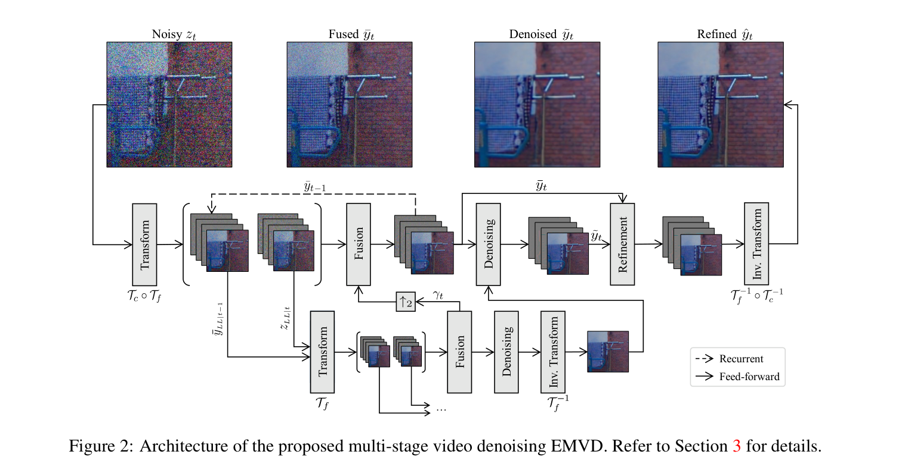

*图 3-1｜论文 Figure 2：EMVD 的完整架构。主干为 Fusion、Denoising、Refinement，此外还包含多尺度分支与跨帧递归连接。*

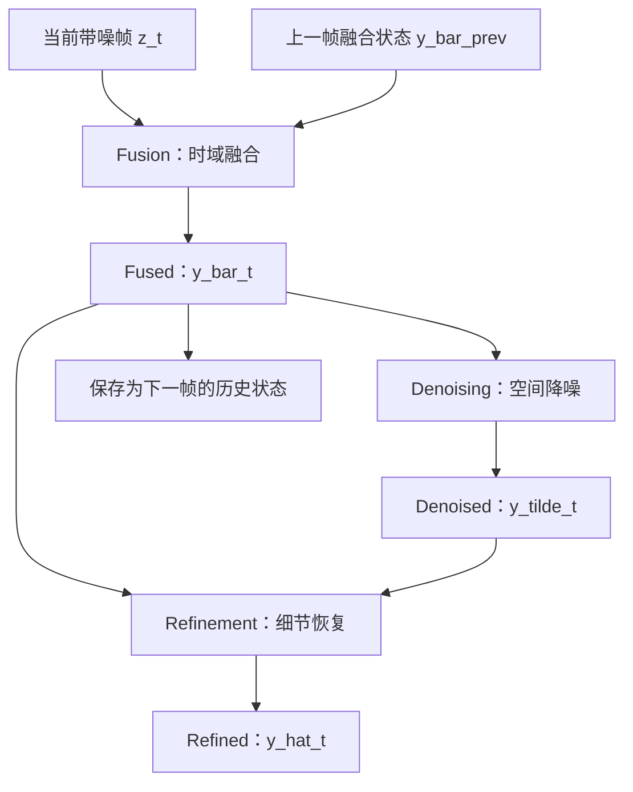

其中最值得注意的是：**Fusion 的输出有两条去向**。

一条进入 Denoising，继续清除残余噪声；另一条保留下来，参与 Refinement，并作为下一时刻的递归状态。

为什么需要这样设计？可以想象同一段低光夜景视频，其中存在三种区域：

| 区域 | 画面特点 | 希望网络做到什么 |
|---|---|---|
| 静止墙面 | 相邻帧内容几乎不变 | 尽量利用历史降低随机噪声 |
| 移动人物 | 当前帧与历史帧明显不同 | 避免错误融合产生重影 |
| 墙面细纹理 | 真实纹理较弱，与噪声相似 | 降噪时尽量保留真实细节 |

在静态区域，历史帧通常包含有价值的信息；但在运动区域，历史可能已经不可靠。因此 Fusion 需要判断：**哪些位置应该相信历史，哪些位置应该相信当前帧？**

即使 Fusion 做出了合理判断，运动区域仍可能因为使用较多当前帧而保留大量噪声，所以还需要 Denoising。

而 Denoising 为了去除噪声，可能把弱纹理一起抹掉，因此最后还需要 Refinement。

为了避免后面的符号混淆，先明确三个中间结果：

| 符号 | 名称 | 含义 |
|---|---|---|
| $\bar y_t$ | Fused | 当前帧与历史融合后的结果 |
| $\tilde y_t$ | Denoised | 对 Fused 进一步空间降噪后的结果 |
| $\hat y_t$ | Refined | 综合 Fused 与 Denoised 得到的最终变换域结果 |

这里还有一个重要约定：**从本章开始，$z_t$、$\bar y_t$、$\tilde y_t$ 等符号均表示变换域数据**。论文在 Section 3.2 后省略了变换算子的书写。最终的 $\hat y_t$ 还需要经过逆变换，才能回到原始 Packed RAW 域。

现在的问题是：Fusion 究竟怎样判断历史是否可靠？

## 3.2 Fusion：自适应选择历史与当前帧

Fusion 的目标是：**利用相邻帧之间的时域相关性降低噪声，同时尽量避免错误融合产生运动伪影。**

它不是简单地对所有帧取平均，而是为历史结果和当前帧分配不同的权重。

### 3.2.1 为什么不能直接平均历史帧与当前帧？

先考虑静止墙面。

假设某个位置的真实信号接近 100，而我们目前得到：

- 历史融合结果：102。
- 当前带噪帧：110。

由于场景没有变化，历史信息通常比较可靠。

如果给历史结果 80% 权重，当前帧 20% 权重，就得到：

$$
Y=0.8\times102+0.2\times110=103.6
$$

融合后的 103.6 比当前带噪值 110 更接近真实值 100。

但同样的方法不能直接用于运动区域。

假设某个人走进画面：

- 历史位置对应背景，值为 102。
- 当前位置对应人物，值为 180。

如果仍然使用 80% 的历史权重：

$$
Y=0.8\times102+0.2\times180=117.6
$$

得到的 117.6 明显偏向旧背景，无法正确表示当前人物。

这种把不同时间的场景内容混合在一起的现象，就可能表现为重影、拖尾或异常轮廓。

如果改为给当前帧 90% 权重：

$$
Y=0.1\times102+0.9\times180=172.2
$$

虽然结果仍不完全等于当前值，但已经更接近当前人物。

因此，**Fusion 真正需要学习的不是怎样平均，而是怎样根据当前位置的时域可靠性选择融合比例。**

### 3.2.2 融合公式：历史和当前帧的加权平均

根据前面的例子，EMVD 把 Fusion 定义为递归的凸组合（论文式 5）：
> **凸组合就是权重非负、权重和为 1 的加权平均。EMVD 用它让 Fusion 在历史帧和当前帧之间选择，而不通过加权操作任意放大信号。**

$$
\boxed{ \bar y_t(x)= \bar\gamma_{t-1}(x)\bar y_{t-1}(x) +\gamma_t(x)z_t(x) }
$$
其中：
- $z_t$：当前带噪帧。
- $\bar y_{t-1}$：上一时刻的融合结果，即历史状态。
- $\bar y_t$：当前新的融合结果。
- $\gamma_t$：当前帧的融合权重。
- $\bar\gamma_{t-1}$：历史融合状态的权重。

这两个权重满足：

$$
\bar\gamma_{t-1}(x)+\gamma_t(x)=1
$$

并且都不小于零。

**为什么权重之和必须为 1？**

因为 EMVD 希望执行的是平均意义上的融合，而不是随意改变信号幅度。

假设历史和当前帧的值都为 100。如果权重是 0.8 和 0.2：

$$
0.8\times100+0.2\times100=100
$$

结果仍然是 100。

如果权重之和变成 1.5，那么：

$$
1.0\times100+0.5\times100=150
$$

即使两个输入完全相同，融合也会人为把信号放大。

所以，**凸组合的作用是让融合结果处于两个输入值之间，同时保持常数信号不变。**

这是一种有利于稳定融合的结构约束，并不是说所有视频融合算法都只能采用这种形式。

对于 EMVD，可以把两个权重简化理解为：

$$
\bar\gamma_{t-1}=1-\gamma_t
$$

因此：
- $\gamma_t$ 接近 0：主要使用历史。
- $\gamma_t$ 接近 1：主要使用当前。
- $\gamma_t$ 位于中间：同时利用两者。

这里还有两个实现细节。

**第一，首帧没有历史信息。**
因此论文定义：

$$
\bar y_0=z_0
$$

也就是直接使用第一帧带噪输入初始化递归状态。

**第二，融合权重只有一个通道。**

对于变换域同一空间位置的 $4C$ 个通道，EMVD 使用同一个融合权重，通过 Broadcasting 完成计算。

这减少了 FCNN 需要预测的参数数量，也降低了存储和计算成本。但它同时意味着：网络没有为每个频率子带单独预测一张融合权重图。

### 3.2.3 FCNN 如何知道应该相信历史还是当前？

现在融合公式已经确定，但最关键的问题还没有解决：

**$\gamma_t$ 究竟从哪里来？**

如果手工设置固定权重，就无法适应不同运动和噪声强度。

因此，EMVD 使用一个小型 CNN，称为 **FCNN（Fusion CNN）**，专门预测融合权重。

先考虑 FCNN 应该观察什么信息。

最直接的方法是比较当前帧与历史帧的差异：

$$
|z_{LL|t}-\bar y_{LL|t-1}|
$$

这里 $LL$ 表示第二章频率变换得到的低频子带。

为什么使用低频？

因为低频主要描述相对稳定的大尺度图像结构。与直接比较全部高频细节相比，在低频表示中判断两帧的整体变化通常更容易。

但仅仅比较差异还不够。

假设当前像素为 110，历史为 100，差异是 10。

这 10 可能来自：
1. 真实场景发生变化。
2. 场景没变，只是当前帧出现了随机噪声。

**如果不知道噪声本身有多强，仅凭两帧差异，很难可靠地区分运动和噪声。**

因此，FCNN 还需要输入当前帧的噪声方差估计：
$$
\hat\sigma_t^2=\sigma_t^2(z_{LL|t})
$$

第二章已经介绍：

$$
\sigma_t^2(y_t)=a_ty_t+b_t
$$

但真实干净信号 $y_t$ 在推理时未知，所以论文使用当前带噪低频分量 $z_{LL|t}$ 作为近似。

现在，FCNN 的输入就具有了明确意义：

| 输入        | 告诉 FCNN 什么       |
| --------- | ---------------- |
| 当前与历史低频差异 | 两帧看起来有多不一致       |
| 当前噪声方差    | 这种不一致可能有多大程度来自噪声 |

论文式（6）为：

$$
\boxed{ \{\gamma_t,\bar\gamma_{t-1}\} = \mathrm{FCNN} \left( |z_{LL|t}-\bar y_{LL|t-1}|, \hat\sigma_t^2 \right) }
$$

FCNN 的末层使用 Sigmoid 将权重限制到 0～1，另一分支使用互补权重，保证符合前面的凸组合约束。

**FCNN 的职责不是直接生成干净图像，而是预测“当前帧应该占多少比例”。**

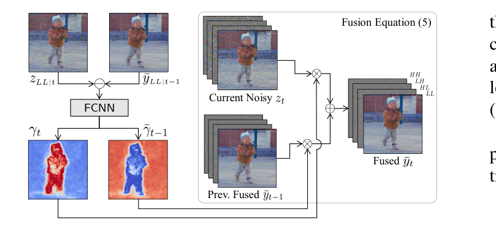

*图 3-2｜论文 Figure 3：FCNN 预测的融合权重。运动区域与静态区域具有不同的权重分布。优先使用论文原图，无法取得时使用明确标注的概念示意。*

论文 Figure 3 显示，FCNN 学到的当前帧权重在运动区域较高，在静态区域较低。

这与我们前面的直觉一致：
- 静态区域：充分使用历史，降低随机噪声。
- 运动区域：更多使用当前帧，降低历史错位造成的伪影。

这里的“降低伪影”并不等于已经实现了精确运动对齐。EMVD 的基本 Fusion 通过权重控制历史信息的使用比例，快速运动和遮挡等复杂情况仍可能产生残留错误。

> **论文式（7）的扩展**
>
> 基础 Fusion 使用当前位置的历史值和当前值进行加权，可以看成一种特殊的 1×1 Kernel Prediction。
>
> 论文进一步指出，可以将它扩展为空间自适应卷积核预测，让 FCNN 输出更大邻域的融合权重，并通过 Softmax 约束权重。
>
> 但这属于 Fusion 机制的推广，理解基础 EMVD 时，重点仍然是式（5）的逐位置递归加权。

### 3.2.4 为什么递归保存 Fused，而不是最终降噪结果？

到这里还剩一个重要问题：

**为什么下一帧接收的是 $\bar y_t$，而不是最后更干净的 $\hat y_t$？**

直觉上，既然最终 Refined 更干净，似乎应该把它作为历史输入。

但需要考虑一个情况：如果空间降噪已经把某些弱纹理抹掉，下一帧继续使用这个结果，就无法再直接利用那些被删除的信息。

Fused 虽然仍有噪声，但它主要经过时域加权融合，没有经过后续 DCNN 的强空间恢复，因此可能保留更多原始细节。

另外，Fused 是由已知权重进行线性组合得到的，比较容易建立递归噪声方差估计。这个性质正是下一节要使用的。

因此，EMVD **将 Fused 作为跨时间递归状态，同时保留 Fused 参与当前帧的 Refinement**。

这不代表 Fused 在所有位置都比 Refined 更有信息价值，而是论文在细节保留、方差建模和递归稳定性之间做出的设计选择。

Fusion 结束后，新的问题出现了：

**历史可靠的静态区域可能已经比较干净，但运动区域由于更多使用当前带噪帧，仍然存在明显噪声。**

所以，只靠 Fusion 还不够。

## 3.3 Denoising：利用融合后的残余噪声方差进一步降噪

Fusion 已经利用时域信息降低了部分噪声，但其效果不是均匀的。

回到之前的两个区域：
- 静止墙面：历史可靠，融合后噪声可能显著降低。
- 移动人物：需要更多依赖当前带噪帧，因此残余噪声可能仍然很强。

这意味着：**DCNN 面对的不是一张噪声强度均匀的图像，而是一张不同位置具有不同残余噪声水平的 Fused 图像。**

### 3.3.1 为什么 Fusion 后还需要空间降噪？

假设历史信息已经足够干净、场景也完全静止，Fusion 可以持续积累多帧信息，从而降低随机噪声。

但在以下情况中，Fusion 的收益会受到限制：
1. 运动幅度较大，历史与当前帧对应不上。
2. 前面只处理过很少的帧，没有足够多的历史信息。
3. 历史状态本身仍然带有较明显的噪声。

因此，EMVD 增加一个独立的 **DCNN（Denoising CNN）**，进一步处理融合后的残余噪声。

但 DCNN 需要知道：**当前 Fused 图像究竟还剩多少噪声？**

要回答这个问题，必须先理解融合如何改变噪声方差。

### 3.3.2 融合噪声方差为什么可以递归计算？

**核心问题：Fusion 已经降低了噪声，但 DCNN 怎么知道融合之后还剩多少噪声？**

第二章已经介绍，原始 RAW 的噪声方差可以通过 $\sigma_t^2(y_t)=a_ty_t+b_t$ 估计。但这个公式描述的是**当前原始观测的噪声**。

Fusion 的输出不同。它已经融合了当前帧和历史帧，噪声强度不仅取决于当前信号，还取决于过去的融合结果和每次融合使用的权重。因此，不能直接把原始 RAW 的噪声方差当作 Fused 的噪声方差。

好在 EMVD 的 Fusion 本质上是加权平均：
$$
\bar y_t=\bar\gamma_{t-1}\bar y_{t-1}+\gamma_tz_t
$$

**既然知道两个输入的噪声方差和融合权重，就可以估计融合后的噪声方差。**

假设：
- 历史 Fused 的噪声方差为 9。
- 当前带噪帧的噪声方差为 25。
- 历史权重为 0.8，当前权重为 0.2。

在两部分噪声独立、权重视为固定值的条件下，融合后的方差为：

$$
\operatorname{Var}(N_{\mathrm{fused}}) =0.8^2\times9+0.2^2\times25 =\boxed{6.76}
$$

这里**权重必须平方**，因为随机变量乘以常数 $a$ 后，其方差变成原来的 $a^2$ 倍。

如果是运动区域，当前帧权重提高到 0.9，同样计算得到：

$$
0.1^2\times9+0.9^2\times25=20.34
$$

这说明，即使都经过了 Fusion，不同区域的剩余噪声强度也可能相差很大。**DCNN 需要知道这个差异，才能针对不同区域进行后续降噪。**

将这一计算推广到连续视频，就得到论文式（9）的递归方差估计：

$$
\boxed{ \bar\sigma_t^2 = \bar\gamma_{t-1}^{\,2}\bar\sigma_{t-1}^2 + \gamma_t^2\hat\sigma_t^2 }
$$

其中，$\bar\sigma_{t-1}^2$ 是上一时刻保存的融合噪声方差估计，$\hat\sigma_t^2$ 是当前帧的噪声方差估计，$\bar\sigma_t^2$ 是这次融合后更新的方差估计。

**为什么叫递归计算？**

因为计算当前帧的融合方差，只需要三个信息：**上一帧的融合方差、当前帧的噪声方差，以及本次融合权重**。

不需要重新读取所有历史帧，也不需要重新计算之前每一次融合的噪声。

第一帧没有历史，直接使用第一帧自身的噪声方差初始化；之后每处理一帧，就按照式（9）更新一次。

> **公式的适用前提**
>
> 式（9）利用了独立随机噪声加权求和的方差公式，因此忽略了历史噪声与当前噪声之间的协方差。
>
> 实际 FCNN 的权重依赖带噪图像，所以这里得到的是论文采用的**近似方差估计**，不是任意场景下严格成立的统计等式。融合后方差也不保证在每个时间步、每个位置都下降。

**最终结论：Fusion 在递归生成图像 $\bar y_t$ 的同时，也能递归维护对应的噪声方差 $\bar\sigma_t^2$。后者作为 DCNN 的输入，使网络知道 Fused 中不同区域还剩多少噪声，而无需重新分析全部历史帧。**

### 3.3.3 DCNN 为什么需要三个输入？

现在才引入 DCNN 的完整公式（论文式 8）：

$$
\boxed{ \tilde y_t = \mathrm{DCNN} \left( \bar y_t,\, z_{LL|t},\, \bar\sigma_t^2 \right) }
$$

它包含三个输入，每个都有明确的作用。

| 输入               | 含义            | 为什么需要                 |
| ---------------- | ------------- | --------------------- |
| $\bar y_t$       | Fusion 输出     | 已经利用历史降低了部分噪声，是主要恢复对象 |
| $z_{LLt}$        | 当前带噪帧的低频分量    | 保留未被历史融合改变的当前帧信息      |
| $\bar\sigma_t^2$ | Fused 的残余噪声方差 | 告诉网络当前区域还剩多少噪声        |

这里最容易产生疑问的是第二个输入：

**既然已经有了 Fused，为什么还要输入当前带噪帧的低频信息？**

因为 Fusion 可能使用了不可靠的历史。

例如运动人物刚进入画面时，历史融合状态包含的仍是旧背景。即使 FCNN 预测了较大的当前帧权重，Fused 中仍可能残留旧背景信息。

DCNN 如果只看到 Fused，就难以判断哪些信息原本来自当前帧，哪些来自历史。

因此，作者额外保留 $z_{LL|t}$ 这条输入，让 DCNN 能够参考**未经历史融合修改的当前帧低频结构**，减少完全依赖 Fused 的风险。

第三个输入 $\bar\sigma_t^2$ 则帮助网络区分不同的残余噪声水平。

例如前面的静态区域方差为 6.76，运动区域为 20.34。DCNN 可以利用这类信息学习不同位置适合采用什么恢复策略，而不需要把所有区域都当作相同噪声强度处理。

**DCNN 的核心职责，是对已经经过时域融合的图像执行空间恢复，而不是重新完成运动可靠性判断。**

这也是任务分解带来的好处：相比要求一个 CNN 同时解决全部时域和空间问题，DCNN 接收到的输入已经包含了部分时域处理结果和残余噪声信息。

但是，空间降噪仍然存在经典问题：

**如果某些真实纹理非常微弱，DCNN 可能无法准确区分它们与噪声，从而把纹理一起抹掉。**

因此，EMVD 没有直接把 Denoised 作为最终输出。

## 3.4 Refinement：从 Fused 中找回被降噪抹掉的细节

Denoising 的目标是尽量去除噪声，但图像恢复始终存在一个矛盾：

**去噪越强，微弱细节越容易被一起抹掉。**

假设夜景墙面存在一条很弱的纹理。

Fusion 后，这条纹理仍然可以看到，但图像还有噪声；经过 DCNN，图像更加平滑，却可能把纹理也削弱。

因此，我们现在有两个具有不同特点的结果：

| | Fused $\bar y_t$ | Denoised $\tilde y_t$ |
|---|---|---|
| 噪声 | 仍有残余噪声 | 通常更少 |
| 细节 | 可能保留更多原始纹理 | 可能出现过度平滑 |
| 主要优势 | 细节信息 | 噪声抑制 |

EMVD 的思路是：**既然 Fused 仍然保留部分有价值的细节，为什么不在最终输出前，再从 Fused 中选择性利用这些信息？**

### 3.4.1 Refinement 再次使用加权融合，但目的不同

先用变换域中的一个高频系数举例。

假设某处真实细节对应的系数接近 15：

- Fused 中的系数为 18，细节明显，但仍有噪声。
- Denoised 中的系数为 4，噪声降低了，但细节也被削弱。

如果希望更多保留来自 Fused 的细节，可以采用：

$$
0.75\times18+0.25\times4=14.5
$$

结果 14.5 比 Denoised 的 4 更接近这个例子中的真实细节系数 15。

但对于平滑区域，Fused 中的大幅变化可能主要是噪声，此时就应该更多信任 Denoised，而不是把噪声重新加回来。

所以，**Refinement 的关键不是无条件增强高频，而是判断哪些高频信息值得保留。**

根据这个思路，EMVD 使用论文式（10）：

$$
\boxed{ \hat y_t(x) = \bar\omega_t(x)\bar y_t(x) + \tilde\omega_t(x)\tilde y_t(x) }
$$

其中：
- $\bar y_t$：Fused，细节可能较多，但仍带噪。
- $\tilde y_t$：Denoised，噪声较少，但可能过度平滑。
- $\bar\omega_t$：分配给 Fused 的权重。
- $\tilde\omega_t$：分配给 Denoised 的权重。
- $\hat y_t$：Refined 结果。

两个权重同样满足凸组合约束：

$$
\bar\omega_t+\tilde\omega_t=1
$$

因此：

- $\bar\omega_t$ 较大：更多保留 Fused 信息。
- $\tilde\omega_t$ 较大：更多使用 Denoised 结果。

这里需要特别注意：**Refinement 不可能凭空恢复两个输入中都已经彻底丢失的信息。**

它能够改善细节，是因为 Fused 分支还保存着一些 Denoised 已经削弱的内容。

### 3.4.2 RCNN 如何判断哪些细节值得保留？

这和 Fusion 面临的问题有些相似：加权公式已经确定，但权重需要根据图像内容动态选择。

因此，EMVD 使用第三个小型网络：
**RCNN（Refinement CNN）**。

论文式（11）定义为：

$$
\boxed{ \{\tilde\omega_t,\bar\omega_t\} = \mathrm{RCNN} \left( \tilde y_t,\, \bar y_t,\, \bar\sigma_t^2 \right) }
$$

RCNN 接收：
1. 更干净的 Denoised。
2. 保留更多细节的 Fused。
3. Fusion 后的残余噪声方差。

这些输入使 RCNN 有机会判断：Fused 与 Denoised 之间的差异究竟更可能来自真实细节，还是来自残余噪声。

例如，如果某个高频结构在 Fused 中明显存在，却在 Denoised 中被抹掉，RCNN 可以学习在该区域提高 Fused 的权重。

但如果 Fused 的变化主要是随机噪声，RCNN 则应该更多采用 Denoised。

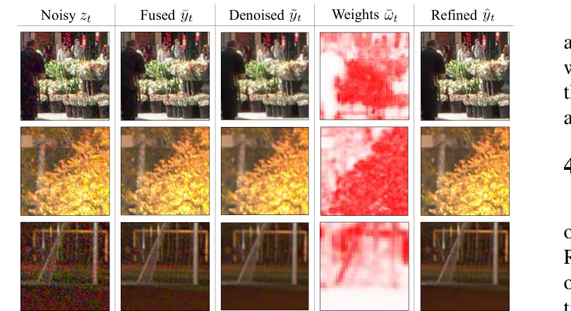

*图 3-3｜论文 Figure 4：Refinement 预测的权重与图像边缘、纹理之间的关系。红色区域表示更多使用 Fused 中的高频信息。优先使用论文原图，无法获取时使用概念示意。*

论文 Figure 4 展示了 RCNN 学习到的行为：一些边缘和纹理区域具有较高的 Fused 权重，因此能够在最终结果中恢复部分细节。

值得注意的是，作者没有为 RCNN 单独提供“哪里是细节”的 GT，也没有强制它必须在边缘区域提高 Fused 权重。

这种行为主要来自网络结构与最终重建损失的共同作用，训练机制将在第四章解释。

### 3.4.3 Fusion 与 Refinement 为什么不能混为一谈？

这是整篇论文中一个特别容易混淆的地方。

Fusion 和 Refinement 都使用两个输入的凸组合，但**它们判断的不是同一件事**。

| | Fusion | Refinement |
|---|---|---|
| 权重 | $\gamma_t$ | $\omega_t$（统称） |
| 选择对象 | 历史融合状态 / 当前带噪帧 | Fused / Denoised |
| 主要判断 | 历史信息是否可靠 | 哪个结果更值得保留 |
| 主要目标 | 利用时间相关性降低噪声 | 平衡残余噪声与细节保留 |
| 预测网络 | FCNN | RCNN |

可以把它们理解成两个不同的问题：

- **Fusion：这个位置应该相信过去，还是相信现在？**
- **Refinement：这个位置应该保留更多细节，还是采用更强降噪后的结果？**

因此，虽然数学形式类似，两个权重的语义完全不同。

现在，单尺度上的三个阶段已经形成完整闭环：

**Fusion 利用历史降低噪声 → Denoising 清除残余噪声 → Refinement 从 Fused 中补回部分细节。**

但 Figure 2 中还有下方的多尺度结构，而且视频帧之间还存在递归连接。接下来需要把这些结构与刚才理解的三个阶段对应起来。

## 3.5 多尺度处理与递归状态共同控制复杂度

前面为了便于理解，一直假设只有一个尺度、一个时间步。

实际 EMVD 还在不同分辨率上处理数据，并且通过递归状态连接不同时间帧。

### 3.5.1 为什么需要多尺度？

第二章已经介绍，频率变换会把数据分成 LL、LH、HL、HH 四个子带。

其中 LL 保留主要的低频结构。

如果继续对 LL 进行频率分解，就可以得到更低分辨率的表示。

为什么要这样做？

因为某些需要处理的问题在低分辨率上更容易判断。

例如，一个物体在原始分辨率上移动了若干像素；到了较低分辨率，相应的位移在采样网格上会变得更小。

这可以在一定程度上提高 Fusion 对局部运动的容忍度。

同时，低分辨率具有更少的空间位置，让部分计算能够以较低成本进行。

**但低分辨率融合并不等于完成精确运动对齐。** 如果场景存在严重遮挡或大幅运动，降低分辨率仍可能无法消除错位。

### 3.5.2 低尺度结果如何帮助高尺度？

现在重新观察 Figure 2 中下方的分支。

低尺度不是单纯重复一遍完整网络，而是先完成相应尺度的 Fusion 和 Denoising，再将部分结果用于更高尺度。

有两条重要的跨尺度信息：

**第一，低尺度 Fusion 权重辅助高尺度 FCNN。**

低分辨率上的权重可以先提供较大空间范围内的历史可靠性判断，再通过上采样成为高尺度 FCNN 的辅助输入。

这使高尺度不需要完全从零开始判断运动和历史可靠性。

**第二，低尺度 Denoising 结果辅助高尺度 DCNN。**

低尺度已经恢复出的图像结构，可以在经过对应的尺度变换后，作为高尺度 DCNN 的额外输入。

这样，高尺度网络不仅看到当前尺度的 Fused、当前低频与残余方差，还能利用低尺度提供的恢复信息。

可以概括为：

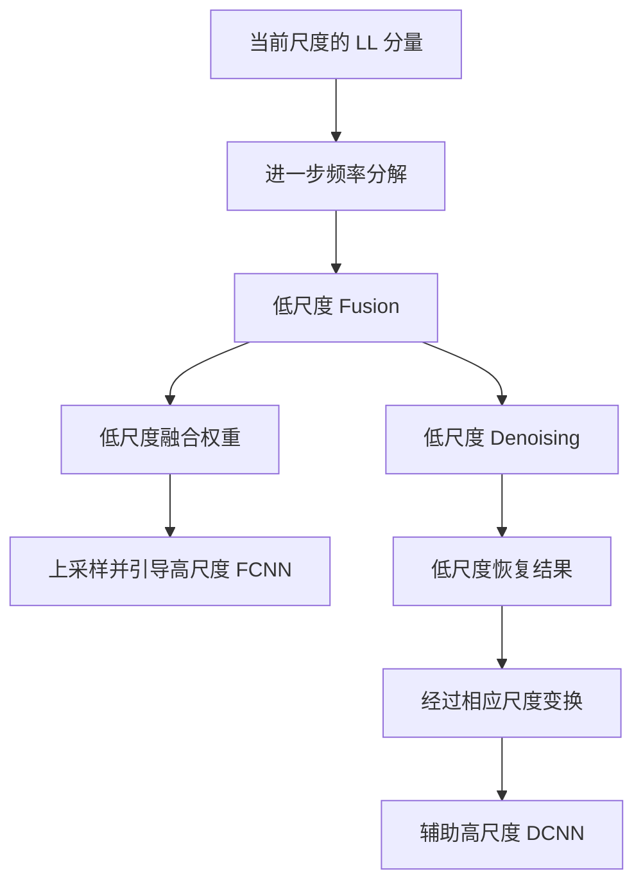

这里还要注意：**Refinement 只在较高尺度使用**。论文没有在每个低尺度都安排完整的 RCNN。

原因与任务分工是一致的：低尺度主要辅助稳定结构恢复和融合判断，最终高尺度则更关注高频细节。

因此，多尺度的作用不只是“把图像缩小后再放大”，而是**让不同分辨率上的结果相互提供引导信息，同时控制计算开销**。

### 3.5.3 递归状态如何跨帧传递？

除了不同尺度之间的连接，EMVD 还需要跨时间维护历史。

对于每一个新时间步：

1. 接收当前带噪帧 $z_t$。
2. 读取上一时刻保存的 Fused 状态 $\bar y_{t-1}$。
3. 通过 FCNN 预测新的融合权重。
4. 使用式（5）得到当前 Fused $\bar y_t$。
5. 通过 DCNN 和 RCNN 得到当前最终输出。
6. 将当前 Fused $\bar y_t$ 作为下一时刻的历史状态。

可以表示为：

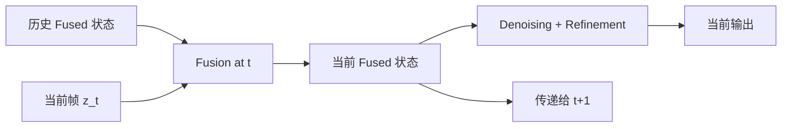

这说明 EMVD 的递归对象并不是完整原始历史序列，而是一个有限的融合状态。

**对于新的一帧，网络不需要重新输入并处理之前所有原始帧，而是利用上一时刻已经积累的融合结果。**

因此，推理阶段的计算和主要历史状态存储不需要随着已经处理的视频帧数持续增长。

当然，这并不意味着历史信息没有损失。有限状态无法保证完整保留所有过去的信息，而 Fusion 的误差也可能沿递归路径传播。这是递归结构需要付出的代价。

### 3.5.4 回到完整架构：三个 CNN 各自学习什么？

最后将三个网络放在一起，可以发现它们的职责并不对称。

| 网络 | 核心输入 | 输出 | 主要学习任务 |
|---|---|---|---|
| FCNN | 当前/历史低频差异、当前噪声方差、低尺度引导 | Fusion 权重 | 判断如何利用历史 |
| DCNN | Fused、当前帧低频、融合方差、低尺度恢复信息 | Denoised | 去除剩余噪声 |
| RCNN | Fused、Denoised、融合方差 | Refinement 权重 | 判断哪些细节值得保留 |

FCNN 和 RCNN 主要预测加权系数，真正复杂的空间降噪映射集中在 DCNN。

这体现了 EMVD 的设计策略：

**能够通过简单数学公式完成的操作，就不要求 CNN 重新学习；需要复杂判断的部分，再交给小型 CNN 预测。**

例如：

- Fusion 的加权运算是确定的，FCNN 只学习权重。
- 融合方差的递推有明确公式，不需要额外学习一个复杂的方差预测网络。
- Refinement 的加权运算也是确定的，RCNN 只学习如何选择两个结果。

这种任务分解，使三个小型网络能够分别处理具有明确意义的问题，而不是让一个大型 CNN 同时学习全部视频降噪操作。

> **第三章核心理解**
>
> EMVD 的三阶段设计，实际上对应三个连续的问题：
>
> 1. **Fusion：历史信息是否可靠？** 利用当前与历史的差异、噪声强度预测融合权重，在静态区域充分降噪，在运动区域减少错误历史信息的影响。
> 2. **Denoising：融合之后还剩多少噪声？** 利用 Fused、当前帧低频以及递归估计的噪声方差，清除时域融合未解决的残余噪声。
> 3. **Refinement：降噪时丢掉了哪些有用细节？** 综合 Fused 和 Denoised，选择性地利用前者仍然保留的高频信息。
>
> **三阶段的意义不是反复降噪，而是将时域融合、空间恢复和细节保留拆成三个更容易学习、计算成本更低的子问题。**

至此，EMVD 的主要 Forward 过程已经完整建立。

但还有两个值得验证的问题：
- 三个阶段没有分别设计独立的画质 GT，为什么仅监督最终输出，就能让各阶段学到不同的行为？
- 作者声称这样分解能够降低复杂度、保持画质，消融实验与实际移动端性能是否支持这一判断？

# 4. 完整网络结构、训练与性能验证

前三章分别解释了 EMVD 的颜色与频率变换、时域 Fusion、空间 Denoising 和 Refinement。但只理解单个模块还不够：**完整网络是怎样连接这些模块的？每处理一帧，数据究竟经过哪些计算？**

本章回到论文 Figure 2，从整个网络的角度重新理解 EMVD，并结合训练方法与实验结果验证其设计。

## 4.1 完整网络由变换、多尺度三阶段处理和逆变换组成

*图 4-1｜论文 Figure 2：EMVD 完整网络架构。实线表示当前时间步内的数据传递，虚线表示跨时间的递归连接。*

先忽略图中下方的多尺度分支，只看最高分辨率上的主干。

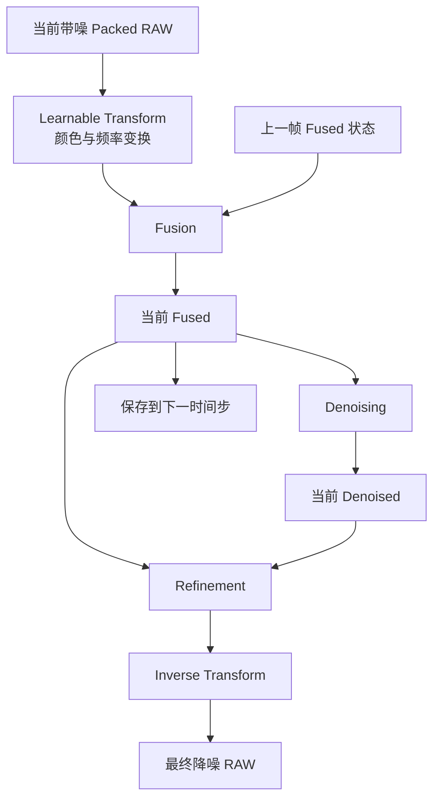

这张图有三个关键点。

**第一，Transform 和 Inverse Transform 包住整个降噪网络。**

输入 Packed RAW 先经过第二章介绍的可学习颜色与频率变换，进入变换域。Fusion、Denoising、Refinement 都在变换域上工作，最终通过逆变换恢复 RAW。

因此，颜色和频率变换不是三个 CNN 内部的普通卷积层，而是位于整个降噪流程前后的表示变换模块。

**第二，Fused 有三个用途。**

它不仅是 Denoising 的输入，还会：
- 保留一条分支，参与最终 Refinement。
- 作为下一帧的历史状态，参与新的 Fusion。
- 配合融合权重，递归更新噪声方差估计。

这解释了为什么 EMVD 不直接把每帧最终 Denoised 或 Refined 结果作为下一帧的历史输入。

**第三，三个阶段并不承担相同的任务。**

FCNN 主要预测时域融合权重；DCNN 执行主要的空间降噪；RCNN 预测精修权重。三者配合起来，完成一次视频帧恢复。

但 Figure 2 还有下方的低尺度处理分支。它们不是另外一个独立网络，而是为高尺度处理提供引导信息。

## 4.2 三个尺度由粗到细协同处理

EMVD 使用三层频率分解，在不同分辨率上进行处理。

为了理解尺寸变化，假设输入已经是 $H\times W\times4$ 的 Packed RAW。

| 处理尺度 | 空间尺寸 | 主要任务 |
|---|---|---|
| Scale 0（较高分辨率） | $H/2\times W/2$ | Fusion、Denoising、Refinement |
| Scale 1 | $H/4\times W/4$ | Fusion、Denoising，辅助 Scale 0 |
| Scale 2（最低分辨率） | $H/8\times W/8$ | Fusion、Denoising，辅助 Scale 1 |

这是用于理解三层频率分解的尺寸示意。每次频率变换会把宽高各缩小一半，同时把当前输入的每个通道分成四个频率子带；不能把空间尺寸下降直接理解为数据总量按同一比例下降。

### 4.2.1 为什么要先处理低分辨率？

假设视频中的人物发生运动。在高分辨率下，前后帧相同物体可能移动了较多像素；降低分辨率之后，相同物理运动对应的网格位移通常更小。

因此，低尺度 Fusion 可以在较粗的空间结构上判断历史信息是否可靠。

同时，较低的空间分辨率也有利于减少部分 CNN 的计算开销。

但低尺度本身不包含足够丰富的高频细节，所以 EMVD 并不是只在低尺度完成降噪，再简单放大成输出，而是采用**从低尺度到高尺度逐步提供引导**的方式。

### 4.2.2 跨尺度究竟传递什么信息？

论文 Figure 2 中有两条重要的跨尺度连接：

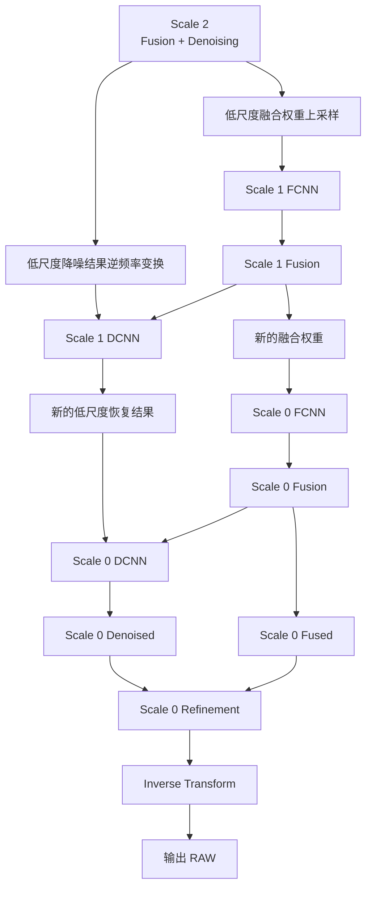

这张图省略了每个尺度的当前带噪输入和上一帧历史状态，它们都仍然需要参与该尺度的 Fusion。

两种跨尺度信息的作用不同：
- **低尺度融合权重 → 高尺度 FCNN**：低尺度先提供较粗的历史可靠性判断，高尺度在此基础上进一步预测自己的融合权重。
- **低尺度降噪结果 → 高尺度 DCNN**：低尺度先恢复部分稳定的图像结构，通过逆频率变换等操作，为高尺度降噪提供辅助信息。

因此，高尺度不是简单重复低尺度的计算，而是在当前尺度数据之外，额外获得了低尺度的引导。

还有一个重要设计：**Refinement 只在最高分辨率尺度执行。**

因为 Refinement 的重点是恢复最终图像中可能被 Denoising 抹掉的细节，没有必要在每个较低尺度都配置一套 RCNN。

至此，多尺度部分的职责就很明确了：**低尺度辅助运动可靠性判断与结构恢复，高尺度负责更完整的细节重建。**

## 4.3 三个 CNN 的内部结构其实很简单

前面介绍了 FCNN、DCNN、RCNN 的输入输出，但还没有解释它们自身长什么样。

论文 Section 4.2 给出了轻量基线的实际配置：

**每个 CNN 采用两层 3×3、16 filters 的卷积与 ReLU，再接一层输出卷积。**

其基础结构可以表示为：

三个 CNN 共用的是这类轻量结构，而不是同一组权重。它们的区别主要来自输入、输出及最后的激活方式。

| 网络 | 输入信息 | 输出 | 输出层处理 |
|---|---|---|---|
| FCNN | 当前/历史低频差异、噪声方差、低尺度权重引导 | 融合权重 | Sigmoid |
| DCNN | Fused、当前低频、融合方差、低尺度恢复结果 | Denoised 图像 | 无输出激活 |
| RCNN | Fused、Denoised、融合方差 | Refinement 权重 | Sigmoid |

低尺度引导只在存在更低尺度时加入；最底层自然没有来自更低尺度的输入。

需要注意，**FCNN 和 RCNN 不负责直接生成恢复后的图像值**。

它们输出的是权重，再由明确的加权公式完成实际融合。因此，CNN 不需要自己学习整个融合映射。

DCNN 才需要直接从输入特征预测恢复后的图像，所以作者认为它承担了最复杂的学习任务。

这也是轻量设计的重要原因：**将网络容量主要用于需要复杂空间恢复的部分，而让具有明确数学形式的融合操作保持简单。**

## 4.4 一帧的完整 Forward 与跨帧状态更新

把上面的结构放在一起，处理第 $t$ 帧时可以按照下面的顺序理解。

| 顺序 | 执行内容 | 产生或更新的信息 |
|---|---|---|
| 1 | 当前 RAW 经过颜色/频率变换 | 各尺度变换域输入 |
| 2 | 读取上一时刻的融合状态 | 历史 Fused 信息 |
| 3 | 从最低尺度开始进行 Fusion | 当前尺度 Fused 与融合权重 |
| 4 | 递归更新融合噪声方差 | 当前尺度残余方差 |
| 5 | 使用 DCNN 进行 Denoising | 当前尺度恢复结果 |
| 6 | 将低尺度权重和恢复结果传向高尺度 | 高尺度辅助输入 |
| 7 | 在最高尺度进行 Refinement | 最终 Refined 结果 |
| 8 | 执行逆变换 | 输出降噪 RAW |
| 9 | 保存本次融合状态及方差状态 | 供下一帧递归使用 |

其中，第 3～6 步在不同尺度上逐层执行。

### 跨时间究竟保存什么？

最重要的是**上一时刻的 Fused 状态**。

对每个尺度而言，下一帧的 Fusion 都需要当前带噪输入和上一时刻的融合结果。

同时，按照第三章的递归方差公式，下一时刻还需要上一时刻的融合方差估计。

因此，从算法依赖关系看，递归状态包括：

- 上一时刻各尺度的 Fused 信息；
- 用于继续方差递推的融合噪声方差状态。

首帧没有历史，直接以当前输入初始化融合状态及对应方差。

这样，处理第 $t$ 帧时，不需要重新把第 0 帧到第 $t-1$ 帧全部输入网络。历史信息已经通过递归状态逐步累积。

**这也是 EMVD 与固定窗口 Multi-frame 方法在计算组织方式上的核心差异。**

但有限状态并不意味着历史信息可以完整、无损地保存。早期融合错误也可能沿时间传播，因此递归状态的选择和更新策略非常重要。

## 4.5 训练：最终输出的 Loss 可以联合优化所有阶段

网络结构虽然由多个模块组成，但训练并不需要为每个阶段单独准备 GT。

EMVD 训练时输入带噪 RAW 视频序列，GT 是对应的干净 RAW 视频序列。

对第 $t$ 帧，预测结果经过逆变换后，与干净 RAW GT 计算 L1 Loss。

整个训练目标是：

$$
\mathcal L=\mathcal L_r+\mathcal L_c+\mathcal L_f
$$

其中：

- $\mathcal L_r$：最终 RAW 输出与干净 GT 的重建误差。
- $\mathcal L_c$：颜色正逆变换的可逆性约束。
- $\mathcal L_f$：频率正逆变换的可逆性约束。

对于包含 $n$ 帧的训练序列，重建损失为：

$$
\mathcal L_r=\frac1n\sum_{t=1}^{n}\|\hat y_t-y_t\|_1
$$

这里按论文的简化记号书写：$\hat y_t$ 表示经过逆变换后的最终预测 RAW，$y_t$ 是对应的干净 RAW GT。

### 为什么没有中间 GT 也能训练？

因为从最终输出到输入变换之间，整个流程是可微分的。

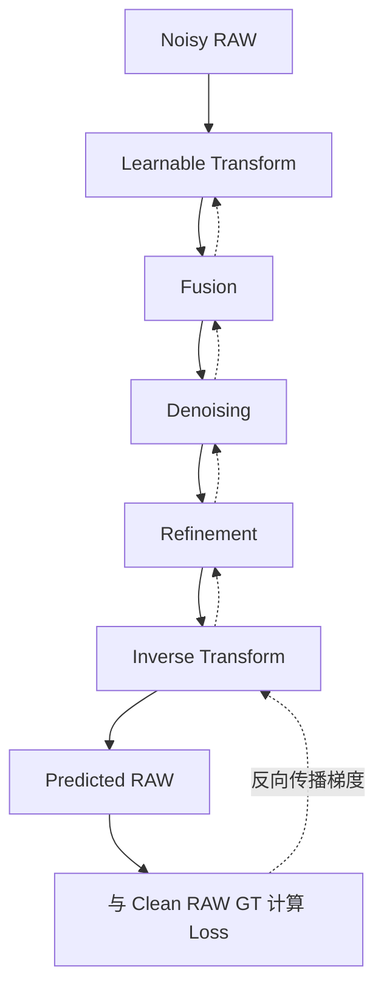

例如，如果某个真实纹理在 Denoising 后被明显抹掉，最终重建误差会受到影响。反向传播的梯度能够同时更新 DCNN、RCNN、FCNN 和可学习变换参数。

但需要区分：**梯度能够传到每个阶段，不等于数学上保证每个阶段都一定学到作者预期的行为。**

论文的设计通过模块职责限制和端到端损失引导学习，作者再通过 Figure 3、Figure 4 以及消融实验证明这些阶段确实学出了符合设计目的的行为。

另外，EMVD 是递归网络，训练时还需要沿时间展开计算图，通过 **BPTT（Backpropagation Through Time）** 让梯度经过历史状态传递。

论文使用连续 25 帧进行训练展开；这不意味着推理时必须同时输入 25 帧。推理仍然逐帧执行，并维护递归状态。

## 4.6 实验证据：真正有价值的是结构选择

前三节已经建立完整网络。实验主要验证两件事：这些设计是否必要，以及它们能否在低计算量下维持画质。

### 关键结构消融

论文 Table 1 中最值得关注的结果如下：

| 改动 | RAW PSNR 变化 | 说明 |
|---|---:|---|
| 用上一帧最终输出代替 Fused 递归 | -0.25 dB | 历史状态选择会影响恢复效果 |
| DCNN 移除当前帧低频输入 | -0.76 dB | 保留未融合的当前信息很重要 |
| 移除所有网络的噪声方差输入 | -1.24 dB | 噪声强度信息对网络很重要 |
| 移除 Refinement，并补偿 DCNN 容量 | -0.17 dB | 两阶段不能完全替代三阶段 |
| 移除颜色变换 | -0.27 dB | 颜色去相关具有实际收益 |
| 用 Pixel Shuffle 替换可学习频率变换 | -0.28 dB | 学习到的变换优于该对照方案 |

这些变化相对于论文中的 **5.38 GFLOPs 轻量基线**；不同消融之间不能简单相加。

其中我认为最值得记住的是两项：

**第一，移除当前帧低频输入造成明显下降。** 这说明 DCNN 不能完全依赖历史融合结果，需要保留访问当前帧原始信息的能力。

**第二，移除噪声方差输入带来的下降更明显。** 这说明 EMVD 的一个重要优势不是只学习图像特征，而是把噪声统计信息显式提供给小型网络。

### 计算量与画质的关系

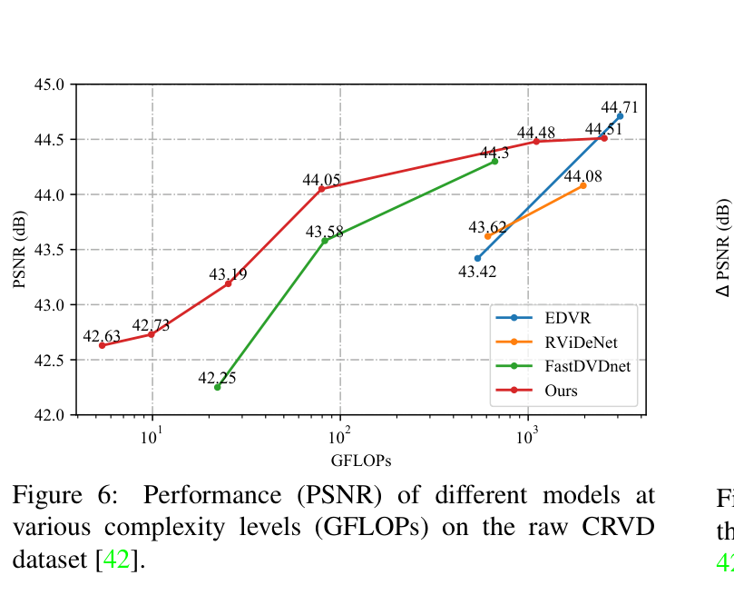

*图 4-2｜论文 Figure 6：不同模型在 CRVD 上的 PSNR 与 GFLOPs 对比。横轴为对数计算复杂度，图中可观察不同计算预算下的画质变化。*

Table 3 中有两个代表性结果：

| 模型 | GFLOPs | RAW PSNR |
|---|---:|---:|
| EMVD 轻量版 | 5.38 | 42.63 dB |
| FastDVDnet 轻量版 | 22.16 | 42.25 dB |
| EMVD 较大版 | 79.52 | 44.05 dB |
| RViDeNet | 1965.04 | 44.08 dB |

这说明，EMVD 在低计算预算下表现得尤其有竞争力。

较大版本 EMVD 在计算量远低于 RViDeNet 的情况下，RAW PSNR 仅相差约 0.03 dB。

这不是说 EMVD 在所有条件下画质都是最好的，而是**在计算资源有限时，三阶段结构能够提供较高的画质效率**。

论文还在 Huawei P40 Pro 上报告了单精度 720p 的运行数据：

| 模型 | 运行时间 | DDR 内存 |
|---|---:|---:|
| FastDVDnet 轻量版 | 177 ms | 724 MB |
| EMVD 轻量版 | 36 ms | 112 MB |

这是论文所用设备和测试条件下的结果，不能直接等同于其他 SoC 上的实际延迟。

**第四章最重要的认识：EMVD 的低复杂度不是来自单一技巧，而是变换域处理、多尺度引导、轻量 CNN、显式融合公式和递归状态复用共同作用的结果。**

---

# 5. 方法论提炼与适用边界

## 5.1 高效来自任务分解、结构先验与状态复用

回顾 EMVD 的完整网络，最值得学习的是它如何分配不同模块的职责。

**第一，把有明确数学形式的操作直接写成结构，只让 CNN 学习难以手工确定的部分。**

例如，Fusion 的加权运算本身不需要 CNN 学习；FCNN 只负责预测权重。

Refinement 也是如此，RCNN 只需要判断 Fused 和 Denoised 应该各占多少比例。

而最复杂的空间恢复任务，则交给 DCNN。

这种设计减少了网络需要从数据中自行学习的内容，也让每个阶段的行为更容易解释。

**第二，把一次复杂恢复拆成三个目标明确的阶段。**

Fusion 利用历史降低噪声；Denoising 处理融合后的残余噪声；Refinement 尝试补回被过度降噪削弱的细节。

这三个阶段不是简单堆叠更多卷积层，而是分别处理不同的误差来源。

**第三，通过变换域与多尺度处理降低计算成本。**

颜色变换和频率变换重新组织数据，让有用信号和噪声在表示空间中更容易区分。

同时，较低分辨率的处理结果可以引导较高分辨率，从而减少部分重复计算。

**第四，通过递归状态复用历史信息。**

EMVD 不需要每次重新联合处理全部过去的视频帧，而是维护 Fused 状态，并逐帧更新。

这使模型能够持续利用过去的信息，而推理时的状态规模不需要随视频长度无限增长。

## 5.2 方法可以迁移，但依赖明确的统计与工程前提

EMVD 的设计思想值得借鉴，但具体结构并不一定适合所有视频恢复任务。

**首先，融合权重不等于精确运动对齐。** 当运动幅度很大或存在遮挡时，低分辨率融合只能在一定程度上缓解错位，无法保证完全消除重影。

**其次，递归状态的选择非常重要。** EMVD 使用 Fused 而不是最终输出，是为了保留部分细节，并让噪声方差能够用递归公式估计。但历史状态也可能累积错误，不能仅凭递归结构就保证长时间稳定。

**再次，噪声模型的准确性会影响整个网络。** FCNN、DCNN、RCNN 都利用噪声方差相关信息。若真实噪声分布与训练假设明显不匹配，网络的权重判断和恢复效果就可能受到影响。

最后，论文的高效性是在其网络配置、数据格式、分辨率与硬件条件下得到验证的。对于新的 Sensor、RAW 格式或部署平台，仍然需要验证计算量、内存、量化和实际画质。

**因此，这篇论文真正值得迁移的方法论，不是直接照搬 Fusion、Denoising、Refinement 三个模块，而是：**

> **把复杂恢复问题拆成具有明确物理意义的子任务；能用数学结构解决的部分，不必全部交给 CNN 学习；需要复杂判断的部分，再分配适当的网络容量。同时，通过合适的表示变换和递归状态复用，控制计算成本。**

这就是我对 EMVD 的最终理解：**它的高效主要来自网络结构设计和任务分工，而不是某个单独卷积层的创新。**
