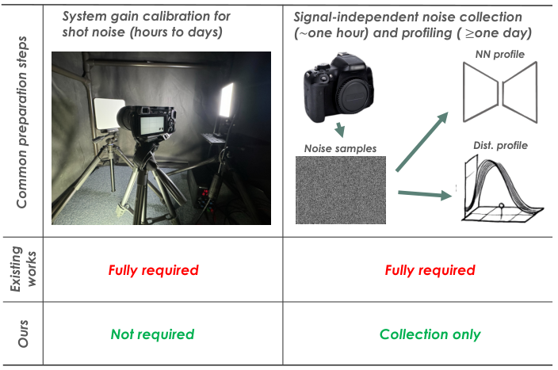
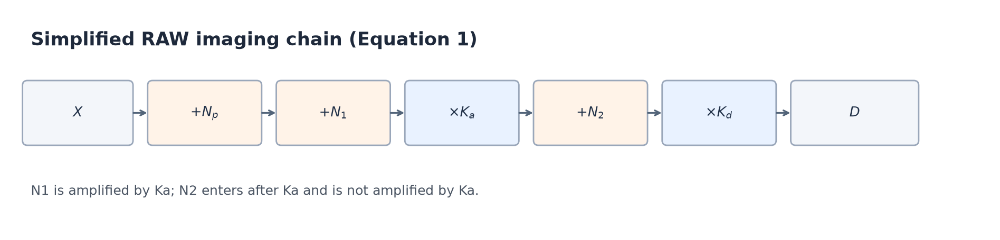
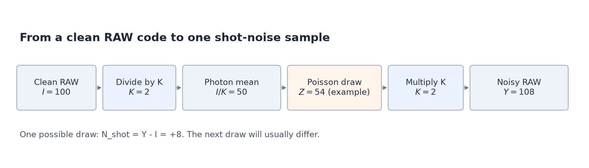
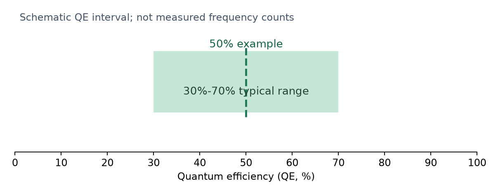
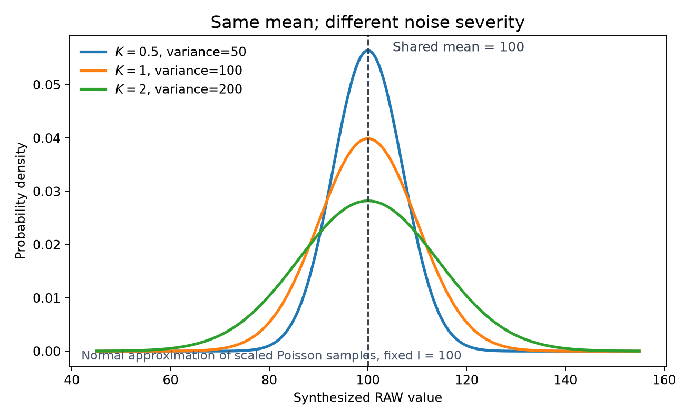
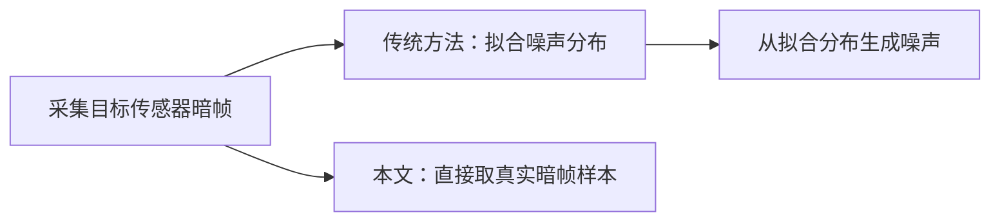
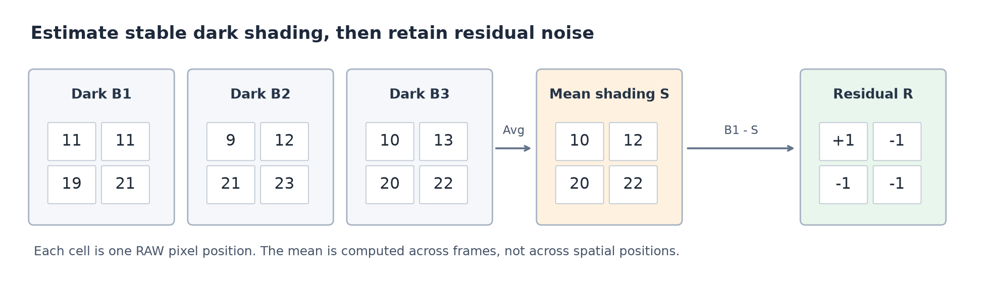
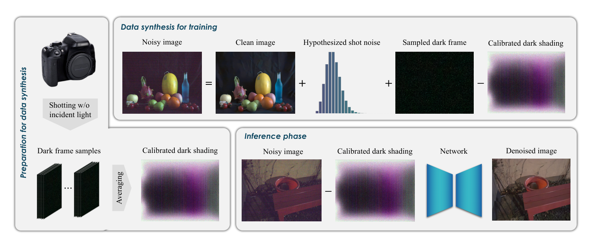

# 1. 论文背景与前置知识

> **论文**：_Noise Modeling in One Hour: Minimizing Preparation Efforts for Self-supervised Low-Light RAW Image Denoising_. CVPR 2025, pp. 5699–5708。  
> **原文**：CVPR Open Access · [arXiv:2505.00045](https://arxiv.org/abs/2505.00045)

> 论文核心思路：论证传统噪声合成中哪些建模步骤其实可以省掉，再将省掉之后的流程整合成一套只需采集暗帧的 pipeline。

## 1.1 问题起点：准备工作为什么是瓶颈

这篇论文要解决的不是“怎样设计一个更强的降噪网络”，而是一个更靠前的工程问题：**将低光 RAW 去噪方案迁移到新传感器时，为什么仅仅为了合成训练所需的噪声，就可能花费数天？这些准备工作是否真的不可省略？**

题目中的 **One Hour** 指的是准备阶段，而不是网络训练时间，更不是承诺任意相机都能在一小时内完成全部适配。作者认为，对于支持自动采集的现代相机，面向特定传感器的噪声合成准备可以缩减为**采集暗帧这一项**，甚至在约一小时内完成。论文的目标是在保持去噪效果的同时，去掉那些昂贵但未必必要的校准和建模步骤。

## 1.2 为什么选 RAW，为什么需要合成噪声

低光条件下，传感器接收到的光子更少，信号相对于噪声变弱。作者关注 **RAW 图像**，首先因为 RAW 尚未经过完整的 ISP 处理，传感器原始噪声的统计特性比处理后的 RGB 图像更容易追溯；其次，RAW 通常具有更高位深，保留了更多原始信息。因此，在 RAW 域学习降噪，有机会更直接地利用传感器噪声的物理规律。

问题随之变成：网络从哪里获得训练样本？最直观的方法是收集真实的“带噪 RAW—干净 RAW”图像对，但真正无噪声的图像通常不可直接拍得。延长曝光或平均多帧，只能构造近似干净的参考图；一旦场景发生运动，两张图之间还可能出现像素错位。若每换一种传感器或增益设置都重复收集成对数据，成本就会迅速累积。

因此，论文转向**从相对干净的 RAW 出发，合成目标传感器的带噪图像**：把合成带噪图作为网络输入，把对应的干净图作为训练目标。这样就不需要为每一台目标设备都采集大批真实 noisy-clean 配对。不过，这条路线的前提是：**合成噪声必须足够接近真实传感器噪声**，否则网络学到的降噪行为可能无法迁移到真实拍摄数据。

这里有一个术语区别：论文将不依赖目标传感器真实成对数据、而依赖噪声合成的路线归入 _self-supervised_；但它实际使用的是合成的 noisy-clean 图像对进行监督训练，**并非盲点网络（Blind-Spot Network）那类只靠带噪图像、遮住中心像素来训练的方法**。因此，本文要解决的瓶颈不是网络如何从无标签图像中学习，而是**怎样以更低准备成本合成可信的 RAW 噪声**。

## 1.3 合成噪声要合成什么：两类噪声

要判断哪些准备工作能够被省略，必须先知道合成噪声究竟包含什么。论文沿用传感器噪声的物理划分：**随入射光信号变化的噪声**，以及**不由入射光信号直接决定的噪声**。两者来源不同，所需的信息也不同。

### 1.3.1 信号相关噪声：散粒噪声

第一类主要是**散粒噪声（shot noise）**。即使场景亮度和曝光时间完全相同，光子也不会每次都以固定数量到达同一个像素；实际到达数量存在随机波动。通常使用**泊松分布（Poisson distribution）**描述这种计数过程。

为了表达这个关系，设 $X$ 为某像素在一次曝光中**期望收到的光子数**，$N$ 为实际收到的随机光子数，则有：

$$
N\sim\mathcal{P}(X),\qquad \mathbb{E}[N]=\operatorname{Var}(N)=X
$$

这里 $\mathbb{E}[N]$ 是计数的均值，$\operatorname{Var}(N)$ 是计数的方差。也就是说，**光子数越大，绝对噪声方差越大**；但计数的标准差为 $\sqrt{X}$，相对均值的波动比例为 $1/\sqrt{X}$，所以**光子越少，相对波动反而越明显**。这解释了为什么低光区域尤其难降噪。若把散粒噪声单独记为 $N_p=N-X$，它的均值为零，但方差仍随信号 $X$ 改变。

### 1.3.2 系统增益 $K$：从光子数到码值

刚才的泊松模型描述的是**光子计数**，而去噪网络处理的是 RAW **数字码值**。光子首先被传感器转换为电子，随后经过模拟放大与数字化，才得到图像中的数值。因此，若要在干净 RAW 上合成散粒噪声，就必须知道光子计数中的随机波动对应到 RAW 码值后有多大。

论文用**系统增益（system gain）** $K$ 表示这个转换尺度，并采用关系：

$$
K=\mathrm{QE}\times\mathrm{AG}
$$

其中，$\mathrm{QE}$（Quantum Efficiency，**量子效率**）表示入射光子转化为有效电子的比例；$\mathrm{AG}$（Analog Gain，**模拟增益**）表示电子信号在读出链路中受到的模拟放大倍数。这里的乘积是论文所采用的简化物理模型：**$K$ 决定散粒噪声在 RAW 码值域中的幅度**。

这也产生了传统方法必须处理的问题：要为特定传感器、特定增益条件合成准确的散粒噪声，通常需要事先**校准 $K$**。否则，即使知道光子计数服从泊松分布，也无法准确确定合成 RAW 噪声的强弱。

### 1.3.3 信号无关噪声：暗帧与 profiling

只有散粒噪声仍不足以描述真实 RAW：即便完全遮住镜头，没有入射光信号，传感器与读出链路也可能产生暗电流相关噪声、热噪声、读出噪声、行/列条纹以及量化误差等。论文把这些统称为**信号无关噪声（signal-independent noise）**，即它们不直接随场景入射光子数变化；这不意味着它们与增益、温度或读出条件无关。

要观察这些噪声，可以采集**暗帧（dark frame）**：在遮光条件下拍摄的 RAW 图像。暗帧提供了目标设备在相应拍摄设置下的信号无关噪声样本。传统方法通常还会执行 **noise profiling**，即选用统计分布或专门的噪声生成网络，对暗帧中的噪声规律进行拟合，再从拟合模型中合成噪声。

但暗帧里也可能包含位置相对固定的偏移，例如**固定模式暗阴影（dark shading）**。它和每次拍摄随机变化的噪声不是一回事：后续必须区分这两部分，才能避免把稳定的像素偏移当成需要网络学习的随机噪声。这正是论文之后引入暗阴影校正的原因。

## 1.4 传统方案的成本结构

现在可以回到论文 Figure 1：对这两类噪声，传统方案分别付出了什么准备成本？

_图 1｜不同噪声合成方案的准备工作。依据论文 Figure 1：传统方案需要增益校准与信号无关噪声 profiling；本文取消前者，并将后者简化为暗帧采集。附带脚本优先提取官方原图，无法获取时才生成信息结构示意图。_

**散粒噪声一侧，成本主要在物理校准环境。**为了确定 $K$，通常需要在受控照明下采集均匀亮度图像（flat-field）或标准噪声测试卡数据。这不仅是按下快门：还涉及可控光源、固定夹具与设备安装。论文特别指出，原型相机板或内窥镜等外形不规则的设备，可能需要定制安装模块，硬件搭建本身就可能持续数天。

**信号无关噪声一侧，成本主要在采集之后的建模流程。**拍摄暗帧只是起点；为了得到可采样的噪声模型，传统方案还要选择合适的统计分布、估计参数并验证拟合效果，有些方法甚至需要额外训练噪声生成网络。真实读出噪声可能具有复杂的空间结构，模型越精细，设计、调试和验证成本也越高。

所以，“规模化部署仍是资源密集型任务”并非泛泛而谈：**一边要为不同硬件搭建校准条件，另一边要为不同噪声分布维护建模流程**。两条成本线叠加，使每次迁移到新传感器都可能重新付出大量准备工作。

## 1.5 本文的两个减法

作者的策略不是再发明一个更复杂、更精确的噪声生成器，而是分别质疑上述两项工作的必要性。

对于**信号相关噪声**，不再实测 $K$，而是给定已知的 AG，**假设一个合理的 QE**，据此得到用于泊松噪声合成的 $K$。对于**信号无关噪声**，不再对暗帧进行复杂的统计 profiling，而是**直接从采集的暗帧中取噪声样本**。这两项减法合在一起，传感器专属的准备工作便主要剩下暗帧采集，也就回到了题目中的 **One Hour**。

不过，简化不等于可以忽视误差。特别是第一个减法存在一个关键疑问：**如果假设的 $K$ 与真实系统增益不一致，合成噪声是否会改变像素的平均亮度，甚至使网络学到错误的颜色偏置？** 第 2 章将从泊松噪声模型出发推导：为什么改变 $K$ 会改变噪声方差，却不会改变干净信号的期望值，以及这种不精确性为什么有可能被去噪训练接受。

# 2. 噪声模型与散粒噪声的简化合成

第 1 章把准备成本拆成了两部分：一部分来自散粒噪声合成前对系统增益 $K$ 的校准，另一部分来自对信号无关噪声分布的 profiling。本章只处理前者。论文的关键判断不是“$K$ 可以乱猜”，而是：**对固定的干净 RAW 码值 $I$ 来说，$K$ 估计不准只会改变散粒噪声的方差，不会改变合成像素的期望值。** 这正是“用假设替代校准”能够成立的数学依据。

## 2.1 从光子到 RAW：完整噪声模型描述了什么

在训练 RAW 降噪网络时，我们希望从一张干净图像出发，人为添加噪声，得到接近真实传感器拍摄结果的带噪图像。

最直观的模型其实很简单：

$$
D=I+N_{\mathrm{shot}}+N_{\mathrm{other}}
$$

其中，$I$ 是干净 RAW 信号，$N_{\mathrm{shot}}$ 是光子随机到达造成的散粒噪声，$N_{\mathrm{other}}$ 是传感器及读出链路产生的其他噪声，$D$ 是最终带噪 RAW。

**但问题在于：这两类噪声是在什么时候产生的？它们又是如何变成 RAW 码值的？** 为了回答这个问题，论文从传感器的成像链路出发，建立了更完整的噪声模型。

*图 2-1｜简化的 RAW 成像链路：光子计数首先受到散粒噪声和前端噪声的影响，经过模拟增益放大后，又叠加后级噪声，最后通过数字增益得到 RAW 码值。*

论文将这一过程写为式（1）：

$$
D=K_d\bigl[K_a(X+N_p+N_1)+N_2\bigr]
$$

理解这个公式，关键不是记住所有符号，而是**沿着成像链路，从内到外看它经历了什么**。

首先，$X$ 是某个像素期望接收到的光子数。由于光子到达具有随机性，实际光子数会产生波动，因此变成 $X+N_p$，其中 $N_p$ 就是散粒噪声。

但传感器除了光子随机性，还存在其他噪声，而且这些噪声可能发生在不同的信号处理阶段。

因此，论文将信号无关噪声分成两部分：
- **$N_1$：模拟放大之前产生的噪声。** 例如前端电路中的部分噪声，它与光信号一起经过模拟增益 $K_a$，因此最终会被放大为 $K_aN_1$。
- **$N_2$：模拟放大之后产生的噪声。** 例如后级读出或转换过程中引入的噪声。由于它是在 $K_a$ 之后才加入的，因此不会再受到 $K_a$ 放大。

为什么已经有 $N_1$，还需要加入 $N_2$？
**因为信号放大之后，后续读出链路仍然可能引入新的噪声。** 如果只建模 $N_1$，就相当于假设所有信号无关噪声都发生在模拟放大之前，这与真实传感器的噪声形成过程并不完全一致。

例如，假设 $K_a=4$、$N_1=2$、$N_2=3$，那么最终信号无关噪声是：
$$
N_{\mathrm{other}}=K_aN_1+N_2=4\times2+3=11
$$

如果模拟增益增加到 $K_a=8$，在相同噪声样本下，这部分噪声会变为 $8\times2+3=19$，而不是原来的两倍。

这个例子说明：**$N_1$ 和 $N_2$ 虽然都属于信号无关噪声，但由于它们处在不同的增益位置，对模拟增益变化的响应不同。**

公式中还有一个 $K_d$，表示数字增益。它与 $K_a$ 的区别是：
- $K_a$ 是模拟增益，作用于前端模拟信号及已经引入的噪声。
- $K_d$ 是数字增益，对已有信号和噪声进行整体缩放。理想情况下，它不会改善信噪比。

> **模拟增益（Analog Gain, AG）与数字增益（Digital Gain, DG）的区别**
> 
> - 模拟增益 $K_a$：在模数转换（ADC）之前，对传感器输出的模拟电信号进行放大。它会同时放大光信号和此前已经产生的噪声，但后续电路引入的噪声不会被同比例放大。因此，适当提高模拟增益可以改善部分读出噪声相对于信号的比例，从而改善信噪比。
>     
> - 数字增益 $K_d$：在 ADC 之后，对已经数字化的像素值直接乘以一个系数。它会同时放大已有信号和噪声，因此理想情况下不会改善信噪比，只是让数值变大。

> **为什么需要模拟增益（AG）和数字增益（DG）？**
> 
> 低光环境下，Sensor 接收到的光子少，产生的电信号非常微弱。如果直接转换成 RAW 数字值，信号可能只占 ADC 量化范围的一小部分，容易受到读出噪声和量化误差的影响。因此，需要通过增益放大信号。
> 
> - 模拟增益 $K_a$：让微弱信号更容易被准确读取。 在 ADC 之前放大电信号，使其更充分地利用 ADC 的量化范围，同时降低后级读出噪声的相对影响。但模拟增益不能增加实际接收到的光子，也不能消除散粒噪声；增益过高还可能导致高光饱和。
>     
> - 数字增益 $K_d$：灵活调整数字信号的亮度与数值范围。 ADC 转换完成后，通过数学乘法调整像素值，不需要改变模拟电路。它可以用于亮度补偿、不同增益设置下的数值归一化等，但不能改善原有信噪比。
>     
> 
> 为什么不全部使用模拟增益？
> 
> 因为模拟增益受到硬件范围、噪声特性和高光饱和的限制，而数字增益更灵活、容易精确控制。例如，可以先使用适当的模拟增益改善信号读取，再使用数字增益完成所需的数值调整。
> 
> **模拟增益主要解决信号读取与量化的问题，数字增益主要解决数字化后的数值调整问题**。两者可以配合使用，但并不是每次拍摄都必须同时使用。

为了简化后续分析，论文令 $K_d=1$，于是式（1）可以展开为：
$$
D=K_aX+K_aN_p+(K_aN_1+N_2)
$$

现在就能看出它与开头那个简单模型的对应关系：

$$
D= \underbrace{K_aX}_{\text{干净信号 }I} + \underbrace{K_aN_p}_{\text{散粒噪声}} + \underbrace{(K_aN_1+N_2)}_{\text{信号无关噪声}}
$$

这就是 2.1 最终想说明的事情：**真实 RAW 噪声由不同物理来源的噪声共同组成，其中散粒噪声与光信号及系统增益有关，而信号无关噪声则来自读出链路中的多个环节。**

值得注意的是，虽然论文在物理模型中区分了 $N_1$ 和 $N_2$，但后续并不要求分别估计它们。因为对于最终 RAW，我们真正需要合成的是两者叠加后的综合噪声 $K_aN_1+N_2$。这也是第 3 章可以直接使用暗帧采样、而不必单独拟合每个噪声来源的原因。

至此，整个噪声合成问题就被拆成了两部分：
1. **散粒噪声**：如何根据干净图像 $I$ 和增益 $K$，生成符合泊松统计的噪声？
2. **信号无关噪声**：如何获得 $K_aN_1+N_2$ 的真实分布，而不必分别建立复杂的噪声模型？

本章接下来先解决第一个问题。因为散粒噪声的强度与 $K$ 有关，而传统方法需要专门校准 $K$，所以论文首先要证明：**为什么不准确的 $K$，仍然可以用于合成有效的散粒噪声？**

## 2.2 如何从干净 RAW 合成散粒噪声？

第 2.1 节已经把 RAW 噪声分成了散粒噪声和信号无关噪声。现在先不管后者，只考虑一个实际任务：**手里有一张干净 RAW，怎样人为制造一张带散粒噪声的 RAW？**
> 散粒噪声（Shot Noise）属于信号相关噪声（Signal-dependent Noise）。

假设干净图中某个像素的码值是 **$I=100$**。这个 100 已经是 RAW 数字码值，而散粒噪声最初来自光子数量的随机波动。要模拟这种波动，就要先知道：这个码值相当于多少个光子？

上一节给出了干净信号与期望光子数的关系 $I=KX$。为了先理解操作过程，暂时假设 **$K=2$**：
> K：系统增益（System Gain）
> X：期望光子数

1. **从 RAW 码值退回光子计数域**：$X=I/K=100/2=50$，即平均光子数为 50。
2. **模拟一次曝光**：实际到达的光子数不会永远等于 50，而是服从以 50 为参数的泊松分布。例如，某次采样可能得到 54 个。
3. **换回 RAW 码值**：$54\times2=108$。于是，这次生成的带噪像素是 108，相比原始的 100，散粒噪声为 $+8$。重新采样时，也可能得到低于 100 的结果。

*图 2-2｜以 $I=100$、$K=2$ 为例，从干净 RAW 反推泊松参数，再把一次随机采样的光子数换回 RAW 码值。图中的 54 只是一次可能的采样结果。*

这里之所以要用泊松分布，是因为**散粒噪声与光子到达数量有关**：平均收到的光子越多，绝对随机波动通常越大，但相对波动反而越小。它不是简单地给每个像素都加上同样强度的随机数。

刚才的操作用数学写出来很短。论文式（3）先描述光子到达的随机性：如果 $X$ 是平均光子数，那么实际光子数 $X+N_p$ 满足

$$
X+N_p\sim\mathrm{Poisson}(X)
$$

而合成时已知的是干净码值 $I$，不是 $X$。利用 $X=I/K$，就能把整个合成过程写成：

$$
Z\sim\mathrm{Poisson}\!\left(\frac{I}{K}\right),\qquad Y_{\mathrm{shot}}=KZ,\qquad N_{\mathrm{shot}}=Y_{\mathrm{shot}}-I
$$

其中，$Z$ 是一次泊松采样得到的光子数；$Y_{\mathrm{shot}}$ 是换回 RAW 域后的带噪像素；$N_{\mathrm{shot}}$ 才是要加到干净图上的噪声。公式只是对前面 $100\rightarrow50\rightarrow54\rightarrow108$ 这一过程的概括。

**现在真正的困难暴露出来了：我们刚才能完成合成，是因为提前假设 $K=2$。** 实际面对一款新传感器时，如果不知道 $K$，就不知道该按 $I/K$ 中的哪个数做泊松采样，也不知道结果该乘回多少。传统方法因此要专门校准 $K$，这正是论文希望省掉的准备工作。

## 2.3 既然不知道真实 K，为什么可以假设一个？

上一节的步骤本身并不复杂，问题只有一个：**$K$ 从哪里来？** 既然直接校准系统增益需要受控光照和额外硬件准备，作者就想找一个有依据的近似值，而不是任意猜测。

关键是第 1 章介绍过的关系（论文式 6）：

$$
K=\mathrm{QE}\times\mathrm{AG}
$$
> QE：量子效率（Quantum Efficiency），即表示传感器将入射光子转换为有效电子的效率。QE 决定有多少光子能转化为电子
> AG：模拟增益（Analog Gain），表示传感器读出时对模拟电信号的放大程度。

对于特定拍摄设置，**AG 通常已知**；难以直接确定的是对应传感器的 QE。相比每次重新校准 $K$，QE 至少有可参考的统计范围：论文补充材料 Section A 汇总了 **393 个相机型号**，现代传感器的 QE 主要落在 **30%～70%**。

仍然沿用上一节的例子。如果已知 $\mathrm{AG}=4$，而我们假设 $\mathrm{QE}=50\%$，就能得到

$$
\hat K=0.5\times4=2
$$

原来上一节使用的 $K=2$，可以通过一个有物理依据的 QE 假设得到，而不一定非要实际测量。若把 30%～70% 代入同一个 AG，则对应的 $K$ 大约在 1.2～2.8 之间；50% 只是选择其中一个代表值。

*图 2-3｜QE 取值范围示意。阴影表示论文补充材料统计中的主要区间 30%～70%，中线为方法章节举例使用的 50%；这不是依据虚构频数生成的直方图。*

这不是说所有传感器的 QE 都是 50%。**作者的第一个依据只是：对于现代典型传感器，假设一个中间值，通常不会让估计出来的 $K$ 偏离得过于离谱。** 论文实验中也使用了其他 QE 假设值，因此 50% 不是写死的参数。

但“误差不会太离谱”还不够。假如真实 QE 是 40%，而我们使用了 50%，合成出来的噪声毕竟与真实噪声不同。**这种误差会不会让网络把原本正确的亮度甚至颜色学错？** 这是下一节要用统计性质回答的问题。

## 2.4 如果 K 猜错了，会影响降噪训练吗？

继续固定干净 RAW 像素 **$I=100$**。我们不改变这张干净图，只改变合成时使用的 $K$：例如分别取 $K=0.5$、$1$、$2$，各重复生成很多次带噪像素。

可以把结果想象成三组围绕 100 上下波动的数字。**$K$ 越大，随机波动越明显；但三组数字的平均值都仍然是 100。**

*图 2-4｜固定 $I=100$，不同 $K$ 的合成像素分布具有相同均值、不同宽度。为了直观展示分布宽度，图中使用与泊松分布具有相同均值和方差的正态曲线近似；实际泊松采样是离散的。*

具体数值是：

| 假设的 $K$ | 泊松参数 $I/K$ | 合成像素的均值 | 合成像素的方差 |
|---|---:|---:|---:|
| 0.5 | 200 | 100 | 50 |
| 1 | 100 | 100 | 100 |
| 2 | 50 | 100 | 200 |

例如，$K=2$ 时，某一次可能生成 108，另一次可能生成 92；**单次结果不必等于 100，但重复很多次之后，平均值会趋近 100**。区别在于，大 $K$ 更容易生成偏离 100 较远的结果。

为什么会这样？回到 2.2 的合成方式：$Z\sim\mathrm{Poisson}(I/K)$，$Y_{\mathrm{shot}}=KZ$。泊松分布有一个重要性质：**均值和方差都等于它的参数**。因此，固定 $I$ 时可以依次推出（论文式 7）：

$$
\begin{aligned} \mathbb E[Z\mid I]&=\operatorname{Var}(Z\mid I)=\frac{I}{K}\\[4pt] \mathbb E[Y_{\mathrm{shot}}\mid I]&=K\cdot\frac{I}{K}=I\\[4pt] \operatorname{Var}(Y_{\mathrm{shot}}\mid I)&=K^2\cdot\frac{I}{K}=KI \end{aligned}
$$

第一行描述泊松采样本身；第二行说明乘回 $K$ 后，均值中的 $K$ 恰好抵消；第三行则说明方差要乘 $K^2$，只能抵消掉一个 $K$，最后仍然剩下 $KI$。

**这就是本章最核心的结论：对于固定的干净 RAW 码值，合成时使用的 $K$ 不影响像素期望值，只影响噪声方差。** 因为 $N_{\mathrm{shot}}=Y_{\mathrm{shot}}-I$，所以

$$
\mathbb E[N_{\mathrm{shot}}\mid I]=0,\qquad \operatorname{Var}(N_{\mathrm{shot}}\mid I)=KI
$$

现在可以理解作者为什么敢用假设的 $K$。如果真实 $K$ 是 1.6，我们却用了 2，合成噪声的**强度**确实偏大；但它仍然以原始干净像素为中心波动，不会系统性地把 100 变成 110 或 90。对 RAW 各颜色通道同样如此：仅仅因为假设了错误的 $K$，并不会在散粒噪声合成环节凭空加入固定的颜色偏移。

这里有一个重要边界：**数学上保证的是“合成散粒噪声的条件均值为零”，而不是“最终训练出的网络绝不偏色”。** 如果还存在固定模式偏移、信号无关噪声、饱和裁剪或训练分布不匹配，最终画质仍然可能受影响。假设 $K$ 也不是越不准确越好；差距太大时，合成噪声的强度就可能与真实测试场景不匹配。

作者还提出一个实际上的好处：当同一个网络要处理较宽范围的 AG 时，不精确的 $K$ 相当于在训练中引入一定的**噪声强度扰动**，可能起到类似数据增强的作用。这里并不意味着每次迭代都必须随机采样一个 QE，而是说“合成噪声不完全等于真实噪声”未必必然降低训练效果。

到这里，第一项准备成本就有了被省略的依据：**合成散粒噪声仍然需要 $K$，但不一定需要精确校准的 $K$。** 现代传感器 QE 的统计范围让假设值有物理依据；泊松噪声的均值与方差性质又解释了估计误差主要会带来什么影响。

不过，真实 RAW 还包含第 2.1 节中的 $K_aN_1+N_2$。它不是由同一个泊松模型决定的，不能仅靠假设 QE 生成。第 3 章就要解决剩下的问题：**既然信号无关噪声的分布复杂，作者为什么不再尝试精细拟合它，而是直接从暗帧中采样？**

# 3. 信号无关噪声的直接采样与完整合成流程

## 3.1 直接采样暗帧，避免复杂的噪声分布拟合

第二章解决了**信号相关噪声**：给定干净 RAW 和一个合理假设的 $K$，就能通过泊松采样生成散粒噪声。但真实 RAW 中还有另一部分噪声，即式（2）的 $K_aN_1+N_2$。它来自传感器与读出链路的多个环节，**不能简单地沿用散粒噪声的泊松模型**。

问题变成：不逐一搞清这些噪声的分布，能否仍然得到真实的训练噪声？

为了与第二章保持一致，第三章只沿用和新增以下五个符号：

| 符号 | 含义 |
|---|---|
| $I$ | 干净 RAW 码值，沿用第二章 |
| $N_{\mathrm{shot}}$ | 已合成的散粒噪声，沿用第二章 |
| $B_i$ | 第 $i$ 张暗帧，即遮光条件下采集的 RAW |
| $\hat S$ | 由多张暗帧估计的暗阴影（dark shading） |
| $R$ | 从暗帧中去除暗阴影后得到的噪声样本 |

传统做法是**先采集暗帧，再进行 noise profiling（噪声分布拟合）**。例如，利用暗帧里的像素值估计高斯分布或更复杂的统计模型，然后从拟合出的模型中随机采样，把生成的噪声加入干净 RAW。

这样做的隐含前提是：**拟合模型能够代表真实传感器的噪声。**

但这个前提并不容易满足。真实信号无关噪声可能存在非高斯分布、行列相关性等复杂现象。

举个直观的例子：**假设某一帧出现随机行噪声，使同一行像素一起偏高**。即使一个模型拟合对了每个像素的噪声幅度分布，如果它把各像素独立采样，就会丢失“整行一起变化”的空间关系。

为了补上这些特征，可以设计更复杂的模型，但模型越复杂，越难在有限暗帧上判断它究竟学到了真实规律，还是只拟合了采集样本中的偶然变化。

因此，作者对 profiling 的判断不是“统计建模在数学上不可能”，而是：**面对复杂的真实噪声，精确 profiling 很难保证；继续细化模型会增加实现成本，还会面临偏差与方差的权衡。**

简单模型可能描述不全，复杂模型也未必能可靠泛化到新的噪声样本。论文 Section 3.3 提出这一判断，具体的实验支持留在 Section 4.4。

既然目标是获得可用于合成的真实噪声，作者选择省掉“先拟合、再重新生成”这个中间环节：**在目标传感器的相应模拟增益 AG 下采集多张暗帧，直接从真实暗帧中取噪声样本。**

因为拍摄时没有入射光信号，暗帧主要记录的正是需要合成的信号无关噪声；因此不必分别构建 $N_1$ 和 $N_2$ 的生成模型，也能取得它们在 RAW 域中的综合样本。

**核心结论：直接采样不是在噪声模型上做更粗糙的近似，而是绕开拟合过程，尽量保留传感器实际采集到的噪声特性。**

这两条路径的区别在于：传统方法需要回答“噪声服从什么分布，参数是多少”，本文则利用暗帧本身提供的真实样本，省掉分布选择、参数拟合和额外噪声生成网络的工作。

**但“直接采样”不等于把原始暗帧毫无处理地加到干净 RAW 上。**

暗帧里还可能有时间上相对稳定的暗阴影。如果把它也当成随机噪声叠加，合成图像可能产生固定偏移；这正是 3.2 要解决的问题。

## 3.2 暗阴影校正：去除固定偏移，保留随机噪声

3.1 的方法是直接使用真实暗帧提供信号无关噪声，而不再拟合复杂的统计分布。
> 先明确目的：我们想得到与真实传感器尽可能一致的信号无关噪声，用它合成训练图像。假设传感器在遮光情况下拍摄了 100 张暗帧。这些暗帧不是完全一样的。虽然没有光信号，但读出电路、暗电流等仍然会产生随机波动，所以每次拍摄得到的 RAW 数值都可能不同。
> 现在有两种方法。
> 方法 A：传统 profiling，先观察这 100 张暗帧，尝试找到一个数学分布来描述它们。问题是，真实噪声可能不是高斯分布，还可能有长尾、行列相关性等复杂特征。如果我们的数学模型不够准确，那么拟合出来的噪声反而与真实噪声存在差异。
> 方法 B：论文的直接采样。既然暗帧已经是传感器实际产生的噪声样本，为什么还要拟合一个分布再重新生成？直接从采集到的暗帧中随机选取样本，用于合成训练图像即可。这样能够保留暗帧中真实存在的噪声幅度、分布形状以及部分空间相关性，而不需要先假设这些特征服从某种数学分布。

但有一个容易忽略的问题：**暗帧记录的并不全是每次拍摄都会变化的随机噪声，还可能包含长时间保持相似的固定偏移。** 如果把原始暗帧原样加到干净 RAW 上，这种偏移也会被当作噪声一起加进去。
> 随机噪声是每次拍摄都可能变化的部分；固定偏移是在相同工作条件下，多次拍摄仍相对稳定的部分。

假设镜头被完全遮住，我们连续拍摄三张暗帧。观察同一个像素 A，读数分别为 **11、9、10**。它们有两个特点：数值会波动，但似乎总围绕 10 变化。因此，可以先把 10 看作该位置相对稳定的偏移，而把 **+1、-1、0** 看作剩下的随机变化。

再观察另一个像素 B，读数为 **21、23、22**，其中心值却是 22。由此可见，稳定偏移**不一定在整张图像上相同**：不同位置可能有不同的固定偏移。真实暗帧中，这些随像素位置变化、在连续拍摄间又较稳定的结构，可能呈现亮度渐变、行列纹理或颜色通道差异。

这类与位置有关、能够在多帧中重复出现的噪声模式通常属于 **FPN（Fixed-Pattern Noise，固定模式噪声）** 的讨论范围。论文此处重点处理的是其中*在时间上相对稳定的暗场偏移*，称为 **dark shading（暗阴影）**。它不是“暗处的随机噪声”，也不能简单等同于所有 FPN；它更像叠在 RAW 上的一张固定偏移图。

> FPN（Fixed-Pattern Noise，固定模式噪声）与 Dark Shading（暗阴影）的区别
> - FPN 是一类噪声的统称：由传感器不同像素或读出电路的特性差异引起，在图像的固定位置形成相对稳定的噪声模式。例如，某些像素总是偏亮，某些列总是偏暗。它既包含暗场中的固定偏移（DSNU），也包含光照下不同像素响应增益的差异（PRNU）。
> - Dark Shading 是暗场中的稳定偏移：即使完全遮住镜头，不同像素的 RAW 输出也可能不为零，而且存在空间差异。例如，像素 A 的值始终在 10 左右，像素 B 始终在 22 左右。这种稳定的暗场偏移可以通过多张暗帧逐像素求平均进行估计。
> 
> 核心区别：FPN 是更广泛的概念，Dark Shading 是本文重点校正的暗场固定偏移。 Dark Shading 可以通过减去平均暗帧进行校正，但这种操作不能消除所有类型的 FPN，例如光照相关的 PRNU。

既然固定偏移在多张暗帧里相对稳定，而随机波动会正负变化，就可以通过**逐像素求平均**来估计这张偏移图。对于位置 $(x,y)$，如果采集了 $M$ 张暗帧，估计结果为：

$$
\hat S(x,y)=\frac{1}{M}\sum_{i=1}^{M}B_i(x,y)
$$

这里 $B_i$、$\hat S$ 都沿用 3.1 的符号。要注意，这是**对每个固定像素位置，跨不同暗帧求平均**，得到的仍然是一张与 RAW 同尺寸的二维图，而不是把整张图平均成一个数。暗帧足够多、随机波动平均后趋近零时，$\hat S$ 才更接近真实的稳定偏移；有限样本只是估计值。

拿到偏移图之后，若本次选中的是第 $j$ 张暗帧，真正用于噪声合成的样本就是：

$$
R(x,y)=B_j(x,y)-\hat S(x,y)
$$

**核心结论：论文的“直接采样暗帧”，指的是直接利用真实暗帧的噪声样本，而不是不经校正地叠加原始暗帧。先减去多帧平均得到的稳定偏移，才得到更接近零均值的随机噪声残差。**

*图 3-1｜简化暗帧示例：对三张暗帧的相同像素位置求平均，得到 dark shading；再从选中的暗帧 $B_1$ 中减去这张平均图，得到用于合成的残余噪声 $R$。图中数字是教学示例，并非论文的实际暗帧数据。*

这一步对降噪训练有什么意义？继续沿用第二章的像素例子：干净 RAW 值为 $I=100$，一次散粒噪声采样产生 $+8$，选中的暗帧在这个位置读数为 11，其中估计的稳定偏移为 10。

如果直接叠加原始暗帧，训练输入就变成 $100+8+11=119$；**校正之后**，真正加上的信号无关噪声是 $11-10=1$，训练输入则是 $100+8+1=109$。两者都包含随机噪声，但前者额外多出固定的 $+10$ 偏移。让网络同时处理这种稳定偏移和随机噪声，会增加它需要学习的内容，也可能带来亮度或颜色偏差。

这里还存在一个必须保持的**训练—推理一致性**：训练时，用暗阴影校正后的暗帧残差合成噪声；推理时，真实带噪 RAW 仍可能带有该稳定偏移，因此也要**先从真实输入减去对应的 dark shading，再送入网络**。否则训练时网络看到的是已经去除固定偏移的数据，推理时却又遇到未经校正的偏移，两个阶段的输入分布就不一致。

而且，**dark shading 必须与目标 RAW 的模拟增益 AG 对应**。论文在每个 AG 下分别采集暗帧并计算对应的校正图；如果把另一个 AG 下的偏移图拿来相减，反而可能引入新的固定误差。传感器温度、曝光条件发生明显变化时，真实偏移也可能变化，因此不能把一次校准得到的图理解成永远准确。

最后，这一步没有重新引入第 1 章试图消除的昂贵准备成本：**用于求平均的正是 3.1 已经采集的那批暗帧**，不需要为 dark shading 额外搭建一套采集系统。作者只是从同一批数据中同时取得了两样东西：一张用于校正的稳定偏移图，以及若干个减去偏移后的随机噪声样本。

现在暗帧中的稳定偏移已经处理掉了，但这些残余噪声仍然是经过 ADC 量化得到的离散数值。**是否还需要把它们“恢复”成更高位深、更连续的噪声？** 这才是下一节 HBNR 要回答的问题。

## 3.3 省略 HBNR：不额外修复量化特性

第 3.2 节通过减去平均暗帧，从真实暗帧中得到残余噪声 $R$。但这些样本已经经过传感器的模数转换（ADC）：原本连续变化的模拟信号被记录成有限精度的数字码值。既然一部分细微变化在量化时丢失了，**是否需要先把暗帧恢复成更高位深，才能用来合成训练噪声？**
> **ADC（模数转换器）为什么会产生量化误差？**
> 传感器将接收到的光信号转换为电荷，再通过读出电路形成模拟电压信号。为了得到 RAW 数字数据，需要通过 ADC（Analog-to-Digital Converter，模数转换器）将模拟电压转换为数字码值。
问题在于 ADC 的位深有限。 例如，10-bit ADC 只能用 $2^10=1024$ 个数字等级表示一定范围内的输入电压，因此必须将连续的电压值映射到有限的等级，这个过程称为量化（Quantization）。
> 
> 假设某个量化等级的间隔为 1：
> - 输入 0.2 → 输出 0
> - 输入 0.4 → 输出 0
> - 输入 0.8 → 输出 1
> 原本不同的 0.2 和 0.4 被映射成了相同的数字码值，无法再准确区分。这种量化前后数值的差异称为量化误差（Quantization Error）。
> 核心理解：ADC 的有限位深决定了数字码值的精度，量化会丢失低于其分辨能力的细微信号变化。 HBNR 试图通过统计模型估计这些丢失的噪声变化，但无法精确恢复原始值。

这是 **HBNR（High-Bit-Depth Noise Recovery，高位深噪声恢复）**试图解决的问题。先用一个简化的数值例子理解“量化损失”：假设 ADC 只能记录整数码值，量化前的噪声读数分别为 $0.2$、$0.4$ 和 $0.8$，四舍五入后就变成 $0$、$0$ 和 $1$。前两个值被记录成相同结果，意味着**仅凭量化后的数字，无法知道它们原本相差多少**。

HBNR 的想法是给这些低位深噪声补回更细的取值。但细节已经丢失，不能直接从暗帧中恢复，因此它必须**额外假设一个噪声分布**：先用高斯分布、均匀分布等简单分布对暗帧噪声做 profiling，挑选较合适的拟合结果，再利用该分布的 *percent-point function*（百分位点函数，也就是累积分布函数的反函数）对原有低位深样本施加扰动，模拟更细的噪声变化。

这听起来是在纠正量化误差，却带来了论文强调的两个问题。

**第一，恢复出来的细节不一定真实。** 量化前的具体值已经不可观测，HBNR 补入的变化来自拟合分布，而不是传感器直接测到的信息。假如真实噪声具有复杂的长尾或空间相关性，简单分布拟合不准，那么额外扰动就可能产生新的合成误差。这也让刚刚在 3.1 省掉的 profiling 步骤重新出现。

**第二，训练时追求“更连续”的噪声，不一定更符合真实推理输入。** 真实 RAW 同样经过 ADC、以有限位深输出，量化特性已经包含在其中。若训练时特意为暗帧补上一层依赖模型的细微扰动，合成噪声并不必然比原始量化样本更接近测试时的噪声。**作者的意思不是“量化有益”，而是“不能仅因为量化丢失了信息，就认定人为恢复后的分布更真实”。**

因此，论文选择**保留 3.2 得到的暗帧残余样本，不额外执行 HBNR**。Section 4.4 的 Table 7 提供了实验佐证：在 SID、ELD、LRID 上，使用或不使用 HBNR 的 PSNR 差异都小于 0.1 dB，并没有稳定、明显的增益。这支持在**本文这套合成流程中**省略 HBNR，而不是证明所有传感器、所有噪声模型下 HBNR 都没有价值。

至此，两类噪声都已经准备好：散粒噪声通过假设 $K$ 的泊松采样得到；信号无关噪声通过暗帧采样、减去 dark shading 得到，且无需再做高位深恢复。剩下的问题是：**它们究竟怎样合成为训练样本，训练和真实推理又怎样保持一致？**

## 3.4 两类噪声共同构成训练样本，无需盲点网络

前面几节实际上解决了一个完整训练流程所需的三个输入：干净 RAW $I$、合成的散粒噪声 $N_{\mathrm{shot}}$、以及暗阴影校正后的暗帧噪声 $R$。**真正的训练流程，并不是让网络学习如何生成噪声，而是先用这三者构造一对“带噪输入—干净目标”，再训练一个普通的去噪网络。**

*图 3-2｜论文 Figure 2：上方为训练数据合成，下方为真实推理。优先由文末 TAG 从 CVPR OpenAccess / arXiv 官方 PDF 裁切；官方图无法取得时才使用标明为重绘的流程示意。*

先看**准备阶段**：针对目标传感器的每个 AG，拍摄一批暗帧 $B_i$，逐像素平均得到对应的 $\hat S$。训练时随机选择其中一张暗帧并减去 $\hat S$，得到 $R$。同一批暗帧既提供真实噪声样本，又提供稳定偏移的校正图，因此不需要重新做独立的噪声 profiling。

然后看**训练数据合成**：选择一张干净 RAW $I$，按第二章的方法用假设的 $K$ 生成散粒噪声 $N_{\mathrm{shot}}$，再加上暗帧残余 $R$。为了明确网络看到的究竟是什么，整个合成操作可以写成：

$$
Y=I+N_{\mathrm{shot}}+R =I+N_{\mathrm{shot}}+(B_j-\hat S)
$$

这里 $Y$ 是网络的**合成带噪输入**；原来的 $I$ 不变，作为**干净训练目标**。这个等式是对论文 Figure 2 的整理，并非论文额外提出的编号公式。

沿用上一节的像素例子：干净值 $I=100$，一次散粒噪声为 $+8$；选中的暗帧在这个位置是 $B_j=11$，对应的暗阴影为 $\hat S=10$，所以 $R=1$。最终训练样本就是 **输入 $Y=100+8+1=109$，目标 $I=100$**。换一张暗帧或重新进行泊松采样，输入会变化，但目标仍然是同一个干净像素。

**网络要学的不是“把噪声生成出来”，而是“从这些不同的带噪输入中恢复到对应的干净目标”。** 论文使用 U-Net 作为去噪骨干，以预测结果和干净 RAW 之间的 L1 距离训练。等明确输入和目标后，损失函数可以简记为：

$$
\mathcal L=\bigl\|f_\theta(Y)-I\bigr\|_1
$$

$f_\theta$ 表示去噪网络，$f_\theta(Y)$ 是它预测的干净 RAW。这里最重要的不是 U-Net 的具体层数，而是**这对训练数据是如何得到的**：不需要为目标传感器拍摄真实 noisy-clean 配对，只需要干净图像和目标传感器的暗帧样本。

**真实推理还要执行对应的暗阴影校正。** 假设传感器实际输出的 RAW 同时包含干净信号、散粒噪声、随机读出噪声及稳定偏移，那么推理前先减去该 AG 下的 $\hat S$，再送入网络。沿用刚才的数值，真实输入若为 $100+8+1+10=119$，减去偏移 10 后就变成 109，形式上与训练时的输入保持一致。注意：**不是把真实 RAW 直接送进网络，也不是在网络输出后再把暗阴影加回来**；网络学习的目标本来就是不包含该固定偏移的干净 RAW。

这里的“一致”有明确条件：暗帧残余与暗阴影应来自**目标 AG 对应的采集设置**；温度、曝光条件明显变化时，偏移和噪声分布也可能变化，不能把一次估计视为永远准确。实际流程中的黑电平基准和数值单位也必须一致，否则即使形式上都做了减法，训练与推理仍可能错位。

最后澄清论文标题中的 *self-supervised*：**本文并没有使用盲点网络。** 盲点网络试图只依赖带噪图像进行训练，而这里先用噪声合成构造出明确的 $(Y,I)$ 样本对，再用 L1 Loss 监督训练 U-Net。“自监督”强调的是不需要目标传感器的真实成对采集数据，不代表训练时没有干净目标。

**第三章最终得到的是一条完整的数据链：假设 $K$ 合成散粒噪声，直接采样暗帧获得信号无关噪声，减去 dark shading，省略 profiling 和 HBNR，最后用合成 noisy-clean 对训练网络。** 下一章要验证的是：做了这些减法后，去噪效果究竟有没有牺牲，论文的消融实验又支持哪些结论。

# 4. 全文总结与个人理解

## 4.1 全文回顾：作者如何把噪声合成准备简化到一小时

这篇论文要解决的核心问题，不是如何设计更强的降噪网络，而是**如何以更低的准备成本，为特定传感器合成足够真实的 RAW 噪声，从而训练有效的降噪模型**。

传统 RAW 噪声合成主要面临两个准备成本：一是为了合成信号相关噪声，需要在受控光照环境下校准系统增益 $K$；二是为了合成信号无关噪声，需要采集暗帧，再通过统计模型或神经网络拟合其噪声分布。作者分别提出了两个简化方案：

1. **信号相关噪声：假设 QE，替代系统增益校准。** 散粒噪声服从泊松统计，系统增益 $K$ 决定其在 RAW 码值域中的强度。作者证明，对于固定的干净 RAW，$K$ 的误差只改变合成噪声的方差，不改变像素的期望值。因此，可以利用已知 AG 和合理假设的 QE 估计 $K$，而不必精确校准。
2. **信号无关噪声：直接采样暗帧，替代复杂的噪声分布拟合。** 真实噪声分布可能具有复杂的统计特性，拟合模型不一定能准确描述它。作者因此直接利用真实暗帧中的噪声样本，避免额外的建模误差和准备成本。

在此基础上，作者通过 **Dark Shading Correction** 分离相对稳定的暗场偏移与随机噪声，并省略需要额外拟合分布的 HBNR。最终，将合成的散粒噪声与暗帧残余噪声叠加到干净 RAW 上，构造 noisy-clean 图像对训练去噪网络。

**整套方案的关键变化，是把面向特定传感器的准备工作，从系统增益校准、暗帧采集和复杂噪声建模，简化为主要采集暗帧这一项。** 论文在多个真实 RAW 数据集上验证了其降噪效果，说明减少准备步骤并不必然意味着牺牲画质。题目中的 One Hour 指的是噪声合成的准备时间，而非网络训练时间。

## 4.2 核心思想：噪声模型不必最精确，而应该足够有效

如果只记住“假设 QE”和“直接采样暗帧”，其实还没有真正理解这篇论文。作者更重要的贡献，是重新审视了一个传统假设：**为了训练高质量降噪网络，是否必须尽可能精确地建模传感器的每一种噪声？**

论文从三个角度回答了这个问题。

**第一，不是所有物理参数都需要精确估计，关键是理解参数误差会产生什么影响。**

传统方法认为准确合成散粒噪声需要精确校准 $K$。但作者没有直接尝试更方便的校准方法，而是先分析：如果 $K$ 不准确，究竟会造成什么后果？

通过泊松分布的数学性质，作者发现 $K$ 的变化不会改变固定干净信号的期望值，只会改变噪声方差。这意味着，即使合成噪声的强度存在一定误差，也不会仅因为 $K$ 不准确，就给训练数据引入固定的亮度或颜色偏移。

这一点最值得学习：**面对一个难以精确获取的参数，应该先分析模型对它的敏感性，再判断是否真的需要付出校准成本。**

**第二，对于分布复杂的噪声，真实样本可能比精心拟合的数学模型更有价值。**

传统 profiling 的思路是从暗帧中学习噪声分布，再利用拟合模型重新生成噪声。但任何统计模型都包含假设：简单模型可能遗漏真实噪声的复杂特征，复杂模型则可能增加实现成本，并出现过拟合问题。

作者选择绕过这个过程，直接使用传感器采集的暗帧样本。这并不是放弃噪声建模，而是用真实数据的经验分布替代人为构造的概率分布。

**这启发我们：如果目标只是获得具有真实统计特性的训练样本，而真实样本本身又容易采集，那么并不一定需要先建立一个复杂的生成模型。**

**第三，额外的数据处理不一定使训练数据更接近真实情况。**

HBNR 尝试恢复暗帧在 ADC 量化过程中丢失的细微变化，看起来能够获得更高精度的噪声样本。但这种恢复无法直接找回已经丢失的真实信息，只能依赖拟合模型进行推测。

更重要的是，真实推理输入本身也是经过量化的 RAW。人为恢复出更连续的噪声分布，并不一定使训练数据更接近实际推理条件，反而可能引入新的模型误差。

因此，**判断一个数据处理步骤是否必要，不能只看它在理论上是否更加精细，而应该看它是否真正改善了训练数据与真实推理数据的一致性。**

这三个判断最终指向同一个核心思想：

**噪声建模的目标不是尽可能完整、精确地复现传感器的所有物理过程，而是以合理的成本，保留那些真正影响降噪训练效果的噪声特性。**

## 4.3 方法的适用条件与我的理解

尽管论文证明了简化噪声合成的可行性，但这些结论并不是无条件成立的。

首先，**假设 $K$ 可行，不代表 $K$ 完全不重要。** 数学上只能保证合成散粒噪声的期望值不受 $K$ 影响，噪声方差仍然与 $K$ 成正比。如果假设值与真实值相差太大，训练噪声与真实噪声之间仍可能存在明显差异。此外，这套方法需要知道 AG，而部分消费级相机只提供 ISO，实际 AG 并不直接暴露。

其次，**直接采样暗帧的前提，是采集到的噪声能够代表目标设备的真实工作条件。** 不同 AG、曝光时间、温度及读出模式下，噪声分布可能发生变化；dark shading 也需要采用对应条件下的估计结果。直接采样消除了统计分布拟合的成本，但并没有消除对真实数据采集条件的要求。

最后，**省略 HBNR 是本文实验条件下的合理选择，而不是证明高位深噪声恢复在所有情况下都没有价值。** 是否需要额外处理，仍应由实际噪声特性和最终去噪效果决定。

我认为，这篇论文最值得吸收的不是某一种具体噪声合成技巧，而是它背后的**建模思路和工程判断方式**：

面对复杂的真实问题，不应默认模型越完整、参数越精确、处理步骤越多，最终效果就一定越好。相反，应该先识别哪些因素真正影响结果，再分析哪些参数可以近似、哪些复杂分布可以用真实样本替代，以及哪些额外操作实际上没有必要。

这也给实际 RAW 降噪研发提供了一种思考方式：当模型效果不理想时，除了增加网络容量或设计更复杂的噪声模型，还应该检查训练噪声是否真正反映了实际推理输入，以及新增的建模步骤是否引入了不必要的假设和误差。

**这篇论文最终让我理解的是：一个好的噪声模型，不一定是物理上最复杂、参数最精确的模型，而是能够在真实性、训练效果和工程成本之间取得合理平衡的模型。**