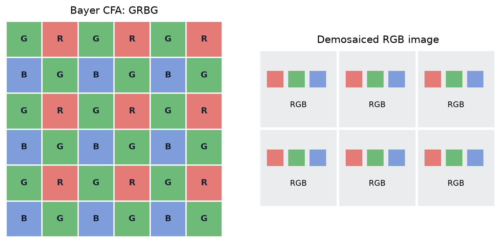
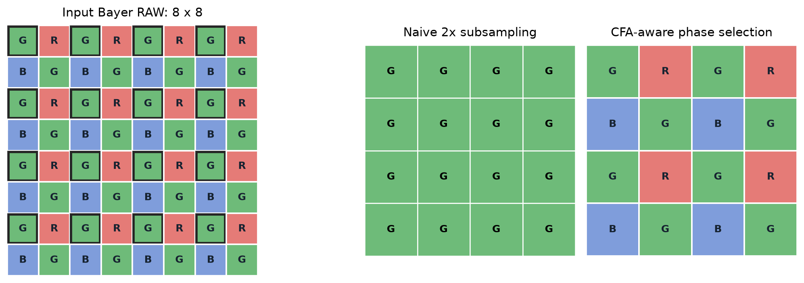
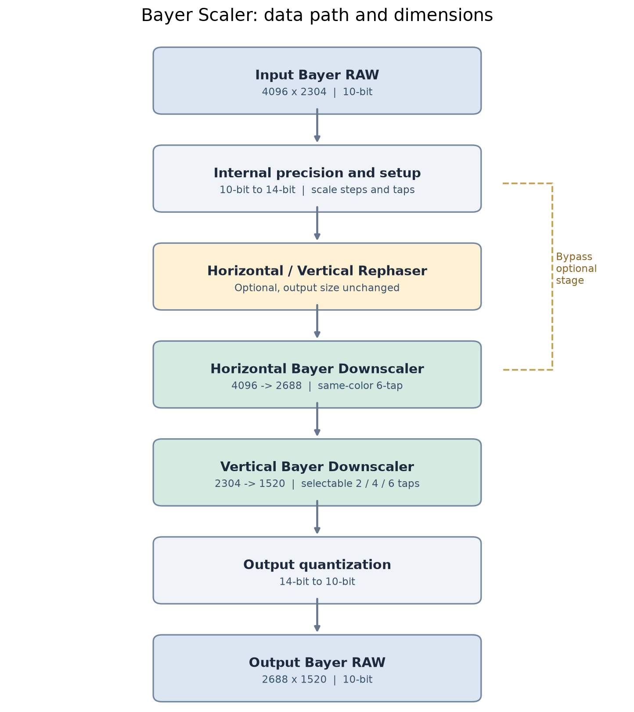
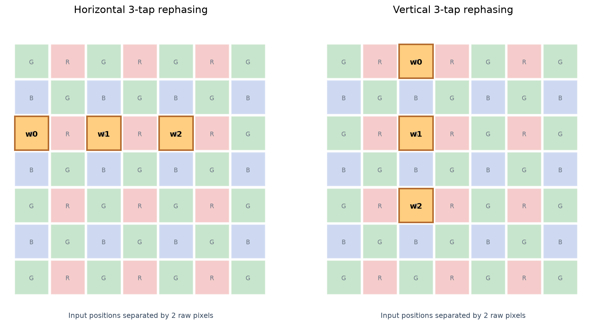
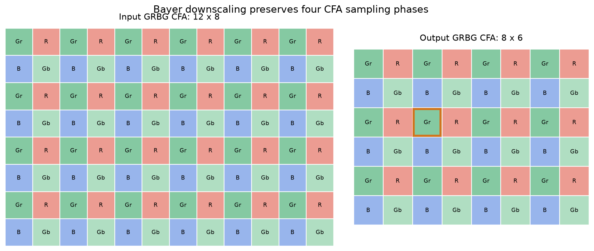
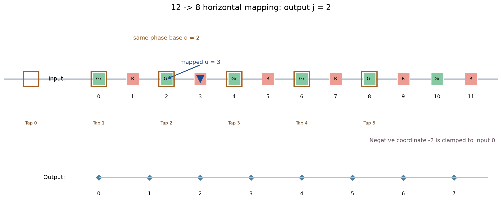
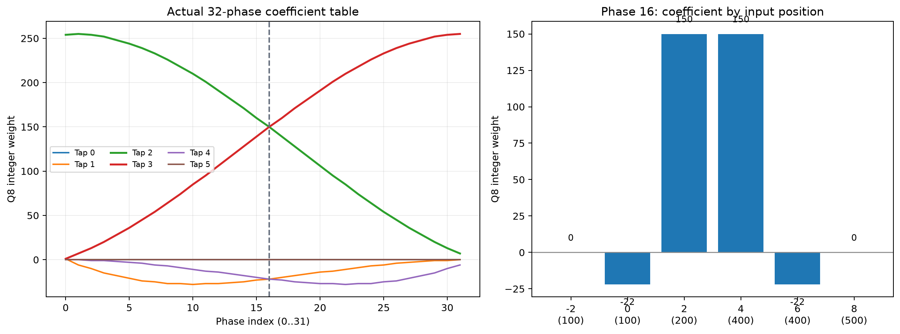
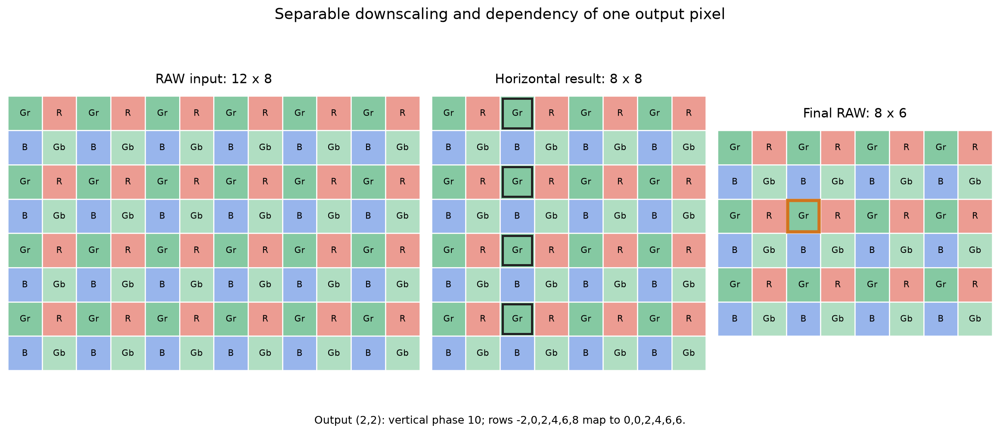
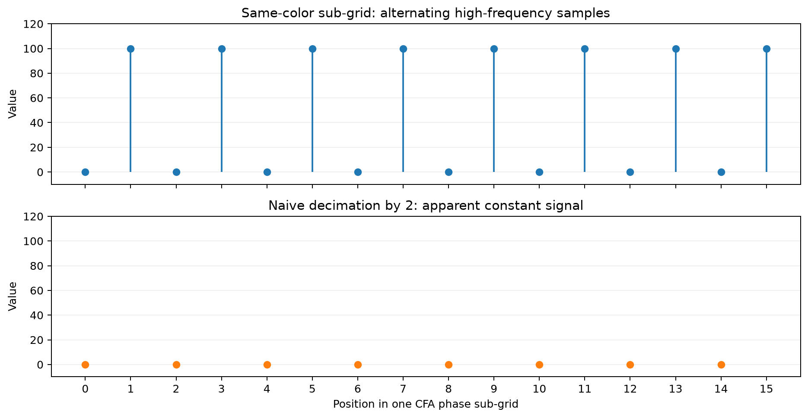

# 1 为什么需要 Bayer Scaler？它是什么？

假设一枚图像传感器可以输出 4000×3000 的图像，但相机正在进行实时预览，后续处理模块只需要 2000×1500。直接处理完整分辨率当然可行，但需要处理四倍数量的采样点，增加数据传输、存储访问和计算负担；直接裁剪又会缩小视野，而不是把完整画面缩小。于是产生了一个自然需求：**保留原有视野，把高分辨率图像变成低分辨率图像。**

在已经得到 RGB 图像的情况下，这通常叫作图像缩放（Resize）。但图像传感器输出的往往还不是 RGB 图像。如果我们希望在后续图像处理之前就降低数据量，问题便不再只是“如何把宽高改小”，而是“如何缩小传感器的原始采样数据”。这就是理解 Bayer Scaler 的起点。

## 1.1 先理解输入：Bayer RAW 为什么不是普通图像？

一张普通的 RGB 图像，在同一像素位置通常具有红、绿、蓝三个颜色值。Bayer RAW 则不同：传感器表面覆盖着按周期排列的彩色滤光片（Color Filter Array，CFA），一个感光位置通常只记录经过一种颜色滤光片后的光强。比如下面的 GRBG 排列，每个 2×2 单元含有一个红色采样点、一个蓝色采样点和两个绿色采样点，向四周重复。



*图 1：Bayer RAW 每个位置仅测得一种颜色分量；RGB 图像每个位置具有三个颜色通道。*

图里的方格并不是已经显示出来的红、绿、蓝色像素；颜色表示这个位置**测量的是哪一种光谱分量**。因此，一张宽为 $W$、高为 $H$ 的 Bayer RAW 虽然可以存成形状为 $H\times W$ 的二维数组，但这个数组的数值并不属于同一种信号：某些位置是红色采样，某些位置是蓝色采样，其余是绿色采样。矩阵形式看起来像灰度图，物理意义却完全不同。

后续 ISP 可以通过 Demosaic（去马赛克）根据邻域采样估计每个像素缺失的颜色分量，从而生成 RGB 图像。但在 Demosaic 之前，数据仍处于 **Bayer 域（Bayer Domain）**；如果此时就要缩放，就不能无视 CFA 的排列结构。

## 1.2 为什么不直接对二维 RAW 做 Resize？

先考虑一个最简单的方法：缩小一半时，每隔一个像素、每隔一行取一个值。假设输入是图 1 的 GRBG 排列，并且每次都从偶数行、偶数列开始取样，那么输出会只剩下原先位于这些位置的 **G** 值。尺寸确实变小了，红色和蓝色采样却被完全丢掉了。



*图 2：从左侧 Bayer 阵列按偶数行、偶数列直接抽样，中间输出只剩一种绿色相位；右侧说明可以通过按 2×2 单元保留相位排列，但这仍不解决采样丢失的问题。*

能否像处理普通灰度图一样，把相邻位置平均起来？例如，一个红色采样位置旁边恰好是绿色采样。把两者直接相加平均，得到的值既不是正确测得的红色，也不是正确测得的绿色。若再把它放进某个规定为红色的位置，后续 Demosaic 就会在错误的颜色语义上继续计算。**问题不是插值公式算错了，而是它混合了本来代表不同颜色的测量值。**

这并不是说 Bayer RAW 完全不能插值。恰恰相反，Bayer Scaler 需要插值；只是它必须知道输出位置应该是什么颜色，并从与该颜色相容的输入采样中构造输出值。另一种做法是先 Demosaic 成 RGB，再缩放 RGB，但这需要提前计算或存储三个颜色通道，且插值生成的颜色估计已经进入计算流程；如果后续模块仍要求 Bayer RAW，它不能直接替代 Bayer 域缩放。

即使设法让输出保持正确的 Bayer 排列，仍然存在另一个问题：低分辨率不可能容纳原来所有的空间细节。简单丢点会漏掉结构，甚至把密集条纹变成不存在的粗条纹；不合适的插值也可能使边缘变模糊。这是**降采样的信息取舍问题**，与颜色排列问题同样重要，但它需要下一章之后再深入推导。

## 1.3 Bayer Scaler 到底是什么？

到这里可以给出一个更准确的定义：**Bayer Scaler 是在 Bayer RAW 域中执行空间重采样、生成目标分辨率 Bayer RAW 的处理模块。** 它既要按目标尺寸重新组织空间信息，也要保证输出 CFA 的颜色位置和采样数值含义正确。

因此，它至少需要同时回答三个问题：
第一，某个输出采样点对应输入画面的什么位置；
第二，怎样利用周围合适的原始采样点计算其数值，而不是盲目混合不同颜色；
第三，怎样在减少采样点时控制细节损失、混叠与伪影。具体实现还必须处理边界、数值精度及计算开销，但这些都是为了实现前面三个目标。

特别要区分两种容易混淆的操作：
**Crop（裁剪）**只保留原图的一部分，减少了视野；
**Bayer Scaling（缩放）**试图把原有视野映射到更少的采样位置。它也不同于 Sensor Binning：后者通常发生在传感器读出或采样组织阶段，通过合并感光单元的信号降低输出分辨率，可能具有不同的噪声和采样特性。Bayer Scaler 则对已经得到的 Bayer 数据进行数字处理。

所以，Bayer Scaler 的真正价值不是“让 RAW 文件变小”，而是**让后续处理链在较少像素上工作，同时尽量保住有意义的图像信息，并维持正确的 Bayer 表达形式**。它无法凭空保留所有被降采样舍弃的细节，设计优劣取决于如何处理这些不可避免的信息损失。


# 第二章：Bayer Scaler算法原理详解

第一章已经明确了 Bayer 缩放的两条底线：输出必须维持正确的颜色采样排列，而缩小尺寸必然涉及信息的重新取舍。现在不妨把问题具体化：输入一帧 $4096\times2304$ 的 GRBG RAW，希望得到一帧 $2688\times1520$ 的 GRBG RAW。输入是单通道二维数组，输出也是单通道二维数组，但输出的每个值并不是从输入中任意挑出一个值，而是按目标位置对应的颜色，从原图的同色采样点重建出来的。

这一章沿着实际算法的计算路径展开。先看一帧数据如何流过各模块，再把每个模块的采样位置、权重、数值精度以及相互依赖逐一算清楚。**真正负责改变分辨率的是 Bayer Downscaler（BDS）；Rephaser 是在某些输入采样条件下可选择启用的前置修正。**

## 2.1 整体架构与数据流



*图 2-1：典型 Bayer Scaler 的完整数据路径。Rephaser 可以整体关闭，也可以分别控制水平和垂直方向；参数准备发生在像素处理之前，不是额外的逐像素滤波阶段。*

输入 RAW 首先进入数值准备阶段。这里有三个必须彼此区分的概念：文件可能以 `uint16` 保存每个采样值，**输入有效位宽**可能只有 10 bit，而**内部计算位宽**可以是 14 bit。转换计算位宽并不增加传感器测得的信息，只是为后面的整数加权运算留出统一的精度空间。例如，10-bit 输入值 $x=200$ 左移四位得到 $3200$，其代表的归一化亮度并未改变。为什么不直接用浮点？因为面向 ISP 的实现通常倾向于使用有限位宽整数、乘加、查表与移位，便于控制硬件资源和数值行为。

在真正处理像素之前，算法根据输入输出尺寸准备水平和垂直缩放步进，并把滤波权重整理成可查表的形式；工作模式则决定要执行哪些分支。这一步相当于为整帧计算准备一张统一的“操作说明”。

接下来有两条典型路径：

- **仅 BDS**：输入 RAW → 水平缩放 → 垂直缩放 → 输出 RAW。
- **Rephaser + BDS**：输入 RAW → 水平相位修正 → 垂直相位修正 → 水平缩放 → 垂直缩放 → 输出 RAW。

Rephaser 处理前后，RAW 宽高不变；水平 BDS 把宽度 $4096$ 变为 $2688$，得到约 $2688\times2304$ 的中间结果；垂直 BDS 再把高度变为 $1520$。最终将内部数值转换到输出有效位宽，写出一帧仍然保留 Bayer CFA 语义的 RAW。实现中还允许 Rephaser-only、单方向处理与 bypass 等分支，但理解上述两条路径足以建立主干。

**输入与输出的 CFA 位置并不是同一批物理采样点。** 比如输出第一行、第二列的颜色由输出 GRBG 网格决定，但它映射回输入后的几何坐标可能是小数，不一定正好落在一个原本标记为红色的输入列上。此时算法不能“改掉输出颜色来适应输入”，而是要在对应的红色采样网格上找到邻域，按位置重新计算。正是这个约束把 Bayer 缩放和直接对二维灰度数组调用 Resize 区分开来。

这里最重要的不是记住框图，而是抓住一个输出像素的形成过程：**决定其颜色相位 → 定位它应采样的输入位置 → 找到同色邻域 → 按对应相位的权重加权 → 量化为一个输出值。** 下面首先解释可选的前置修正 Rephaser，再把 BDS 的这条链路展开。

## 2.2 采样相位修正：Rephaser

在 Bayer Scaler 中，真正负责降低分辨率的是 Bayer Downscaler。但在进入 Downscaler 之前，算法还提供一个可选的模块：**Rephaser（采样相位修正）**。

Rephaser 的操作其实很明确：**输入一张 Bayer RAW，利用每个像素周围的同色采样值，重新计算这个像素的数值，输出另一张尺寸和 Bayer 排列都不变的 RAW。**

例如，输入是 $4096\times2304$，输出仍然是 $4096\times2304$。原来 `RAW[100,200]` 的值可能是 $114$，经过计算后变成 $116$，但这个像素依然位于第 100 行、第 200 列。

既然不改变分辨率，为什么还要重新计算像素值？理解这个问题，需要先区分 RAW 的**数组位置**与**实际采样位置**。

### 2.2.1 Rephaser 的作用

我们通常认为，RAW 数组中第 $x$ 列的数据，就代表图像空间中位置 $x$ 附近的光强。例如，第 0、1、2、3 列分别对应空间位置 0、1、2、3。
但这实际上隐含了一个假设：**Sensor 输出的采样值，其有效空间位置与 RAW 数组索引是一致的。**
对于正常、规则的采样网格，这个假设没有问题。但在某些特殊 Sensor 读出模式下，情况可能不同。
例如，Sensor 可能进行 Binning（像素合并），将多个感光单元的信号组合成一个 RAW 采样值。这个过程不一定有问题：如果合并后的值已经正确对应目标空间位置，当然不需要修正。
真正值得关注的是，**某些读出方式可能使合并后的采样中心偏离下游算法所假设的规则网格位置**。

> 假设 RAW 是 RGGB，其中某个位置存储着绿色值 `G=100`。
> **正常情况下，我们认为这个值代表该位置附近的绿色光信号**。
> **但在某些 Sensor Binning 模式下，这个 `G=100` 可能不是由该位置的单个绿色感光单元独立测得，而是由附近多个绿色感光单元的信号合并得到的**。
> 
> 这时有两种情况：
> 1. 合并后的有效采样中心仍然对应当前位置。那么这个 G 值没有采样位置问题，不需要 Rephaser。
> 2. **合并后的有效采样中心偏离了当前位置。例如，RAW 第 10 列存储的 G 值，实际更接近空间位置 9.75 的绿色信号。如果后续算法把它当作位置 10 的信号，就存在采样位置偏差**。
> 
> Rephaser 主要针对第二种情况。
   它利用附近已有的绿色采样值，重新估计位置 10 应该对应的绿色信号，再把结果写回第 10 列。
> 
> 所以它不是：
> - 把绿色变成其他颜色。
> - 恢复 Binning 前的独立感光单元数据。
> - 增加新的 RAW 像素。
> 
> 而是**保持原来的 RGGB 网格不变，修正已有采样值所代表的空间位置关系**。


假设有一种输入 RAW，其数组位置与实际采样中心之间存在如下关系：

|RAW 列索引|0|1|2|3|4|5|
|---|---|---|---|---|---|---|
|目标空间位置|0|1|2|3|4|5|
|实际采样中心（假设）|-0.25|1.25|1.75|3.25|3.75|5.25|

这里需要特别注意：RAW 仍然只有第 0、1、2、3、4、5 列，**并不存在第 1.75 列这样的数组索引**。
表格的含义是：虽然某个采样值存储在 `RAW[y,2]`，但它实际上代表的信号可能更接近空间位置 $1.75$，而不是 $2$。
这两个坐标描述的是不同的事情：
- **数组坐标**决定像素保存在 RAW 的哪个位置，是整数索引。
- **空间采样坐标**描述这个像素值实际对应什么位置的光信号，可以是非整数。

如果后面的 Downscaler 将 `RAW[y,2]` 直接当成空间位置 $2$ 的采样值，就会引入位置误差。

因此，假如输入确实存在这种偏移，我们希望重新计算：
$$
RAW_{\mathrm{out}}[y,2]\approx f(2)
$$

其中 $f(x)$ 表示空间中的连续光信号，而目前已有的输入更接近：
$$
RAW_{\mathrm{in}}[y,2]\approx f(1.75)
$$

**Rephaser 要做的，就是利用周围已有的采样值，估计标准位置 $2$ 上应该具有的值，并把结果仍然保存到** `**RAW[y,2]**`**。**
它不会增加像素，不会恢复 Binning 前已经丢失的独立测量值，也不会改变 RAW 数组的排列。它只是尝试让原有数组位置的采样值，与目标规则网格的空间位置更一致。
这里的 $\pm0.25$ 只是用于解释算法的一个假设场景，不代表所有 Sensor 都存在这样的偏移。是否需要 Rephaser，仍然取决于具体输入的采样方式。

### 2.2.2 水平 Rephaser 的计算原理
现在我们已经明确了目标：**利用周围已有的采样，重新估计当前位置应该代表的信号。**

具体怎样计算？
以一行 GRBG RAW 为例：
```
RAW 列索引：   0    1    2    3    4    5
Bayer 颜色：   G    R    G    R    G    R
```

假设现在要重新计算第 $2$ 列的绿色采样。
由于 Bayer RAW 相邻列可能属于不同颜色，不能直接将第 $1$、$2$、$3$ 列混合计算。应该使用第 $0$、$2$、$4$ 列这三个绿色采样：

```
RAW 列索引：   0    1    2    3    4
Bayer 颜色：   G    R    G    R    G
               ↑         ↑         ↑
              左侧      当前      右侧
```

这三个采样点属于同一行、同一颜色，左右间隔均为两个 RAW 像素。

这种使用三个输入采样值进行加权计算的方式，称为 **3-tap（三抽头）滤波**。Tap 就是参与一次计算的一个输入采样值。



_图 2-2：Rephaser 的同色邻域采样。水平计算取同一行中间隔两个 RAW 像素的三个采样，垂直计算取同一列中间隔两行的三个采样。图中展示的是 RAW 数组里的取样关系，而不是新增像素。_

在实际算法的一组配置中，水平 Rephaser 使用三个权重：

$$
(w_0,w_1,w_2)=(3,22,7)
$$

计算公式为：

$$
Y[y,x]=\operatorname{clip}\left( \left( 3X[y,x-2]+22X[y,x]+7X[y,x+2] \right)\gg5 \right)
$$

这里 $X$ 是输入 RAW，$Y$ 是修正后的 RAW。`>>5` 表示将非负的整数加权结果右移五位，相当于除以 $32$ 后舍去小数；`clip` 表示将结果限制在合法数值范围内。

三个权重之和为 $32$，因此，如果三个输入值完全相同，例如都是 $100$，计算结果仍然是 $100$。这保证了常量区域不会因为加权而改变数值。

但为什么权重不是对称的，例如 $(5,22,5)$，而是左侧 $3$、右侧 $7$？

**因为 Rephaser 不只是进行邻域平滑，它还希望利用不对称的权重，产生一定的空间采样位置修正效果。**

我们用上一节假设的采样位置，完整计算一次。

假设局部绿色信号沿水平方向逐渐变亮，可以近似表示为：

$$
f(x)=100+8x
$$

同时假设偶数列的实际采样中心比目标位置靠左 $0.25$ 个像素。那么第 $0$、$2$、$4$ 列实际记录的就是：

|RAW 列索引|0|2|4|
|---|---|---|---|
|实际采样位置|-0.25|1.75|3.75|
|输入 RAW 值|98|114|130|

现在要修正第 $2$ 列。

它原来的数值是 $114$，对应空间位置 $1.75$。但目标是让它代表位置 $2$，这个位置的理想信号值为：

$$
f(2)=100+8\times2=116
$$

使用 Rephaser 的三点加权公式：

$$
\begin{aligned} Y[y,2] &=\frac{3\times98+22\times114+7\times130}{32}\\ &=\frac{3712}{32}\\ &=116 \end{aligned}
$$

最终得到：

$$
RAW_{\mathrm{in}}[y,2]=114 \quad\longrightarrow\quad RAW_{\mathrm{out}}[y,2]=116
$$

第 $2$ 列还是第 $2$ 列，只是数值被重新估计为 $116$。对于这个假设的线性信号，修正后的值恰好与标准采样位置对应。

这便是 Rephaser 的实际运算含义。

**进一步地，可以从权重本身推导它的等效空间位移**。

三个输入点相对于当前列的距离分别为 $-2$、$0$、$+2$。对于局部线性信号，归一化加权的等效位置偏移为：

$$
\delta=\frac{3(-2)+22(0)+7(2)}{32}=0.25
$$

因此，**$(3,22,7)$ 这组权重对于局部线性信号，等效于向右移动 $0.25$ 个 RAW 像素的采样位置。**

这解释了为什么右侧的权重更大。它不是随意选择三个值进行平均，而是在保持常量信号不变的同时，产生特定方向的采样位置调整。

当然，这种等效关系是针对局部线性信号成立的。真实图像包含边缘和高频纹理，三点加权并不能保证对所有信号都实现精确、无损的空间移动。

### 2.2.3 Bayer 奇偶位置与反向权重

刚才讨论的是偶数列。但相邻的奇数列也需要计算。

在实际算法中，相邻两种列相位使用相反的权重顺序：

$$
\begin{aligned} \text{一种列相位：}&\quad(3,22,7)\\ \text{另一种列相位：}&\quad(7,22,3) \end{aligned}
$$

对于第二组权重，同样计算它的等效位置偏移：

$$
\delta=\frac{7(-2)+22(0)+3(2)}{32}=-0.25
$$

因此，**第二组权重对局部线性信号，等效于向左移动 $0.25$ 个 RAW 像素**。

这意味着算法可以对相邻的奇偶位置施加方向相反的修正：

```
一种列相位：向右修正
另一种列相位：向左修正
```

如果输入 RAW 的有效采样中心确实呈现交替偏移，这种计算就可能补偿相应的采样关系。

例如，在前面的假设中，奇数列的采样中心比目标位置靠右 $0.25$。第 $1$、$3$、$5$ 列的实际采样位置分别是 $1.25$、$3.25$、$5.25$，对应信号值为 $110$、$126$、$142$。

使用反向权重修正第 $3$ 列：

$$
\begin{aligned} Y[y,3] &=\frac{7\times110+22\times126+3\times142}{32}\\ &=124 \end{aligned}
$$

而目标空间位置 $3$ 的信号正好是：

$$
f(3)=124
$$

这样，偶数列和奇数列分别沿相反方向调整，重新构造了规则网格上的采样值。

要注意，这里处理的是**采样位置的奇偶关系**，并不是规定某一种颜色永远向左或向右移动。不同 Bayer 排列中，奇偶位置对应的颜色可能不同，但算法仍然需要保证取样点属于相同的颜色相位。

### 2.2.4 垂直 Rephaser 与二维处理

前面的计算只处理水平方向。RAW 是二维图像，如果垂直方向也存在需要修正的采样位置关系，就可以使用类似的方法进行垂直 Rephaser。

垂直计算选取的是同一列中相隔两行的三个同色采样：

$$
X[y-2,x],\quad X[y,x],\quad X[y+2,x]
$$

对应的计算形式为：

$$
Y[y,x]=\operatorname{clip}\left( \left( v_0X[y-2,x]+v_1X[y,x]+v_2X[y+2,x] \right)\gg5 \right)
$$

其中 $v_0,v_1,v_2$ 是垂直方向的三个权重。同样可以根据奇偶行采用正向或反向的权重顺序。

当水平和垂直 Rephaser 都启用时，算法的执行顺序是：

$$
X\xrightarrow{\text{水平 Rephaser}}X_H \xrightarrow{\text{垂直 Rephaser}}X_{HV}
$$

首先用输入 RAW 逐行计算水平修正结果，得到一张尺寸不变的中间 RAW；接着以它作为输入，逐列计算垂直修正结果。

实际实现通过 $7\times7$ 的局部窗口准备附近的 RAW 数据，但每次三点加权并不使用全部 $49$ 个像素。水平计算使用三个同色采样，垂直计算也使用三个同色采样。处理图像边界时，还需要保持 Bayer 采样位置的奇偶关系，避免错误地取到其他颜色。

所以，Rephaser 的整个过程可以理解为：**不改变 RAW 的像素数量和颜色排列，只是沿水平、垂直方向，利用同色邻域重新计算采样值。**

### 2.2.5 Rephaser 对图像细节的影响

虽然前面的例子表明三点加权可以修正局部线性信号的采样位置，但实际图像并不总是平滑的直线信号。

考虑三个同色采样值：

$$
[100,\ 140,\ 100]
$$

中间位置的数值明显高于左右两侧，说明这里存在局部快速变化。

经过 $(3,22,7)$ 加权：

$$
Y=\frac{3\times100+22\times140+7\times100}{32}=127.5
$$

实际使用整数右移后得到 $127$，低于原来的 $140$。

这说明，**Rephaser 在调整等效采样位置的同时，也会改变信号的高频成分**。对于孤立的峰值或谷值，三点加权可能使它们的幅度减小。

如果这些快速变化来自噪声，平滑可能让画面显得更干净；但如果它们来自头发、织物、细线条等真实纹理，也可能导致细节损失。连续执行水平和垂直 Rephaser 时，这种影响还可能进一步累积。

因此，Rephaser 不能简单理解为降噪，也不能把它等同于后续 Downscaler 所需的抗混叠滤波。它的设计重点是特定输入采样关系下的相位修正，平滑只是这种加权运算同时可能产生的信号影响。

还有一点必须明确：**Rephaser 的权重是预先配置的，而不是算法从 RAW 中自动检测采样位置偏移后生成的。** 例如，$(3,22,7)$ 可以在数学上产生 $\pm0.25$ 像素的局部线性等效修正，但仅凭这组权重，不能证明实际 Sensor 的物理采样中心一定偏移了相同的距离。

如果输入本来就符合目标规则采样网格，就没有理由仅仅因为发生过 Binning 而启用 Rephaser。反之，如果输入具有与这些修正权重相匹配的采样关系，Rephaser 才可能改善采样位置的一致性。

至此，可以准确概括 Rephaser 的作用：

**它针对某些输入 RAW 的采样位置关系，利用三个同色邻域采样值，通过非对称加权重新估计原有像素位置的信号。它不恢复 Binning 前的信息、不增加像素、不改变分辨率，但可能同时影响噪声与纹理。**

完成可选的 Rephaser 后，得到的仍是一张原尺寸的 Bayer RAW。接下来，Bayer Downscaler 才开始真正减少采样数量，将输入的高分辨率采样网格映射到目标分辨率。

## 2.3 Bayer Downscaler 缩放原理

Bayer Downscaler（BDS）的任务，是将一张高分辨率 Bayer RAW 缩放成目标分辨率，同时保持 Bayer 颜色排列正确。

我们使用同一个例子贯穿整个算法：输入一张 **12×8 GRBG RAW**，输出一张 **8×6 GRBG RAW**，最终计算输出像素 `RAW_out[2,2]` 的数值。

### 2.3.1 Bayer 采样网格与子网格分解
首先观察输入和输出 RAW 的颜色排列。

输入 RAW（12 列、8 行）：
```
         x=0  1   2   3   4   5   6   7   8   9  10  11
y=0       Gr  R  Gr   R  Gr   R  Gr   R  Gr   R  Gr   R
y=1        B Gb   B  Gb   B  Gb   B  Gb   B  Gb   B  Gb
y=2       Gr  R  Gr   R  Gr   R  Gr   R  Gr   R  Gr   R
y=3        B Gb   B  Gb   B  Gb   B  Gb   B  Gb   B  Gb
y=4       Gr  R  Gr   R  Gr   R  Gr   R  Gr   R  Gr   R
y=5        B Gb   B  Gb   B  Gb   B  Gb   B  Gb   B  Gb
y=6       Gr  R  Gr   R  Gr   R  Gr   R  Gr   R  Gr   R
y=7        B Gb   B  Gb   B  Gb   B  Gb   B  Gb   B  Gb
```

输出 RAW（8 列、6 行）：
```
         x=0  1   2   3   4   5   6   7
y=0       Gr  R  Gr   R  Gr   R  Gr   R
y=1        B Gb   B  Gb   B  Gb   B  Gb
y=2       Gr  R [Gr]  R  Gr   R  Gr   R
y=3        B Gb   B  Gb   B  Gb   B  Gb
y=4       Gr  R  Gr   R  Gr   R  Gr   R
y=5        B Gb   B  Gb   B  Gb   B  Gb
```

方括号标记了我们要计算的输出像素 `(2,2)`。



_图 2-3：输入和输出的 GRBG 采样网格。虽然分辨率改变，但输出依然保持相同的 Bayer CFA 排列。_

从网格可以看出，Bayer RAW 虽然存储为一个二维数组，但其中的元素并不全是同一种信号。根据行列的奇偶位置，可以将它分成四组采样子网格：

|子网格|行索引|列索引|颜色|
|---|---|---|---|
|Gr|偶数|偶数|绿色|
|R|偶数|奇数|红色|
|B|奇数|偶数|蓝色|
|Gb|奇数|奇数|绿色|

每组子网格内部都是规则的单色采样。例如，Gr 位于 `(0,0)`、`(0,2)`、`(2,0)`、`(2,2)` 等位置，水平和垂直采样间隔均为两个 RAW 像素。

为什么要做这样的划分？

因为输出像素 `(2,2)` 属于 Gr。如果直接把 RAW 当作普通灰度图进行二维插值，就可能同时使用附近的 R、B、Gb 值。它们对应不同的颜色测量或不同的 CFA 采样相位，不能直接混合成 Gr。

所以，**Bayer Downscaler 必须在对应的 CFA 子网格中重建输出采样值。**

这不要求实际代码创建四张独立图像，只需要在读取输入时保持行列奇偶位置一致。

为了后续完整计算，下面给出本例输入 RAW 中 Gr 子网格的数值。表格只列出当前目标像素计算所需的采样点：

|原始 RAW 行 \ 列|0|2|4|6|8|
|---|---|---|---|---|---|
|0|100|200|400|400|500|
|2|130|230|430|430|530|
|4|160|260|460|460|560|
|6|190|290|490|490|590|

后续所有数值计算都使用这组数据。

**至此，我们确定了输出** `**(2,2)**` **必须是 Gr，后续只能从输入的 Gr 子网格取样。**

### 2.3.2 输出坐标映射与同色采样定位

确定颜色后，接下来要找到输出像素在输入图像中对应的位置。

先考虑水平方向。输入宽度为 12，输出宽度为 8。在当前算法采用的起点对齐规则下，输出每移动一列，对应输入空间移动：

$s_H=W_{\mathrm{in}}/W_{\mathrm{out}}=12/8=1.5$

因此，输出第 $j$ 列对应输入空间位置：

$u_j=j\times s_H$

我们要计算的是输出第 2 列：

$u_2=2\times1.5=3$

这说明输出第 2 列需要重建**输入空间位置 3 的信号**。

但输入第 3 列是 R，而我们需要的是 Gr。输入在位置 3 并没有直接记录绿色，只能利用附近已有的 Gr 采样估计。

输入第 0 行的颜色排列是：
```
输入列：   0    1    2    3    4    5    6
颜色：     Gr   R    Gr   R    Gr   R    Gr
                     ↑    ↑    ↑
                  采样点 目标 采样点
                         x=3
```

最近的两个 Gr 采样点位于输入第 2、4 列。它们之间的空间位置 3，就是我们希望估计的目标。

当前算法先确定一个**同色采样基准** $q_j$：它是输入中不超过目标坐标 $u_j$、且与输出列具有相同奇偶位置的最近一列。

对于当前例子，输出列 2 是偶数列，因此从输入偶数列取样；不超过 $u_2=3$ 的最近偶数列是 2。

所以：

$q_2=2$

目标位置仍然是 3，基准 2 只是用来组织邻域采样。

在此基础上，水平 Downscaler 使用六个间隔为两个 RAW 像素的候选位置：

$$
[q_j-4,\ q_j-2,\ q_j,\ q_j+2,\ q_j+4,\ q_j+6]
$$

代入 $q_2=2$：

$[-2,0,2,4,6,8]$



_图 2-4：输出第 2 列映射到输入空间位置 3。由于需要 Gr，相应的输入采样基准为第 2 列，六个候选位置均属于同一个 CFA 列相位。_

由于 RAW 没有第 -2 列，边界处理需要将它映射到有效的同相位采样位置。当前例子中，-2 映射到 0，因此实际读取：

$[0,0,2,4,6,8]$

对于第 0 行，根据前面给出的输入数据，六个采样值就是：

$[100,100,200,400,400,500]$

其他偶数行也在相同的列位置取样，只是数值不同。

**至此，我们已经找到水平输出第 2 列所需的六个同色输入值；下一步是确定它们各自的权重。**

### 2.3.3 多相滤波与加权重建

现在我们要根据六个输入 Gr 采样值，计算输入空间位置 $x=3$ 的绿色信号。

先考虑最简单的情况。

输入第 2 列和第 4 列的绿色值分别为：

$G(2)=200,\quad G(4)=400$

假设这两个采样点之间的信号沿直线变化，那么位于正中间的 $x=3$ 可以通过线性插值得到：

$G(3)=0.5\times200+0.5\times400=300$

为什么两个权重都是 0.5？

因为目标位于两个采样点的中点，距离左右端点相同。如果目标改为 $x=2.5$，它只走过了从 2 到 4 这段距离的四分之一。

在线性信号假设下（假设这个信号是线性，随 x 放大）：

$$
G(x)=\frac{4-x}{2}G(2)+\frac{x-2}{2}G(4)
$$

因此，目标在 2.5 时，左右权重分别是 0.75、0.25；目标在 3 时，权重变成 0.5、0.5。

**权重随目标位置变化，是因为我们要估计不同位置的信号。在线性插值中，这些权重由直线方程直接推导出来。**

这种两点加权也是一种 **2-tap FIR 滤波（使用两个输入采样进行有限加权求和）**。

但两点插值只能按照两个端点之间的直线估计信号。真实图像可能包含曲线变化、边缘和高频纹理；而且本算法正在降低采样密度，还需要控制新分辨率下的频率表现。因此，实际实现采用范围更宽的滤波器，为不同的画质目标提供更多系数设计自由度。

当前水平 Downscaler 采用 **6-tap FIR 滤波器**，使用六个输入采样位置：

$$
Y_H=\sum_{k=0}^{5}c_kx_k
$$

其中，$x_k$ 是六个输入采样值，$c_k$ 是相应权重。与两点线性插值相比，六点滤波不是简单地增加四个平均项，而是使用一组预先设计的系数来决定整个邻域怎样贡献输出。

接下来需要确定：本次计算应该使用哪一组系数？

前面已经知道目标位置是 $u_2=3$，同色采样基准为 $q_2=2$，下一个同色采样位置是 4。

定义目标在这两个采样位置之间的相对位置：

$$
\alpha=\frac{u_j-q_j}{2}
$$

对于当前例子：

$\alpha=(3-2)/2=0.5$

$\alpha=0$ 表示目标位于左侧基准，$\alpha=0.5$ 表示目标位于中点，$\alpha$ 接近 1 表示目标更靠近右侧采样点。

**不同的 $\alpha$ 需要不同的滤波权重，但权重的具体数值还取决于选用什么滤波器。** 例如，线性插值和六点滤波即使面对同一个 $\alpha=0.5$，也不会使用相同数量和数值的权重。

当前算法采用 **Polyphase Filtering（多相滤波：把不同小数采样位置对应的滤波系数预先保存成表，运行时按位置查表）**。

它将相邻同色采样点之间的相对位置划分成 32 个离散相位：

$p=\lfloor32\alpha\rfloor$

例如：

| 相对位置 $\alpha$ | 相位索引 $p$ | 目标位置        |
| ------------- | -------- | ----------- |
| 0             | 0        | 位于左侧采样点     |
| 0.25          | 8        | 位于两点间的四分之一处 |
| 0.5           | 16       | 位于两点中间      |
| 0.75          | 24       | 位于两点间的四分之三处 |

我们得到 $\alpha=0.5$，因此查找相位 16 的系数。

当前源码使用的水平系数表，在相位 16 处给出：
$[0,-22,150,150,-22,0]$



_图 2-5：32 相位系数表及相位 16 的六个权重。目标相对位置决定查哪一行系数，具体权重由滤波器设计决定。_

为什么这些系数这么大，而不像线性插值那样是 0.5？

因为算法采用 **Q8 定点系数（将权重放大 $2^8=256$ 倍后保存为整数）**，避免在实际滤波循环中进行浮点乘加。

上述系数之和为：

$0-22+150+150-22+0=256$

除以 256 后，归一化权重之和为 1。这样，当所有输入采样值相同时，输出仍然保持相同数值。

其中的负权重用于调整滤波器的整体频率响应，使其能够实现不同于普通正权重平均的信号重建效果；代价是某些边缘可能产生过冲或振铃。负权重本身并不保证更好的抗混叠效果。

现在使用 2.3.2 已经确定的六个采样值，计算第 0 行的水平输出：

输入：
$[100,100,200,400,400,500]$

系数：
$[0,-22,150,150,-22,0]$

整数乘加：
$$
S_H=0\times100-22\times100+150\times200+150\times400-22\times400+0\times500=79000
$$

最后将结果加 128，再右移八位，完成定点舍入与归一化：

$$
Y_H=(79000+128)\gg8=309
$$

因此：

$X_H[0,2]=309$

这里 $X_H$ 表示水平滤波后的中间 RAW。

与两点线性插值得到的 300 相比，六点滤波得到 309，原因是两种滤波器使用了不同的邻域与权重。它们估计的是同一空间位置，但采用的信号重建方法不同。

**至此，我们已经完成第 0 行、第 2 列的水平重采样，得到中间值 309；接下来要将同样的计算应用到其他行，再进行垂直缩放。**

### 2.3.4 二维可分离缩放

前面只计算了一行中的一个输出值。但我们要把整张 $12\times8$ 的 RAW 变成 $8\times6$，不仅需要缩小宽度，还需要缩小高度。

当前算法采用 **可分离滤波（将二维滤波拆成水平和垂直两次一维滤波）**：

$12\times8\xrightarrow{\text{水平滤波}}8\times8\xrightarrow{\text{垂直滤波}}8\times6$

首先，对原始 RAW 的每一行执行水平缩放，将 12 列变为 8 列。因为没有改变行数，所以得到的中间 RAW 是 $8\times8$。

然后，以这张中间 RAW 为输入，沿垂直方向进行重采样，将 8 行变为 6 行。



_图 2-6：Bayer Downscaler 的两次一维滤波。水平处理生成 8×8 中间 RAW，垂直处理再生成最终 8×6 RAW。_

为什么可以将二维计算拆开？

假设一个二维邻域中的输入值为 $X_{i,j}$，水平权重为 $h_j$，垂直权重为 $v_i$。如果二维滤波权重可以写成两个一维权重的乘积：

$h(x,y)=h_H(x)\cdot h_V(y)$

那么二维加权求和就是：

$$
Y=\sum_i\sum_jv_ih_jX_{i,j}=\sum_iv_i\left(\sum_jh_jX_{i,j}\right)
$$

括号里的 $\sum_jh_jX_{i,j}$ 就是对第 $i$ 行执行水平滤波得到的结果。先把每行的结果算出来，再用 $v_i$ 进行垂直加权，就完成了二维计算。

这种分解能够复用水平中间结果，减少重复运算。实际整数实现还会在中间阶段进行舍入和裁剪，因此不必然与一次无限精度的二维卷积逐 bit 相同。

现在继续计算我们的目标输出像素 `(2,2)`。

首先，需要得到中间 RAW 第 2 列、不同偶数行的水平输出。它们使用相同的水平采样列 `[0,0,2,4,6,8]` 和相位 16 系数。

根据 2.3.1 给出的输入数据：

|原始 RAW 行|六个水平输入采样值|水平滤波结果|
|---|---|---|
|0|[100,100,200,400,400,500]|309|
|2|[130,130,230,430,430,530]|339|
|4|[160,160,260,460,460,560]|369|
|6|[190,190,290,490,490,590]|399|

例如，第 2 行的水平计算为：
$$
X_H[2,2]=(-22\times130+150\times230+150\times430-22\times430+128)\gg8=339
$$

其他行采用相同方法，得到表中的结果。

因此，水平中间 RAW 的第 2 列已经有了我们需要的四个偶数行采样：

$X_H[0,2]=309,\quad X_H[2,2]=339,\quad X_H[4,2]=369,\quad X_H[6,2]=399$

接下来进行垂直缩放。

输入高度为 8，输出高度为 6，垂直缩放比例为：

$s_V=H_{\mathrm{in}}/H_{\mathrm{out}}=8/6$

输出第 2 行对应的中间 RAW 空间位置为：

$v_2=2\times(8/6)\approx2.667$

因为输出行 2 是偶数行，所以垂直滤波只能读取中间 RAW 的偶数行，保持 Gr 的 CFA 相位。

不超过 $v_2$ 的最近偶数行是第 2 行，因此垂直采样基准为 2。六个候选位置经过边界延拓后为：

$[0,0,2,4,6,6]$

实际垂直输入值就是：

$[309,309,339,369,399,399]$

现在计算垂直滤波相位。目标位于第 2 行和第 4 行之间，其相对位置为：

$\alpha_V=(2.667-2)/2\approx0.333$

对应的 32 相位索引为 10。在实际 C 实现中，这个索引由定点累加器取得：先得到 8-bit 小数相位 85，再右移三位得到 10。

查当前垂直系数表，第 10 组权重是：

$[0,-28,210,85,-11,0]$

进行垂直加权：

$$
S_V=0\times309-28\times309+210\times339+85\times369-11\times399+0\times399=89514
$$

完成 Q8 归一化：

$$
Y_V=(89514+128)\gg8=350
$$

因此，最终输出为：

$$
\boxed{RAW_{\mathrm{out}}[2,2]=350}
$$

这个值来自原始 RAW 中多个偶数行、偶数列的 Gr 采样。算法先沿水平方向加权，再对得到的中间值沿垂直方向加权，最终完成二维重采样。

**至此，目标输出像素** `**(2,2)**` **已经从原始 RAW 完整计算到数值 350，二维 Bayer Downscaler 的主要计算过程结束。**

### 2.3.5 小结：BDS 的完整计算链

Bayer Downscaler 的核心计算可以归纳为三步：

1. **输出颜色由目标 CFA 网格决定。** 例如输出 `(2,2)` 属于 Gr，因此只能从输入相应的 Gr 子网格取样。
    
2. **采样位置由输入输出分辨率决定。** 坐标映射确定目标在输入空间中的位置，再根据 CFA 奇偶关系选出同相位邻域。
    
3. **输出数值由多相滤波计算。** 根据目标的相对采样位置查找系数，先进行水平重采样，再进行垂直重采样。
    

这套计算同时涉及两个不同的信号处理目标：**插值**用于估计目标位置上的信号，**抗混叠**用于控制降采样后无法正确表示的高频。

当前算法使用同一套邻域滤波结构进行重采样，但两项目标能兼顾到什么程度，取决于实际滤波系数的设计。

**至此，我们已经掌握 BDS 怎样计算输出像素；下一节只讨论滤波系数会怎样影响最终画质。**

## 2.4 滤波系数与画质取舍

### 2.4.1 插值与抗混叠的关系

前面计算输出 `(2,2)` 时，我们通过坐标映射确定目标位置，再利用周围的 Gr 采样估计目标信号。这属于**插值**：已知离散采样值，估计尚未直接测量的空间位置上的信号。

但 Bayer Downscaler 不只是在已有网格之间插值。它还要减少采样数量，因此必须考虑**抗混叠**。

当输出分辨率降低时，输出采样网格的间距变大。原来在高分辨率下能够表示的某些快速明暗变化，在较低采样率下可能被错误地表现为其他信号。

考虑某个 Bayer 同色子网格上的高频交替信号：

```
输入：   0  100  0  100  0  100  0  100 ...
```

如果每隔两个同色采样点直接取一个：

```
输出：   0       0       0       0 ...
```

原来的高频变化消失了。如果从另一位置开始抽样，还可能得到全为 100 的序列。

这就是混叠：**不同的高频输入，在降低采样密度后可能产生错误的低频表现。**



_图 2-7：单个 Bayer 同色子网格上的高频交替信号，经过直接降采样后可能变成错误的常量信号。_

为了减轻混叠，需要在降低采样密度时适当抑制新网格无法表示的高频成分。

这就是抗混叠滤波的目的。

插值与抗混叠可以使用同一个加权滤波器完成：滤波器一方面根据目标位置组合邻域采样，另一方面通过系数的频率响应决定哪些空间频率被保留、削弱或增强。

但不能认为用了 6-tap 或存在负权重，就已经实现了充分抗混叠。负权重可以帮助设计特定的频率响应，也可能增强某些高频或引入振铃。最终效果取决于**全部系数共同形成的频率响应**，而不是某个系数的正负。

**至此，我们区分了重采样中的位置估计与高频控制；下一节进一步看 Tap 数量和系数设计如何影响这两者。**

### 2.4.2 Tap 数量与系数设计的取舍

滤波器的 Tap 数量决定一次计算能够使用多少个邻域采样位置，也决定了系数设计具有多少自由度。

**2-tap** 通常可以实现线性插值。它只需要两个采样值，计算简单、资源消耗低，但滤波器可调整的空间有限；对于降采样，高频抑制能力可能不足，同时线性插值本身也可能使边缘细节变软。

**4-tap 和 6-tap** 使用更宽的邻域。更多系数允许设计更复杂的频率响应，例如在保持部分细节的同时增强特定频段的抑制能力，或者实现更陡的频率过渡。

但更多 Tap 也意味着更大的取样范围、更多乘加操作和更高的实现成本。如果系数设计不合适，还可能在高对比边缘产生过冲或振铃。

滤波器系数并不是仅根据目标采样位置就能唯一确定的。工程上通常先选择希望达到的频率响应，再通过窗函数法、等波纹优化等方法设计有限长度滤波器，最后将其离散成不同采样相位的系数表。

对于当前 Bayer Downscaler，算法将每个相位的权重保存为 Q8 整数系数，并在运行时通过查表和整数乘加完成计算。源码可以确定这些系数的数值和使用方式，但仅凭系数表本身，不能证明它最初采用了哪一种设计方法。

当前使用的水平系数表虽然采用 6-tap 结构，但最外侧两个系数为零，因此实际上只有四个位置贡献非零权重。这说明**滤波器结构支持多少 Tap，与当前系数实际使用多少个有效 Tap，并不完全相同**。

最终选择哪种滤波器，需要在几个目标之间权衡：目标缩放比例下的混叠抑制、细节保留、边缘振铃、乘加成本和系数存储成本。

**Tap 并不是越多越好；合适的滤波器，是在特定缩放比例、画质目标和硬件预算下取得合理平衡的结果。**

# 第三章：总结

## 3.1 一句话抓住本质

Bayer Scaler 是在 Bayer RAW 域完成降采样：把四组交错的颜色子网格分别做一维多相滤波重采样，先水平后垂直，输出仍是正确排列的 Bayer RAW。

## 3.2 必须记住的三个约束

| 约束 | 含义 | 违反的后果 |
|------|------|------------|
| **颜色不能混** | 输出某个位置是什么颜色，只能从输入的同色子网格取样 | 红色测量值被当绿色用，后续 Demosaic 在错误颜色语义上继续算 |
| **位置要映射** | 输出像素对应输入空间的小数坐标，不能直接复制某个输入像素 | 缩放比例不为整数时，输出画面错位或比例失真 |
| **高频要控制** | 采样变稀疏后，原网格无法表达的高频会变成错误的低频 | 密集条纹变成粗条纹或整片常量（混叠） |

三个约束对应三个设计决策：子网格分解、坐标映射、多相滤波系数。

## 3.3 两个模块的分工

| | Rephaser | Bayer Downscaler（BDS） |
|--|----------|-------------------------|
| 是否改变分辨率 | 否，输入输出同尺寸 | 是，宽度和高度分别缩小 |
| 做什么 | 修正已有采样值代表的**空间位置** | 在新的稀疏网格上**重建采样值** |
| 何时启用 | 可选，仅当输入采样中心偏离规则网格时 | 必选，降采样的主体 |
| 邻域大小 | 3-tap（同色三点） | 6-tap（同色六点，可退化为 4/2-tap） |
| 副作用 | 平滑高频，可能损失纹理 | 混叠抑制不足会失真，过度则模糊 |

记忆要点：**Rephaser 修“位置”，BDS 改“密度”**。两者都不恢复 Binning 前丢失的信息。

## 3.4 BDS 的计算三步

任何一个输出像素 `(i,j)` 的数值，都由以下三步决定：
1. **定颜色**：看输出 CFA 网格的奇偶相位，确定是 R / Gr / Gb / B。这决定了只能从哪一组输入子网格取样。
2. **定位置**：按缩放比例算出该输出像素对应的输入空间坐标（小数），再找到不超过它、且同奇偶相位的最近输入采样作为基准，取六个间隔为 2 的同色邻域点。
3. **定权重**：用目标在基准与下一个同色点之间的相对位置，查到对应的相位系数，加权求和并做定点舍入。

二维实现采用**可分离滤波**：先对每行做水平滤波（宽度变小、行数不变），再对每列做垂直滤波（高度变小）。中间结果被复用，这是“先水平后垂直”等价于二维滤波的前提。

## 3.5 两个容易混淆的点

**插值 vs 抗混叠**
- 插值：已知离散采样，估计目标位置的值。解决“这个位置应该是什么”。
- 抗混叠：降采样前，抑制输出网格无法表达的高频。解决“哪些信息不该被错误地带到低分辨率”。
- 两者可以用同一组系数实现，但不是同一个目标。多相滤波只负责“按位置选系数”，抗混叠效果取决于系数表的整体频率响应。

**结构 Tap 数 vs 有效 Tap 数**
算法结构支持 6-tap，不代表当前系数真的用了 6 个点。当前水平系数表首尾为零，实际只有中间 4 个位置贡献非零权重。Tap 越多，设计自由度越高，但乘加成本和振铃风险也越高，不是越多越好。

## 3.6 理解自检：能否不看文章回答这五个问题
1. 为什么不能直接把 Bayer RAW 当灰度图做 Resize？
2. Gr 和 Gb 都是绿色，为什么不能混用？
3. 输出像素的“颜色”由什么决定？“位置”由什么决定？
4. 多相滤波中的“相位”指的是什么？为什么需要 32 组系数而不是 1 组？
5. 两个 Tap 数相同的滤波器，画质一定相同吗？为什么？

能答出前四题，说明 BDS 的计算链已经清楚；能答出第五题，说明理解了“系数设计”与“算法结构”是两件事。

## 3.7 最后的一句话总结
**Bayer Scaler 不是“把 RAW 改小”，而是“在四组颜色子网格上各做一次带位置修正的一维重采样，再拼回正确的 Bayer 排列”。**

降采样必然丢失信息，算法的全部设计空间只在于：**选择丢哪些、以什么方式丢、以及如何让剩下的采样值仍然代表正确的颜色和位置。**