# 1 Gamma 与 DeGamma

## 1.1 什么是 Gamma

先观察同一张图像经过不同 Gamma 参数处理后的结果：

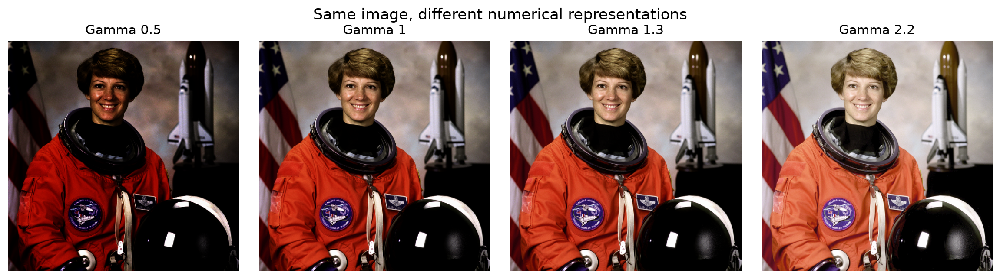

可以看到，随着 Gamma 参数增大，图像中的暗部逐渐变亮，但物体的形状、位置和基本结构没有发生变化。

这是因为 Gamma 并不是降噪、锐化或者其他空间滤波操作，而是一种**改变图像像素数值的非线性变换**。

假设图像的有效信号已经归一化到 0～1，Gamma 的计算方式为：
$$
\boxed{y=x^{1/\gamma}}
$$

其中：
- $x$：原始图像信号。
- $y$：Gamma 变换后的信号。
- $\gamma$：控制变换程度的参数。

| Gamma 参数 | 变换效果 |
| --- | --- |
| $\gamma=1$ | 不改变原始信号 |
| $\gamma>1$ | 信号数值增大，直接显示时图像变亮 |
| $0<\gamma<1$ | 信号数值减小，直接显示时图像变暗 |

需要注意，不同文献可能采用 $x^\gamma$ 或 $x^{1/\gamma}$ 的定义。本文统一使用后者，因此 Gamma 大于 1 时，0～1 之间的信号数值增大。

### Gamma 为什么是非线性变换？

如果只是将所有像素的数值乘以 2，那么原本相差 0.01 的两个像素，处理后都会相差 0.02。

这种变换对不同信号位置使用了相同的倍率。

但 Gamma 不一样。

为了方便理解，假设 $\gamma=2$，此时 Gamma 就是开平方：

$$
y=\sqrt{x}
$$

分别观察暗区和亮区中两个相邻像素的变化：

| 区域 | 原始像素值 | Gamma 后 | 像素差值变化 |
| --- | --- | --- | --- |
| 暗区 | 0.04 → 0.05 | 0.2000 → 0.2236 | 0.01 → 0.0236 |
| 亮区 | 0.64 → 0.65 | 0.8000 → 0.8062 | 0.01 → 0.0062 |

原本两个区域的像素差值都是 0.01，但是经过 Gamma 后，暗区的差值变大了，亮区的差值反而变小了。

**Gamma 不只是改变像素数值的大小，更重要的是改变不同信号区间的数值间距。**

这也是 Gamma 能够影响图像局部对比度、纹理和噪声的原因。

### 什么是 DeGamma？

DeGamma（逆 Gamma）就是 Gamma 的逆操作，用于将经过 Gamma 变换的信号恢复到原来的数值表示。

$$
\boxed{x=y^\gamma}
$$

例如，采用 $\gamma=2$：

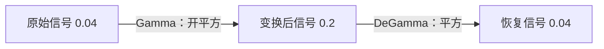

Gamma 和 DeGamma 在数学上是互逆的。

这意味着，在没有量化、截断等信息损失的情况下，Gamma 本身不会增加或减少原始图像所包含的信息，只是改变了这些信息的数值表示方式。

## 1.2 为什么图像处理中需要 Gamma？

既然 Gamma 不会增加图像信息，为什么还要使用它？

传统图像处理中，Gamma 主要用于解决两个问题。

**1. 图像编码与显示设备之间的匹配。**

图像文件中的像素数值，与屏幕实际发出的光强，不一定是线性关系。通过约定好的非线性编码和对应的显示传递函数，可以使图像被正确显示。

**2. 更合理地利用有限的编码精度。**

假设使用 8-bit 保存图像，总共只有 256 个编码等级。

如果采用线性编码，这些等级会均匀分布在整个线性信号范围内。

但人眼对亮度变化的感知不是线性的。在一定的视觉适应条件下，暗部较小的绝对亮度变化也可能被感知到。因此，将更多编码等级分配给暗部，具有实际价值。

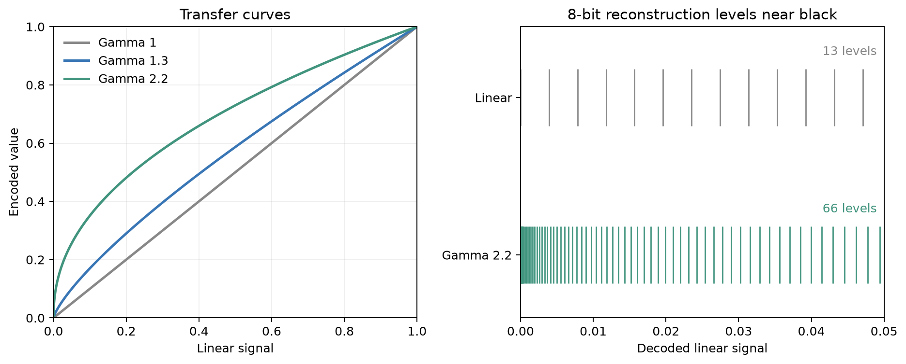

观察左图：
- Gamma 曲线在暗部比较陡峭，意味着暗部较小的输入变化会产生较大的输出变化。
- Gamma 曲线在亮部比较平缓，意味着亮部的数值间距受到压缩。

观察右图：
同样使用 8-bit 编码，在 0～0.05 的暗部线性信号范围内：

| 编码方式 | 可表示的线性重建等级 |
| --- | ---: |
| 线性编码 | 13 |
| Gamma 2.2 编码 | 66 |

**Gamma 没有增加总位深，而是让有限的编码等级在暗部分布得更加密集，使原本可能被量化合并的不同暗部信号得到保留**。

当然，代价是亮部的部分编码等级会变得更加稀疏。

实际常见的 sRGB 编码采用带有低亮度线性段的分段函数，而不是简单的 Gamma 2.2，但基本的非线性编码思想是相通的。

以上是传统图像处理中使用 Gamma 的主要原因。

不过，RAW 降噪网络通常直接处理浮点数，也不是直接面向屏幕显示。那么传统图像编码的这些理由，并不足以解释为什么 RAW 降噪网络也会使用 Gamma。

## 1.3 线性域与 Gamma 域

在继续讨论 RAW 降噪之前，需要简单理解信号域的概念。

对于传感器 RAW，在固定曝光、增益等条件下，扣除 Black Level 后的平均有效信号与接收到的光量近似成正比。

例如，接收的光量增加一倍，有效 RAW 信号也近似增加一倍。

这种信号称为线性信号。

对线性信号执行 Gamma 后，原来的正比例关系不再成立。此时，我们可以称信号处于 Gamma 域或非线性域。

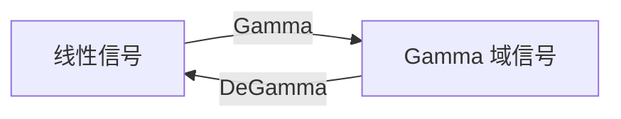

需要区分两个不同维度的概念：

| 概念 | 描述的是什么 |
| --- | --- |
| RAW、RGB、YUV | 图像数据的组织或表示形式 |
| 线性域、Gamma 域 | 信号数值与其原始线性信号之间的映射关系 |

因此：
- RAW 可以是线性的，也可以是经过 Gamma 变换的 RAW。
- RGB 可以是线性 RGB，也可以是经过非线性编码的 RGB。
- Gamma 不会直接将 RAW 转换为 RGB，因为它没有改变图像的颜色采样布局。

在实际工程中，不能仅凭一个张量是 RAW 或 RGB，就判断它是否已经经过 Gamma。

# 2 Gamma 对图像信号与噪声的影响

要理解 Gamma 在 RAW 降噪中的作用，首先需要理解它对真实纹理和传感器噪声分别产生了什么影响。

## 2.1 Gamma 对纹理的影响

图像中的纹理，本质上表现为像素信号在空间上的变化。

例如，一块背景信号为 0.04 的暗部区域，其表面存在一些细微的材质变化：

```text
0.040, 0.042, 0.039, 0.041, 0.038 ...
```

这些像素之间的差值，就是纹理在数值上的表现之一。

第一章已经看到，Gamma 可以放大暗区的局部信号差值。那么，这些纹理的数值变化究竟会被放大多少？

### 用 Gamma 曲线的斜率理解信号变化

曲线的斜率描述的是：输入发生变化时，输出变化得有多快。

例如，输入增加 0.001，而输出增加 0.002，那么这个位置附近的变化倍率就是 2。

对于曲线，斜率并不是固定的。数学上，可以通过导数计算曲线在某个位置的局部斜率。

Gamma 函数的导数为：

$$
G'(x)=\frac{1}{\gamma}x^{1/\gamma-1}
$$

不需要记住这个公式的求导过程。只需要理解，$G'(x)$ 表示信号 $x$ 附近微小变化经过 Gamma 后的近似倍率。

以 Gamma 1.3 为例：

| 背景信号 | 局部斜率 | 对微小纹理变化的影响 |
| ---: | ---: | --- |
| 0.01 | 2.23 | 放大约 2.23 倍 |
| 0.04 | 1.62 | 放大约 1.62 倍 |
| 0.10 | 1.31 | 放大约 1.31 倍 |
| 0.64 | 0.85 | 缩小至约 0.85 倍 |

例如，在背景信号为 0.04 的暗区，原来幅度为 0.002 的微弱纹理，经过 Gamma 1.3 后，其幅度近似变成：

$$
0.002\times1.62\approx0.00324
$$

这就是 Gamma 拉伸暗部纹理数值幅度的具体含义。

但 RAW 图像中除了真实纹理，还有噪声。Gamma 能够区分它们吗？

## 2.2 Gamma 对噪声的影响

不能。对于 Gamma 来说，它只是在处理像素数值，并不知道某个像素变化来自真实纹理还是随机噪声。

下面使用一块真实砖墙纹理，构造一个低亮度、低对比度的带噪图像，观察 Gamma 前后的变化。

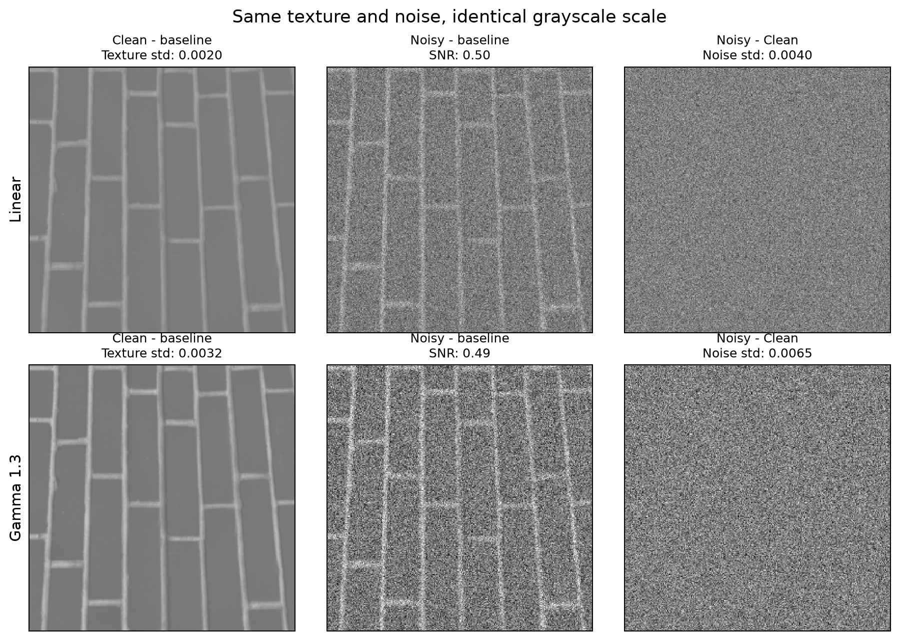

图中：
- 第一行是线性域，第二行是 Gamma 1.3 域。
- 左列是没有附加噪声的纹理。
- 中列是带噪纹理。
- 右列是 Noisy 减去 Clean 得到的噪声差值。

为了直接比较变化幅度，Clean 和 Noisy 都减去了各自信号域中的背景基准值，所有图像采用相同的灰度显示范围，没有分别进行自动亮度拉伸。

可以看到，Gamma 后的砖墙纹理更加明显，但随机噪声也更加明显。

### Gamma 能否提高信噪比？

为了判断纹理是否容易从噪声中被识别，可以使用纹理幅度与噪声标准差的比值。

这里定义局部纹理信噪比为：

$$
\mathrm{SNR}_{\mathrm{texture}} =\frac{\text{纹理幅度}}{\text{噪声标准差}}
$$

对于同一个小范围内的纹理和噪声，如果它们相对于背景信号都足够小，就会受到近似相同的 Gamma 局部斜率影响。

假设暗区的局部 Gamma 放大倍率为 2：

| 指标 | Gamma 前 | Gamma 后 |
| --- | ---: | ---: |
| 纹理幅度 | 0.002 | 0.004 |
| 噪声标准差 | 0.004 | 0.008 |
| 局部纹理信噪比 | 0.5 | 0.5 |

纹理和噪声同时被放大了两倍，但它们之间的相对关系没有改善。

前面的砖墙实验也是如此：Gamma 后纹理的标准差由约 0.0020 增加到 0.0032，噪声的标准差由约 0.0040 增加到 0.0065，而纹理信噪比仍然接近 0.5。

**在局部小扰动条件下，Gamma 不会直接提高纹理信噪比。**

因此，不能简单地将 Gamma 理解为暗部细节恢复。它能够让暗部纹理的数值变化更加明显，但已经被噪声干扰的纹理，不会因为 Gamma 而获得新的有效信息。

## 2.3 Gamma 如何改变噪声统计

虽然 Gamma 不会直接改善同一个局部区域的纹理信噪比，但它会改变不同亮度区域之间的噪声强度关系。

这是另一个非常重要的问题。

### 2.3.1 线性 RAW 中的噪声规律

RAW 噪声主要可以分为两个成分：

| 噪声类型 | 产生原因 | 与信号强度的关系 |
| --- | --- | --- |
| Shot Noise（散粒噪声） | 光子到达的随机性 | 信号越强，噪声方差越大 |
| Read Noise（读出噪声） | 传感器的电子读出过程 | 固定工作条件下近似与信号无关 |

其中，方差是标准差的平方，也用于描述随机变量的波动程度。

这两类噪声的方差通常可以使用以下形式近似描述：

$$
\boxed{\sigma^2=aX+b}
$$

其中：
- $X$：Clean 线性信号。
- $aX$：Shot Noise 的方差。
- $b$：Read Noise 的方差。
- $a$ 和 $b$：与传感器及增益等工作条件有关的噪声参数。

例如，假设暂时只有 Shot Noise：

| Clean 信号 | Shot Noise 方差 | 噪声标准差 |
| ---: | ---: | ---: |
| 0.04 | 0.000004 | 0.002 |
| 0.64 | 0.000064 | 0.008 |

这里采用示例参数 $a=0.0001$。

亮区信号是暗区的 16 倍，噪声方差也是 16 倍，但噪声标准差只有 4 倍，因为标准差等于方差的平方根。

这就是线性 RAW 中信号相关噪声的特点：不同亮度区域具有不同的噪声强度。

### 2.3.2 经过 Gamma 后，噪声规律发生了什么变化？

假设一个 Clean 信号为 $X$，其噪声为 $N$，则带噪输入为：
$$
Y=X+N
$$

对带噪信号执行 Gamma 后，需要用变换后的 Noisy 减去变换后的 Clean，才能得到 Gamma 域中的噪声。

$$
N_\gamma=G(X+N)-G(X)
$$

不能简单地对噪声本身执行 Gamma，因为非线性变换不满足直接拆分相加的关系。

根据前面介绍的局部斜率，当噪声相对于背景信号足够小时：

$$
N_\gamma\approx G'(X)N
$$

也就是说，**噪声幅度近似乘上了 Gamma 的局部斜率**。

例如，所有噪声值都被放大2倍，那么：
- 噪声标准差变成原来的 2 倍。
- 噪声方差变成原来的 4 倍。

因此，Gamma 域中的噪声方差近似为：

$$
\boxed{ \sigma_\gamma^2(X)\approx [G'(X)]^2(aX+b) }
$$

这个公式的关键并不在于计算复杂的幂函数，而在于：**不同亮度区域具有不同的 Gamma 斜率，因此它们的噪声方差会受到不同程度的缩放。**

### 2.3.3 对 Shot Noise 和 Read Noise 的实际影响

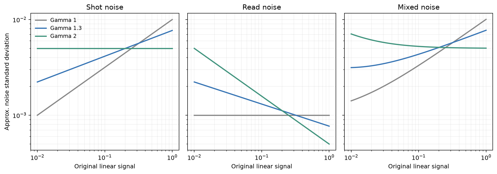

这张图分别展示了只有 Shot Noise、只有 Read Noise，以及两种噪声混合时，Gamma 对噪声标准差的影响。

横轴为原始线性信号，纵轴为对应信号域中的噪声标准差。为了方便观察不同数量级的变化，两个坐标轴都使用对数刻度。

使用的噪声参数是示例参数，不对应某个实际传感器。

**观察左图：Shot Noise**

在线性域中，随着信号增大，Shot Noise 的标准差也在增大。

Gamma 会放大低信号区域的噪声，同时适当压缩高信号区域的噪声。因此，Gamma 1.3 的曲线比线性域更加平缓。

当 Gamma 为 2 时，曲线近似变成水平线，意味着 Shot Noise 的方差近似不再随信号变化。这种思想称为方差稳定化（Variance Stabilization）。

**观察中图：Read Noise**

在线性域中，Read Noise 的标准差近似是固定的。

但 Gamma 对暗区的放大倍率更大，因此原本与信号无关的 Read Noise，经过 Gamma 后反而具有了信号相关性。

**观察右图：混合噪声**

实际 RAW 中同时存在 Shot Noise 和 Read Noise。

Gamma 一方面可以减小 Shot Noise 在不同亮度区域之间的强度差异，另一方面又可能显著放大暗区的 Read Noise。

因此，Gamma 并不一定能让所有亮度区域的噪声变得更加均匀。实际效果取决于传感器的噪声构成，以及采用的 Gamma 参数。

上述分析基于局部小扰动近似。当信号非常接近零，或者噪声幅度相对于信号非常大时，实际噪声统计可能与理论曲线存在较大差异。

---

到这里需要区分两个结论：

- 对同一个局部区域而言，Gamma 同时改变纹理和噪声，不能直接提高纹理信噪比。
- 对不同亮度区域而言，Gamma 改变了它们之间的噪声强度关系。

第二点，正是理解 Gamma 为什么可能有利于降噪网络的基础。

# 3 Gamma 在 RAW 降噪网络中的作用

## 3.1 为什么 RAW 降噪网络使用 Gamma？

考虑两种不同的降噪方案：

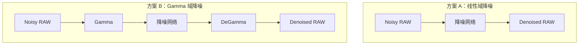

两种方案的输入和最终输出都是线性 RAW，区别仅在于网络内部采用不同的信号表示。

**既然 Gamma 没有增加信息，也没有直接提高信噪比，为什么第二种方案仍然可能取得更好的降噪效果？**

需要从信号表示和噪声统计两个角度理解。

### 3.1.1 改变不同亮度下的结构响应

假设拍摄同一种具有细微纹理的材质，只改变其所处环境的亮度。

在暗区，背景信号为 0.04，纹理幅度为 0.002。

在亮区，背景信号为 0.64，纹理幅度为 0.032。

**两者的相对纹理对比度相同，都是背景信号的 5%，但是在线性 RAW 中，亮区的绝对纹理幅度是暗区的 16 倍。**

经过 Gamma 1.3 后：

| 指标 | 暗区 | 亮区 |
| --- | ---: | ---: |
| 背景信号 | 0.04 | 0.64 |
| 线性域纹理幅度 | 0.002 | 0.032 |
| Gamma 局部斜率 | 1.62 | 0.85 |
| Gamma 域纹理幅度（近似） | 0.00324 | 0.02729 |

此时，**两个区域的纹理幅度差异由原来的 16 倍降低到约 8.4 倍**。

这对神经网络意味着什么？

神经网络通过卷积等操作提取图像特征。例如，最简单的一种局部特征提取操作，就是计算相邻像素之间的差值。

**对于同一种材质，如果它在不同亮度下对应的数值响应差异非常大，那么网络就需要学习如何适应这些不同幅度的特征。**

**Gamma 改变了这种数值分布，使原本幅度差异很大的结构响应变得相对接近。**

**对于有限容量的网络，这种信号表示可能更有利于使用共享的特征提取和恢复策略。**

当然，网络也可以通过训练、归一化及条件输入等方式，自行学习适应不同亮度的特征。因此，Gamma 并不是实现这一目标的唯一方式。

而且，暗部纹理的数值幅度增大时，噪声也会增大。

Gamma 改善的是网络处理信号的数值条件，而不是暗部纹理本身所包含的信息。

### 3.1.2 改变网络需要适应的噪声范围

**除了纹理，降噪网络还需要适应不同亮度区域的噪声强度**。

继续使用第二章中只有 Shot Noise 的例子：

| 区域 | Clean 信号 | 线性域噪声标准差 |
| --- | ---: | ---: |
| 暗区 | 0.04 | 0.002 |
| 亮区 | 0.64 | 0.008 |

亮区噪声标准差是暗区的 4 倍。

为了理解这会给降噪带来什么困难，可以先考虑一种非常简单的降噪方法：根据局部信号变化的幅度，判断它更可能是纹理还是噪声。

假设使用一个固定阈值：

- 阈值过小，亮区中幅度较大的噪声可能无法被有效抑制。
- 阈值过大，暗区中本来就很微弱的纹理可能被错误抹除。

这说明，同一套降噪规则很难直接适用于噪声强度差异很大的区域。

现在对两个区域执行 Gamma 1.3：

| 区域 | 原始噪声标准差 | Gamma 后噪声标准差 |
| --- | ---: | ---: |
| 暗区 | 0.002 | 0.00323 |
| 亮区 | 0.008 | 0.00682 |
| 亮区与暗区的噪声强度比 | 4.00 倍 | 2.11 倍 |

Gamma 并没有把两个区域的噪声都减小，而是通过放大暗区噪声、压缩亮区噪声，使不同区域的噪声尺度变得更加接近。

这样，降噪算法需要适应的噪声幅度范围就可能更小。

实际的神经网络当然不是简单的固定阈值滤波器。但它同样需要从训练数据中学习如何区分真实结构与不同强度的噪声。

当不同亮度区域的噪声统计更加接近时，有限容量的网络可能更容易共享降噪策略，而不需要学习过多与亮度相关的处理差异。

这也是方差稳定化方法用于图像降噪的主要动机之一。

不过，真实传感器还存在 Read Noise，降噪网络也可能具有显式的噪声条件输入。因此，不能直接认为 Gamma 一定能够减小整个训练数据集的噪声差异。

**Gamma 在 RAW 降噪中的价值，不是让带噪图像本身变得更干净，而是通过重新表示信号，改变有限容量网络所面对的学习问题。**

## 3.2 网络处理域与 Loss 计算域

理解 Gamma 在训练中的作用，还需要明确一个容易混淆的问题：

网络在 Gamma 域中执行降噪，是否意味着 Loss 也应该在 Gamma 域中计算？

实际上，这是两个独立的设计选择。

### 3.2.1 三种常见的训练方式

```mermaid
flowchart TD
    subgraph A["A：线性域网络，线性域 Loss"]
        direction LR
        A1["Noisy RAW"] --> A2["Network"]
        A2 --> A3["Linear Prediction"]
        A3 --> A4["Linear Loss"]
    end

    subgraph B["B：Gamma 域网络，Gamma 域 Loss"]
        direction LR
        B1["Noisy RAW"] --> B2["Gamma"]
        B2 --> B3["Network"]
        B3 --> B4["Gamma Loss"]
    end

    subgraph C["C：Gamma 域网络，线性域 Loss"]
        direction LR
        C1["Noisy RAW"] --> C2["Gamma"]
        C2 --> C3["Network"]
        C3 --> C4["DeGamma"]
        C4 --> C5["Linear Loss"]
    end
```

三种方案的区别：

| 方式 | 网络输入输出 | Loss 比较的信号 |
| --- | --- | --- |
| A | 线性 RAW | 线性预测与线性 Target |
| B | Gamma RAW | Gamma 预测与 Gamma Target |
| C | Gamma RAW | DeGamma 后的预测与线性 Target |

对于方式 B，监督 Target 也需要进行对应的 Gamma 变换。

对于方式 C，网络输出需要先执行 DeGamma，恢复到线性 RAW 域，再与原始线性 Target 计算 Loss。

本文后续重点介绍方式 C。

### 3.2.2 为什么 Loss 所在的信号域很重要？

假设暗区和亮区的两个像素都产生了相同大小的线性预测误差：

| 区域 | 监督 Target | 网络预测值（线性域） | 线性误差 |
| --- | ---: | ---: | ---: |
| 暗区 | 0.040 | 0.041 | 0.001 |
| 亮区 | 0.640 | 0.641 | 0.001 |

如果直接在线性域计算 L1 Loss，那么两个像素的误差都是 0.001。

但是，如果先对预测值和 Target 执行 Gamma 1.3，再计算 L1 Loss，由于暗区和亮区具有不同的局部斜率，得到的误差就不一样了。

| 区域 | 线性域 L1 | Gamma 域 L1（近似） |
| --- | ---: | ---: |
| 暗区 | 0.001 | 0.00162 |
| 亮区 | 0.001 | 0.00085 |

相同大小的线性预测误差，在 Gamma 域中，暗区受到的惩罚更大。

因此，选择 Gamma 域 L1，相当于对不同亮度下的线性误差施加了不同程度的权重。

这解释了网络输入 Gamma 和 Loss Gamma 的区别：

- 网络输入 Gamma，主要改变网络处理信号时的数值分布。
- Gamma 域 Loss，进一步改变训练时对不同预测误差的评价方式。

如果采用 Gamma 域网络、线性域 Loss，那么网络虽然接收到经过 Gamma 拉伸的暗部信号，但最终仍然按照线性 RAW 误差进行评价。

不能因此认为暗区 Loss 的权重已经被 Gamma 直接提高。

### DeGamma 会影响反向传播吗？

会。

虽然最终 Loss 在线性域计算，但网络实际输出的是 Gamma 域信号。

当网络输出发生微小变化时，这个变化需要先经过 DeGamma，才能影响最终的线性预测值。

由于 DeGamma 同样是非线性变换，所以相同大小的 Gamma 域输出变化，在暗区和亮区可能产生不同大小的线性变化。

因此，DeGamma 也会影响 Loss 梯度传递回网络的方式。

这里不需要展开反向传播的数学推导。只需要明确：**网络处理域、Loss 计算域以及梯度传递方式，并不是完全相同的概念。**

## 3.3 Gamma 参数应该如何选择？

传统图像编码中经常听到 Gamma 2.2，而某些 RAW 降噪网络采用 Gamma 1.3。

为什么不是直接使用 2.2？

回顾第二章中的例子，比较不同 Gamma 参数对于两个亮度区域的影响：

| Gamma | 暗区局部变化倍率（X=0.04） | 亮区局部变化倍率（X=0.64） |
| ---: | ---: | ---: |
| 1.0 | 1.00 | 1.00 |
| 1.3 | 1.62 | 0.85 |
| 2.0 | 2.50 | 0.63 |
| 2.2 | 2.63 | 0.58 |

Gamma 参数越大，暗部数值通常受到更强的拉伸，亮部受到更明显的压缩。

**对于 RAW 降噪，这同时带来两个方面的影响：**
- **更强的 Gamma 可以进一步减小不同亮度区域之间的部分信号和 Shot Noise 幅度差异。**
- **更强的 Gamma 也会更加明显地放大暗区 Read Noise，并改变原本的噪声分布。**

因此，不能只根据暗部纹理被放大多少，就判断某个 Gamma 参数是否更好。

| Gamma 参数 | 可以怎样理解 |
| --- | --- |
| 1.0 | 不进行非线性变换，直接处理线性 RAW |
| 1.3 | 进行比较温和的信号重分配 |
| 2.0 | 对纯 Shot Noise 具有近似方差稳定作用 |
| 2.2 | 更强的非线性变换，不代表更适合 RAW 降噪 |

**选择 Gamma 1.3，可以理解为一种折中的工程设计：适度拉伸低信号区域，调整不同亮度下的噪声尺度，同时避免采用过强的非线性变换**。

但这只是理解其设计动机的一种方式，并不能证明 1.3 是最优参数。

具体选择仍然需要结合传感器噪声特性、网络容量、训练方式和最终降噪效果。

# 4 Gamma 在实际降噪工程中的实现

前面已经理解了 Gamma 的作用。接下来以一种采用 Gamma 1.3 的递归 RAW 降噪实现为例，将 Gamma 和 DeGamma 放回完整的训练、推理和 ISP 链路中理解。

## 4.1 实际 RAW 中的 Gamma

前面使用的 Gamma 公式：

$$
y=x^{1/\gamma}
$$

默认输入 $x$ 已经归一化到 0～1，并且 0 对应没有有效光信号的情况。

但实际 RAW 通常并不是这样的。

例如，一个 12-bit RAW 数值域可能具有以下约定：

| 参数 | 数值 |
| --- | ---: |
| Black Level（黑电平） | 300 |
| White Level（有效信号上限） | 4095 |

Black Level 是零有效光信号对应的基准偏置。因此，即使没有入射光，RAW 数值也可能在 300 附近波动。

对于一个 RAW 像素值 500，其中真正高于 Black Level 的有效信号只有：

$$
500-300=200
$$

### 为什么不能直接对 RAW DN 做 Gamma？

如果将 RAW DN 直接除以 4095，再执行 Gamma 1.3，最后乘回 4095，那么原本的黑电平会变成：

$$
4095\times \left(\frac{300}{4095}\right)^{1/1.3} \approx548.37
$$

原本代表零有效光信号的 300 DN，被变成了约 548 DN。

如果工程中的其他处理仍然认为 Black Level 是 300，就会错误地把其中一部分数值当成有效光信号。

为了保持 Black Level 不变，一种实现采用以下方式：

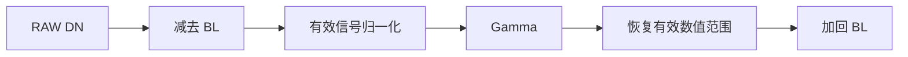

例如，对于 RAW DN=500：

| 处理步骤 | 数值 |
| --- | ---: |
| 原始 RAW DN | 500 |
| 减去 BL | 200 |
| 除以有效信号范围 3795 | 0.05270 |
| Gamma 1.3 | 约 0.10394 |
| 乘回 3795，再加回 BL | 约 694.4 |

对应的完整公式为：

$$
G(I)=BL+(WL-BL) \left(\frac{I-BL}{WL-BL}\right)^{1/\gamma}
$$

执行 DeGamma 时，采用相同的减 BL、归一化和恢复范围过程，只需要将幂函数的指数由 $1/\gamma$ 改为 $\gamma$。

对于低于 Black Level 的噪声波动，由于有效信号为负，直接计算分数次幂可能出现数值问题。一种处理方式是让低于或等于 Black Level 的像素保持原值。

需要注意，并不是所有工程都必须加回 Black Level。也可以直接在去除黑电平后的有效信号域中处理。

关键在于：整个系统必须采用一致的数值域约定。

## 4.2 训练中的 Gamma 和 DeGamma

一种采用 Gamma 域网络、线性域 Loss 的训练流程如下：

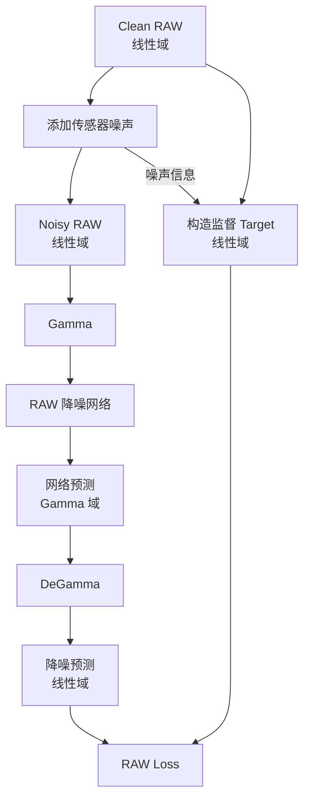

理解这张图时，需要关注三个问题。

### 为什么先加噪，再做 Gamma？

因为实际传感器噪声通常是在线性 RAW 域中建模的。

我们希望模拟的过程是：

```text
线性 Clean + 传感器噪声 → Noisy RAW → Gamma
```

这样，真实信号和噪声都会受到 Gamma 的非线性变换。

如果先对 Clean 执行 Gamma，再直接添加原来线性域中的噪声，那么噪声没有经过应有的 Gamma 变换，得到的噪声统计就会与实际输入不一致。

### 网络输出为什么仍然在 Gamma 域？

因为这一实现将 Gamma 域中的降噪映射作为网络的学习目标。

网络输入是经过 Gamma 的 Noisy RAW，输出是经过降噪的 Gamma 域信号。

这里的输出信号虽然已经完成降噪，但仍然没有恢复原来的线性数值关系。

### 为什么 Loss 前需要执行 DeGamma？

因为监督 Target 位于线性 RAW 域。

如果直接将 Gamma 域预测与线性 Target 比较，那么即使网络已经准确恢复了图像信号，也会因为两者的数值表示不同而产生错误的 Loss。

因此，需要先执行 DeGamma，再进行比较。

这里的 Target 可以是无噪 Clean，也可以是在 Clean 基础上构造的受控残噪目标。关键不是 Target 是否完全无噪，而是预测结果与监督目标必须处于相同的信号域。

整个训练过程可以概括为：

**在线性域构造数据和监督目标，在 Gamma 域执行降噪，最终回到线性域评价预测误差。**

## 4.3 推理与时域递归中的 Gamma

### 4.3.1 推理过程

推理与训练的主要区别，是不再需要构造 Clean、监督 Target 和 Loss。

但网络的输入输出域必须保持一致。

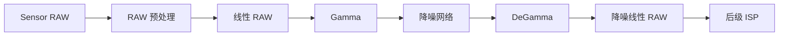

假设某个像素的有效线性信号为 0.04，Gamma 1.3 后约为 0.08407。

如果降噪网络已经准确恢复了这个 Gamma 域信号，那么不同的输出处理会得到：

| 输出处理 | 后续收到的有效信号 |
| --- | ---: |
| 正确执行 DeGamma | 0.04000 |
| 遗漏 DeGamma | 0.08407 |
| 重复执行 DeGamma | 约 0.01523 |

因此：

- 遗漏 DeGamma，会将偏大的 Gamma 编码值错误地当成线性信号。
- 重复执行 DeGamma，则会对已经恢复的线性信号再次进行非线性压缩。

两者都会破坏原来的信号关系，并进一步影响后级 ISP 的亮度和颜色处理。

### 4.3.2 时域递归中的历史状态

与单帧降噪不同，时域降噪还需要使用上一帧的信息。

假设一种递归降噪网络具有两个图像输入：

- Cur：当前带噪帧。
- Ref：上一帧的降噪结果。

由于网络在 Gamma 域中执行，所以 Cur 和 Ref 都需要处于 Gamma 域。

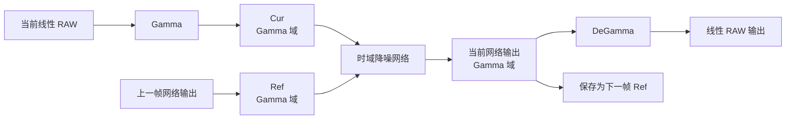

这里最值得注意的是，网络输出存在两个不同的用途。

| 用途 | 如何处理 |
| --- | --- |
| 作为当前帧最终 RAW 输出 | 执行 DeGamma |
| 作为下一帧的 Ref | 直接保留 Gamma 域输出 |

为什么不能直接将 DeGamma 后的结果作为下一帧 Ref？

假设当前帧和上一帧对应位置的真实有效信号都是 0.04。

正确的 Ref 和 Cur 应该为：

```text
Cur = 0.08407
Ref = 0.08407
```

但如果错误地将上一帧 DeGamma 后的结果直接作为 Ref：

```text
Cur = 0.08407
Ref = 0.04000
```

两个实际相同的信号，会因为处于不同信号域而出现明显的数值差异。

对于依赖 Ref 和 Cur 进行历史融合的网络，这种人为引入的差异会破坏训练时建立的信号关系。

当然，也可以选择保存线性域历史，然后在下一帧输入网络前重新执行 Gamma。

但如果网络本身已经输出 Gamma 域信号，直接保留这个结果作为历史状态会更加直接，也避免了不必要的数值往返转换。

首帧没有历史结果时，一种常见处理方式是将当前 Gamma 域带噪帧同时作为 Ref 和 Cur。

### 4.3.3 DeGamma 一定在神经网络内部吗？

不一定。

需要区分神经网络本体和完整的降噪处理模块。

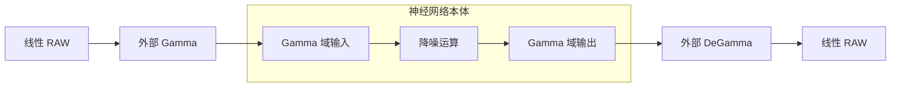

Gamma 和 DeGamma 可以直接包含在网络计算图中，也可以由网络外部的软件处理、定点运算或硬件 LUT 完成。

因此，一个导出的神经网络中即使没有 Gamma 和 DeGamma 算子，也不代表完整的 AIBNR 系统没有这两个操作。

判断一个系统是否包含 DeGamma，需要查看完整的输入输出处理链路，而不是只检查模型结构。

对于量化部署，还需要注意 Gamma 和 DeGamma 的有限精度实现。LUT 插值、定点舍入和数值截断，都可能使正向和逆向变换不再严格互逆。

## 4.4 AIBNR Gamma 与 ISP Gamma 的区别

在一个完整的图像系统中，经常不止出现一次 Gamma。

例如，一种 AIBNR 实现采用 Gamma 1.3，训练时的 YUV Loss 分支采用 Gamma 1.8，后级 ISP 还可能具有独立的 Gamma 曲线。

它们是否相互冲突？

不会，因为它们具有不同的用途。

### 4.4.1 训练中的 YUV Loss Gamma

有些降噪网络除了直接计算 RAW Loss，还会将预测结果与监督 Target 转换为 RGB 或 YUV，再计算相应的 Loss。

目的是让训练不仅关注 RAW 数值误差，也关注经过图像处理后的亮度和颜色表现。

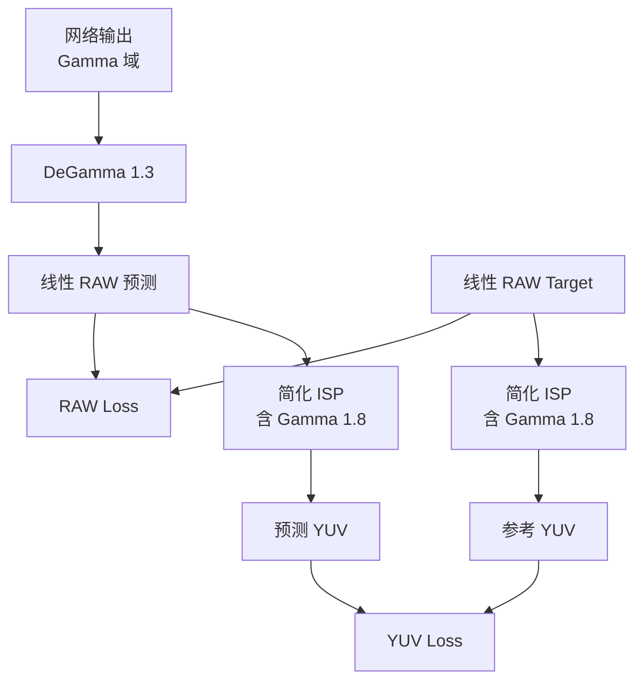

这里的 Gamma 1.8，并不是用于抵消网络输入的 Gamma 1.3。

Gamma 1.3 已经通过对应的 DeGamma 完成逆变换。

Gamma 1.8 属于另外一条监督分支，用于构造计算 YUV Loss 所需要的图像表示。

两者不要求使用相同的 Gamma 参数。

### 4.4.2 推理中的 ISP Gamma

一种典型的 RAW 降噪与后级 ISP 逻辑链路为：

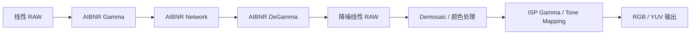

AIBNR 的 Gamma 用于调整网络处理的信号表示；DeGamma 用于恢复线性 RAW。

ISP 中的 Gamma 则服务于最终图像的亮度表现、编码和显示。

具体 ISP 的模块顺序和曲线实现可能不同，但两类 Gamma 的设计目的并不相同。

因此，即使后级 ISP 中已经存在 Gamma，也不能认为 AIBNR 不再需要 DeGamma。

如果 AIBNR 输出仍然处于 Gamma 域，而后级 ISP 期待的是线性 RAW，那么两者之间就存在信号域不一致的问题。

---

| Gamma 类型 | 使用位置 | 作用 |
| --- | --- | --- |
| AIBNR Gamma | 网络输入前 | 改变网络处理的信号表示 |
| AIBNR DeGamma | 线性 Loss 或最终 RAW 输出前 | 恢复线性信号 |
| Loss Gamma | RGB/YUV 监督分支 | 改变监督所关注的图像表示 |
| ISP Gamma | 后级 ISP | 图像亮度映射、编码与显示 |

# 5 总结

Gamma 是一种非线性信号变换，DeGamma 是它的逆变换。

传统图像处理利用 Gamma 匹配显示系统，并在有限位深下重新分配编码精度；RAW 降噪网络则利用它改变信号表示和噪声统计，从而改变网络需要学习的问题。

对于一种采用 Gamma 域的递归 RAW 降噪实现：

- 在线性 RAW 域构造传感器噪声。
- 入模前执行 Gamma。
- Cur、Ref 和网络输出保持在 Gamma 域。
- 计算线性 RAW Loss 和输出最终 RAW 前执行 DeGamma。
- 后级 ISP 使用独立的 Gamma 设计。

理解 Gamma 时，最重要的是始终明确三个问题：

1. 当前信号处于什么域？
2. 为什么需要改变它的数值表示？
3. 下一步处理需要什么信号域？

只要这三个问题明确，就能够理解 Gamma 和 DeGamma 在不同图像处理链路中的作用。
