弱纹理恢复的困难，不只是“噪声还没有去干净”。同一块织物上的亮度起伏，既可能是真实编织结构，也可能来自随机噪声；一条接近像素宽度的细线，还会受到采样位置、颜色滤波阵列和运动的共同影响。如果训练数据只强调明显边缘，或者把带有残噪、模糊的参考当作 Clean，模型就很难学到正确的取舍。

本文讨论一条以数据为中心的路线：**先获得可信的结构，再控制它以多大幅度、什么尺度、在怎样的噪声和运动条件下进入模型。**

整个流程分为三部分：明确数据要求；通过真实 RAW 和程序化生成两条路线制作 Clean 母素材；从母素材构造 RAW 时序训练样本。VibrantLeaves 是其中的可控素材生成工具，而不是整套方案的替代品。

文中区分“官方代码生成样例”和“自制原理示意”，均不是本文训练的降噪模型输出。公开论文的实验结果单独注明出处；本文不报告未经验证的传感器实测收益。

## 1 问题背景与数据要求

### 1.1 弱纹理为什么容易与噪声混淆

在一个局部区域内，把扣除黑电平后的线性 Clean 写成：

$$
\begin{aligned} X(\mathbf p)&=m(\mathbf p)+a\,T(\mathbf p),\\ Y(\mathbf p)&=X(\mathbf p)+n(\mathbf p). \end{aligned}
$$

$m$ 是背景或缓变分量，$T$ 表示结构形态，$a$ 控制纹理起伏幅度，$n$ 是采集噪声。这个分解用于分析，不意味着真实材质一定能被无损拆开。

当 $aT$ 与噪声处于相近量级时，仅凭单个像素无法可靠地区分二者。方向连续性、重复间距、邻域关联和跨帧一致性，才提供了额外证据。细结构还有一个更直接的问题：**如果进入模型前就被采样或量化抹掉，网络没有足够观测信息把它唯一恢复出来。**

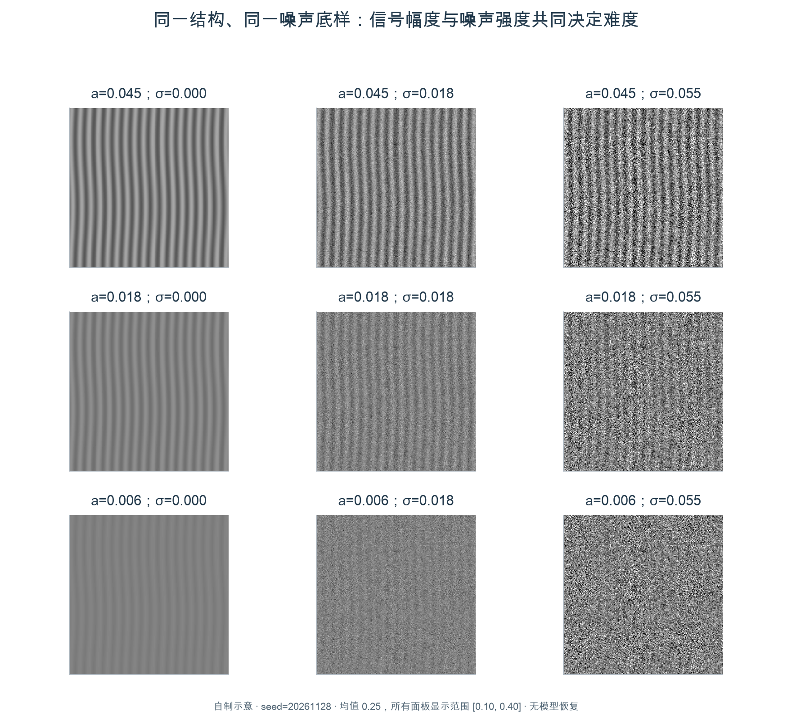

图 1｜自制信号实验。同一底层纹理共享相位和形变场，噪声也使用同一个标准正态底样，仅改变幅度。所有面板使用相同显示范围。应同时看横向的噪声变化和纵向的纹理变化，不能把“看起来干净”等同于“纹理更真实”。

对于常见的信号相关噪声近似：

$$
\operatorname{Var}[n\mid X]\approx\alpha X+\beta, \qquad \alpha>0,\ \beta\geq0.
$$

$\alpha$ 和 $\beta$ 必须对应同一数据域及归一化约定。泊松—高斯模型把光子相关分量与读出等扰动分开建模，其适用条件及截断问题可参见 [Foi 等人的原始研究](https://webpages.tuni.fi/foi/papers/Foi-PoissonianGaussianClippedRaw-2007-IEEE_TIP.pdf)。实际传感器还可能包含行列噪声、暗电流、固定图样及更复杂的读出分布，不能默认都由两个参数解释。

若 $T$ 在局部区域归一化为单位 RMS，那么

$$
\frac{a}{\sqrt{\alpha m+\beta}}
$$

可以帮助理解局部信号难度，但不是通用可恢复性指标：结构尺度、方向、采样相位和连续范围仍然重要。

还应区分两种“降低亮度”：

- **固定绝对纹理幅度，降低背景 $m$**：信号相关噪声可能变小，不保证更难。
- **固定相对对比度，降低曝光**：背景和纹理一起变弱，读噪占比通常上升，往往更难。

因此，不能只把“暗部”“极弱纹理”当作难度标签。应记录生成方式，并在最终带噪输入域中判断。

### 1.2 数据需要覆盖哪些结构

| 内容类型 | 典型内容 | 希望模型学到的能力 |
| --- | --- | --- |
| 自然弱纹理 | 木纹、织物、纸纹、墙面细纹、颗粒材质 | 保留低对比的真实材质变化，而不是一律平滑 |
| 重复细结构 | 平行细线、滤网、编织、规则与准规则网格 | 保持线宽、间距、方向及重复关系，避免粘连和变形 |
| 局部几何结构 | 细笔画、直线、曲线、转角、交点、狭窄缝隙 | 保持形状、连接关系和边界位置，避免断裂与扭曲 |
| 平坦与缓变区域 | 均匀表面、缓慢光照变化、柔和边缘、纹理渐消区域 | 不生成虚假纹理、颗粒或不自然的硬边 |

这些类别还要满足两个共同要求。

**粗细结构共存。** 布料的褶皱与编织纹理、木材的大尺度走势与细弱纤维，属于同一表面的不同尺度。只有粗结构容易忽略材质，只有微纹理又缺少组织细节的上下文。

**足够的空间连续性。** 一两个高频像素不足以表达线条延续、周期稳定性或材质方向。Patch 应容纳一定数量的结构单元，并覆盖结构与平坦区域的过渡。

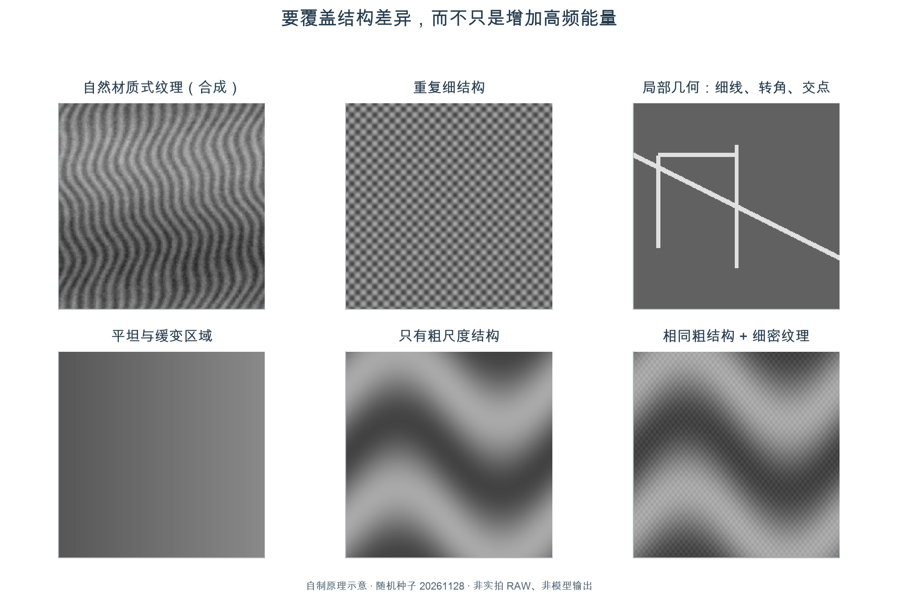

图 2｜自制结构示意，左上为木纹式合成信号，并非真实木材照片。下排右侧在相同粗结构上叠加细密纹理。应观察细结构与整体形态的关系，而不仅是哪个区域“高频更多”。

### 1.3 控制内容，也控制内容进入模型时的条件

| 控制维度 | 需要覆盖的因素 | 需要防止的错误 |
| --- | --- | --- |
| 信号难度 | 纹理幅度、背景亮度、噪声强度、颜色与色度 | 把亮度标签当成难度，或只保留极端困难样本 |
| 空间结构 | 尺度、线宽、间距、方向、形状、规则性与密度 | 只增加随机高频，却没有连续结构 |
| 局部成像 | 柔和与清晰边界、周围内容、采样相位、饱和和暗部 | 重采样、裁剪或提前量化意外改变目标结构 |
| 时间条件 | 静态、微动、平移、小旋转及时间连续性 | 拼接不连续的帧，或输入和监督错位 |

优先控制**纹理幅度 × 结构尺度 × 背景亮度 × 噪声强度**。不必穷举所有组合，但应覆盖实际问题里的关键交互。

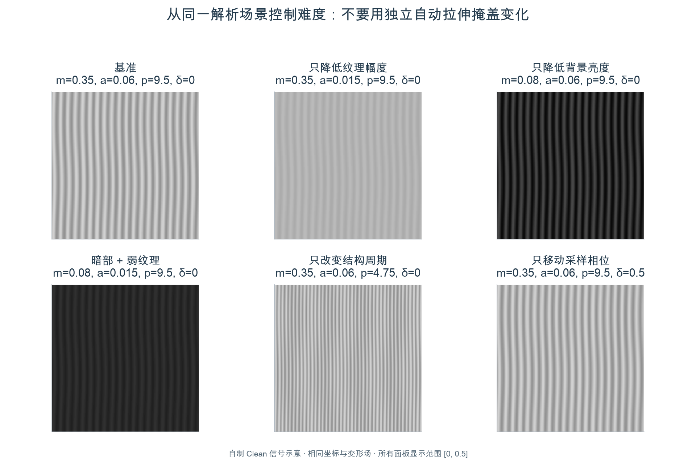

图 3｜同一解析场景的六种 Clean 变体，分别记录背景、幅度、周期和采样偏移。这里只比较 Clean，尚未加入噪声；所有面板显示范围一致。降低背景但保持绝对幅度，与降低曝光并不等价。

同时保留容易、中等和困难样本，不让训练只面对不可辨认的输入；保留真正平坦的对照，不为了“纹理含量”全部剔除。Clean 中存在明确结构、加噪后很难辨认，是允许的；生成错误造成结构消失或标签错位，不是合法的难度增强。

### 1.4 什么叫可信的 Clean

本文的 Clean 指**噪声足够低、结构可信的训练参考**，不是严格无噪声的物理真值。它至少应满足：

- 随机残噪低于需要监督的纹理幅度，且估计方法与局限可说明。
- 线宽、间距、对比度与连续性没有被平均、插值或锐化破坏。
- 坏点、固定条纹、运动残影、截断与饱和没有被误当成材质。
- 数据域、Black Level、White Level、CFA、有效位深及归一化明确。
- 来源、有效区域、制作参数和随机种子可追溯。

参考图里的系统误差，不会因为被命名为 GT 就变得正确。

## 2 素材构造与 Clean 制作

真实 RAW 提供真实材质、光学及传感器采样关系；程序化生成提供明确的结构参数和可控难度。两条路线应互补，而不是预设一条能替代另一条。

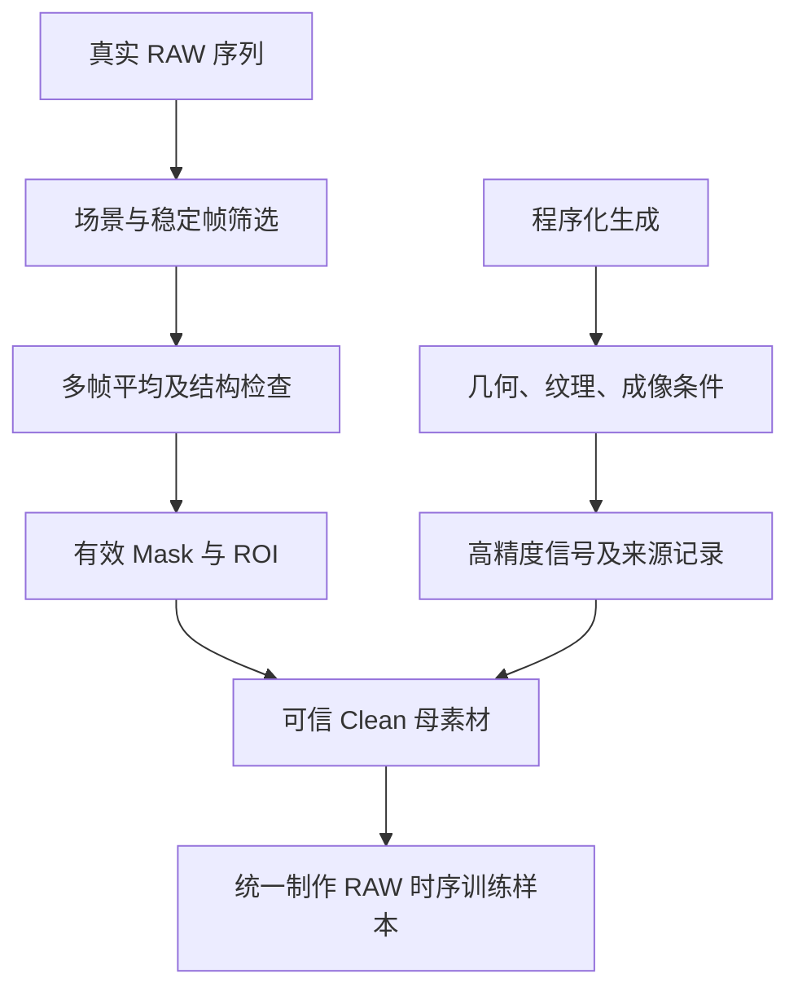

### 2.1 真实 RAW：从稳定采集到可信参考

#### 2.1.1 为什么低 ISO 不必然意味着可靠的 Clean

低 ISO 只是采集设置之一。曝光不足时仍可能噪声明显；延长曝光可能引入物体运动、抖动和照明变化；固定图样、热像素、饱和与焦点错误也不会自动消失。

先检查细纹理是否合焦，有无过曝或暗部截断，曝光、增益及相关元数据是否一致，有无闪烁光源、滚动快门畸变和场景运动。用于观察的去马赛克预览不能带有会掩盖问题的降噪、锐化或局部对比度增强。

**一张很干净但纹理已经模糊的图，不是细结构恢复任务需要的好参考。**

#### 2.1.2 用指标缩小候选池，但不让指标代替内容判断

可以先读取代表帧和少量探针帧，生成接触表，再按目标结构筛选。

| 指标 | 主要用途 | 解释边界 |
| --- | --- | --- |
| 均值、分位数、黑白电平附近占比 | 识别亮度分布、暗部和饱和 | 不同传感器的 DN 不能直接横比 |
| Laplacian 方差、梯度强度 | 发现边缘及局部变化 | 噪声和锐化伪影也会抬高分数 |
| 多尺度带通能量、局部标准差 | 比较粗细结构分布 | 需考虑噪声底，不能把残噪当微纹理 |
| 方向相干性、FFT 周期性 | 寻找方向性和重复结构 | 强周期不代表自然材质，弱纹理也未必有尖锐谱峰 |
| 相位相关、NCC、帧间差异 | 辅助检查位移及稳定性 | 亮度变化、混叠与低信噪比会影响判断 |

最终仍需看缩略图及局部放大，区分材质、边缘、噪声与伪影。这里不假定已有可靠的自动语义分类器，更不把“高频强度”定义为“纹理质量”。

#### 2.1.3 稳定帧筛选：先排除会损伤结构的平均

稳定性要同时检查亮度、结构与几何，不能只看相邻帧是否相似。

1. **探针抽样。** 均匀抽取少量帧，并在疑似变化区间加密，避免全量读取后才发现序列不可用。
2. **亮度稳定性。** 比较可靠区域的均值、分位数和局部变化，识别曝光漂移、闪烁和局部照明变化。
3. **结构稳定性。** 联合清晰度、方向及局部差异，排除失焦、运动物体和抖动。
4. **几何稳定性。** 检查位移及累计量。相邻探针移动很少，不代表整个序列没有缓慢漂移。
5. **有效区间。** 采用连续稳定段，并检查最终参与平均的帧，而非只依赖探针通过率。

例如，一份实现可以从数十个探针开始，用相对亮度偏差与 DN 容差共同筛选，再从稳定区间取数十至上百帧。数量取决于噪声目标、曝光和运动，不存在一个固定最佳帧数。

DN 阈值不能跨位深、增益和黑电平直接复用。“允许 1 像素位移”对几像素周期的结构也可能过宽；相位相关给出位移数值，不代表亚像素细节已经对齐。需要配准时，应采用适合 CFA 的处理，并检查配准插值本身是否损伤结构。

#### 2.1.4 多帧平均：噪声下降有条件

对同一位置 $\mathbf p$，考虑：

$$
\begin{aligned} I_t(\mathbf p)&=X(\mathbf p)+b(\mathbf p)+n_t(\mathbf p),\\ C_N(\mathbf p)&=\frac1N\sum_{t=1}^N I_t(\mathbf p). \end{aligned}
$$

$b$ 是各帧共有的偏差，例如未校正的固定图样；$n_t$ 是零均值随机部分。一般情况下：

$$
\operatorname{Var}[C_N] =\frac1{N^2}\sum_{i=1}^N\sum_{j=1}^N\operatorname{Cov}(n_i,n_j).
$$

若噪声跨帧独立、各帧方差相同，且场景与采集条件稳定：

$$
\operatorname{Var}[C_N]=\frac{\sigma^2}{N}, \qquad \sigma_{C_N}=\frac{\sigma}{\sqrt N}.
$$

对等方差、两两相关系数为 $\rho$ 的示例模型：

$$
\operatorname{Var}[C_N]=\sigma^2\left(\frac{1-\rho}{N}+\rho\right).
$$

正相关分量带来噪声下限；固定偏差 $b$ 原样保留。饱和、截断或错误黑电平造成的偏差，同样不能靠增加帧数消除。

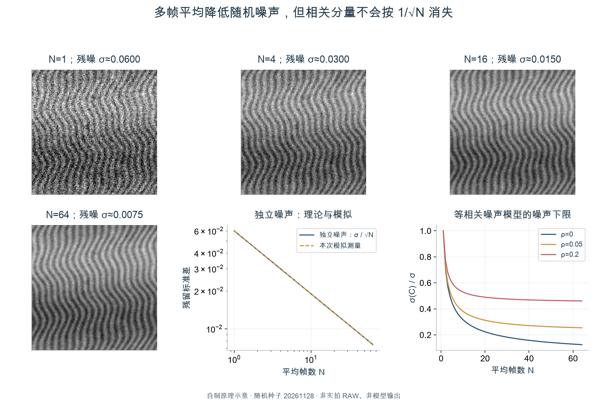

图 4｜自制数值实验。前四个面板从相同母信号生成独立高斯噪声帧，显示范围一致；曲线比较独立噪声的理论与测量，以及等相关模型下的标准差。这里只验证噪声平均关系，不证明模型恢复能力。

运动是另一个独立问题：即使噪声完全独立，只要结构在各帧坐标中没有对齐，平均就可能产生模糊。噪声下降和纹理保真必须分别检查。

#### 2.1.5 奇偶帧 A/B 平均与半差 D

将选中的 $N=2K$ 帧按时间交替分成两组：

$$
\begin{aligned} A&=\frac1K\sum_{k=0}^{K-1}I_{2k},\\ B&=\frac1K\sum_{k=0}^{K-1}I_{2k+1}. \end{aligned}
$$

定义：

$$
C=\frac{A+B}{2},\qquad D=\frac{A-B}{2}.
$$

等量分组时，$C$ 等价于全帧平均。如果两组随机残噪独立且统计相同：

$$
\operatorname{Var}(C-X-b)=\operatorname{Var}(D)=\frac{\sigma^2}{2K}.
$$

因此，$D$ 可以帮助估计 $C$ 的随机残噪量级。实际应在局部可靠区域结合空间统计或噪声模型估计，不能把单个像素的 $|D|$ 当作确定误差上界。

奇偶交替让两组覆盖相近的采集时间，通常比前后两半更能减轻缓慢变化造成的组间偏差。但这不是漂移校正，也不保证两组独立：跨帧相关噪声、周期闪烁和曝光交替都可能破坏条件。

若两组噪声方差均为 $v$、协方差为 $c$：

$$
\begin{aligned} \operatorname{Var}\left(\frac{n_A+n_B}{2}\right)&=\frac{v+c}{2},\\ \operatorname{Var}\left(\frac{n_A-n_B}{2}\right)&=\frac{v-c}{2}. \end{aligned}
$$

正相关会让半差低估平均参考里的随机误差。两组共有的固定图样和模糊，也会在相减时抵消。

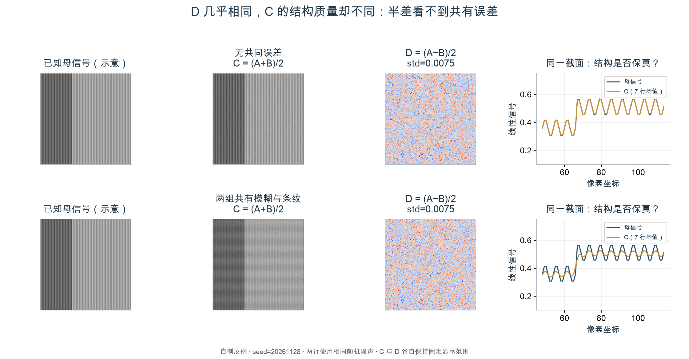

图 5｜自制反例。下排给两组同时加入相同模糊与条纹，随机噪声与上排完全相同，因此两行 $D$ 相同，但 $C$ 的细线和边界已经不同。半差不能证明结构保真；仍需检查线宽、间距、对比度及与清晰单帧的对应关系。

两组帧数不等时，使用

$$
C=\frac{N_AA+N_BB}{N_A+N_B}
$$

恢复全帧平均，不能直接沿用“半差与最终平均的噪声方差相同”的结论。为了使检查易于解释，可优先等量分组，并明确处理多出的一帧。

#### 2.1.6 Mask 与 ROI：可信区域和有价值区域不是一回事

平均图可能同时含有静止墙面、运动残影、过曝灯具和近黑区域，不能整张无条件用于训练。

**有效 Mask 回答“哪里可信”。** 综合检查时间变化是否符合预期噪声、A/B 差异是否异常、是否存在饱和或截断、坏点和几何无效边界，并在目标尺度检查失焦、平均模糊和插值损伤。A/B 检查对共有误差不敏感，不能替代后者。

二值 Mask 可保存为 0/255 或布尔值，关键是明确语义。使用软置信度或带 Mask 的损失时，还需保证训练接口确实使用这些信息，不能仅将其保存。

**ROI 回答“哪里值得训练”。** 先通过有效性检查，再按自然纹理、重复结构和局部几何选择内容。平坦缓变区域仍应按比例保留，不能作为“低分区域”全部丢弃。

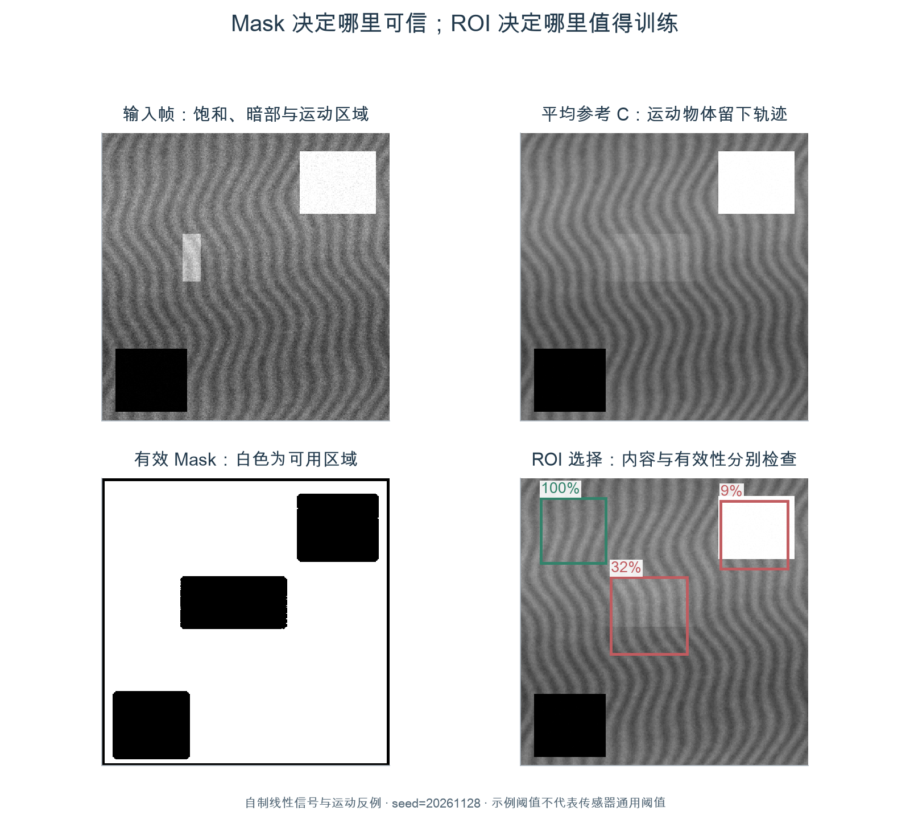

图 6｜自制序列中的饱和块、近黑区域和运动物体。平均降低随机噪声，却保留运动轨迹。Mask 排除不可信区域；ROI 还要结合内容判断。方框标注有效像素比例，绿色和红色分别表示本例可用与不可用。

需要完整监督的 Patch 应避开无效像素，并为插值核和运动轨迹留足边界。不能把残影、无效区域补零或插值填洞后，继续当作真实 Clean。

### 2.2 程序化路线：用明确规则补齐真实素材的覆盖

#### 2.2.1 VibrantLeaves 提供什么，不提供什么

传统 Dead Leaves 图像通过随机形状的遮挡叠加形成。常见的圆盘、近似平坦填充版本具备多尺度边界，但缺少丰富的局部几何和物体内部纹理。这是特定配置的局限，不是随机遮挡模型在数学上只能使用圆盘。

[VibrantLeaves 论文 v3](https://arxiv.org/html/2504.10201v3) 和 [官方代码](https://github.com/rachddou/DeadLeavesPlus) 引入三类可控因素：

| 模块 | 生成机制 | 对本方案的价值 |
| --- | --- | --- |
| 几何 | 随机点集的凹包、多边形平滑，并混合圆盘和矩形 | 覆盖直边、转角、孔洞、曲率变化及细小轮廓 |
| 纹理 | 准周期插值场、频谱控制的随机微纹理、两尺度混合 | 表达重复关系、局部随机性及粗细组织 |
| 深度线索 | 多层景深合成与纹理透视变换 | 覆盖柔和边界、清晰与失焦区域共存、局部尺度变化 |

凹包控制形状的凹凸和孔洞，平滑再阈值化调节轮廓；不同尺寸形状的遮挡叠加提供跨尺度结构。深度部分是简化的分层成像模型，不是完整三维场景、光谱渲染或真实镜头仿真。

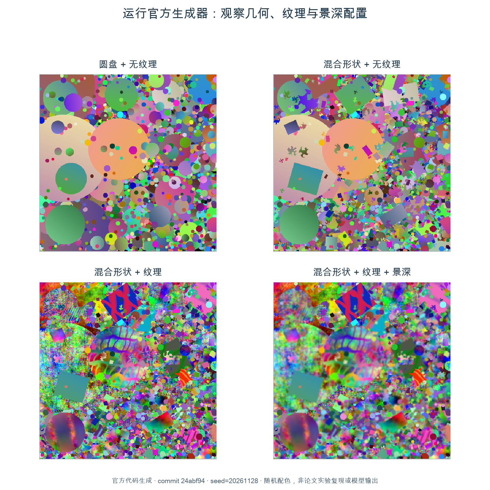

图 7｜运行官方代码生成的四种配置，版本固定为 [24abf949](https://github.com/rachddou/DeadLeavesPlus/tree/24abf9493d7502cbbf206690f1724697e53da0f7)。使用随机配色，未使用内部素材或外部照片色彩源；“无纹理”沿用官方的渐变填充设置。它们展示生成机制，不是降噪结果，也不构成论文消融实验复现。官方这一路输出为 8-bit 展示图，不能直接当作高精度 RAW 母素材。

论文证据有明确范围：§V-A 使用 RGB 加性高斯噪声实验，VL 训练集约含 1 万张 500×500 图像，并提取 50 万个 128×128 Patch。下表摘录 Table II 中 DRUNet 在五个测试集上的平均 PSNR，噪声标准差按 0–255 域计，不是本文重新训练的结果。

| DRUNet 的训练数据 | σ=25，平均 PSNR/dB | σ=50，平均 PSNR/dB |
| --- | ---: | ---: |
| Dead Leaves | 31.60 | 28.68 |
| VibrantLeaves | 33.19 | 30.11 |
| 自然图像 | 33.91 | 30.86 |

五个测试集为 Kodak24、CBSD68、McMaster、Urban100 和 Bokeh；自然图像基线使用 Waterloo、DIV2K 和 Flickr 数据。VL 缩小了与自然图像训练的差距，但没有全面超过它。来源：[论文 §V-A、Table II](https://arxiv.org/html/2504.10201v3#S5.SS1)。

对本文更有价值的是“内容成分影响恢复偏好”：消融中去掉周期纹理主要影响重复结构；去掉微纹理可能出现不恰当的周期性外观；深度建模对失焦区域尤其重要。应结合测试内容理解，不能推出适用于所有任务的最佳比例。来源：[论文 §VI-B、S14](https://arxiv.org/html/2504.10201v3#S6.SS2)。

**这些证据支持可控结构建模的价值，但不直接证明某个 RAW 时域模型、传感器或 ISP 的收益。** 下文的 RAW 转换和序列构造属于工程适配，需要在各自数据域验证。

#### 2.2.2 准周期纹理：把重复关系写进底层信号

先用一个相位场理解机制：

$$
\phi(x,y)=2\pi\frac{x}{p}+u(x,y), \qquad \beta(x,y)=\sigma_k\bigl(\sin\phi(x,y)\bigr).
$$

$p$ 控制周期，$u$ 是平滑变化的相位扰动，$\sigma_k$ 是陡峭程度可控的 Sigmoid，并可进一步归一化或截断。用插值场混合两个颜色或材质：

$$
T(x,y)=\beta(x,y)c_1+\bigl(1-\beta(x,y)\bigr)c_2.
$$

旋转坐标改变方向；两个方向的插值场相乘形成网格；增强 Sigmoid 斜率和截断插值场可改变边界及线条占比；平滑形变和透视变换引入局部不规则性。

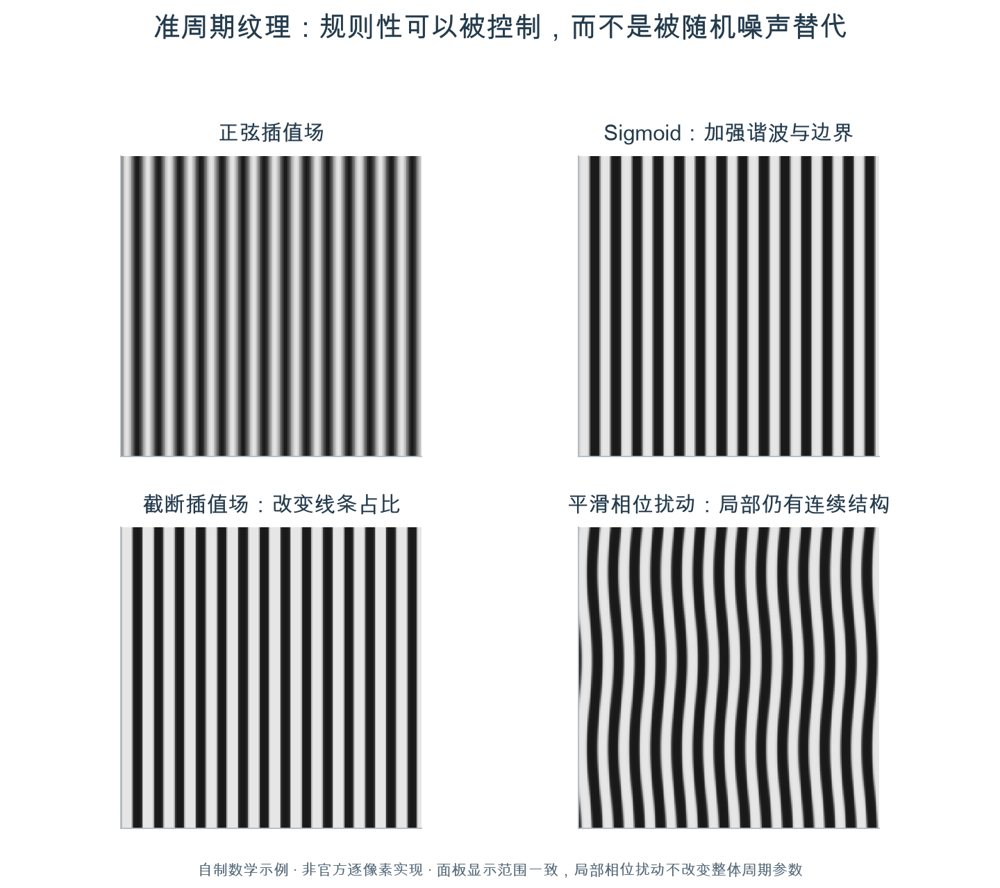

图 8｜本文自制的简化数学示例，依次改变非线性、截断和相位扰动，并非官方代码的逐像素复刻。局部重复关系仍然明确，可以追踪周期、线条和连续性的变化。

若希望周期沿空间变化，可以从正周期函数 $p(s)$ 积分得到连续相位：

$$
\phi(x)=2\pi\int_0^x\frac1{p(s)}\,\mathrm ds.
$$

这是便于控制的构造方式，而非论文分段公式的直接转写。关键是保证局部相位和结构连续，不把随机拼接造成的断点误认为有价值的细结构。

官方实现会在 CIELAB 中进行颜色或材质插值，并组合方向、非线性和形变。这有利于生成丰富外观，但 CIELAB 插值不是线性传感器信号混合。需要 RAW 数据时，必须另行定义线性成像约定。

#### 2.2.3 随机微纹理：让随机性具有空间相关结构

白噪声提供随机高频，却缺少材质在邻域内的相关性。一个可复现的原理示例是对白噪声做频域滤波，构造：

$$
S_T(\mathbf f)\propto\lVert\mathbf f\rVert^{-\gamma}.
$$

这里把 $S_T$ 明确定义为**功率谱密度**。从白噪声 $Z$ 出发，滤波器的幅度响应应取功率谱的平方根：

$$
\begin{aligned} T&=\mathcal F^{-1}\left[\mathcal F(Z)H(\mathbf f)\right],\\ H(\mathbf f)&\propto\lVert\mathbf f\rVert^{-\gamma/2}. \end{aligned}
$$

直流项单独处理，并限制最低频率，避免零频奇点。$\gamma$ 较小时高频相对丰富，较大时更平滑。以下是本文图示的简化实现，不是官方彩色纹理函数：

```python
import numpy as np

def microtexture(size=256, gamma=1.5, seed=20261128):
    rng = np.random.default_rng(seed)
    z = rng.standard_normal((size, size))
    f = np.fft.fftfreq(size)
    radius = np.hypot(f[:, None], f[None, :])
    amplitude = np.maximum(radius, 1 / size) ** (-gamma / 2)
    amplitude[0, 0] = 0
    t = np.fft.ifft2(np.fft.fft2(z) * amplitude).real
    t -= t.mean()
    return t / np.sqrt(np.mean(t * t))
```

改变 $\gamma$ 时沿用相同随机底样，并统一 RMS，是为了单独观察频谱形态，而不是同时改变相位和强度。有限图像、边界、截断和颜色映射都会影响最终谱，应测量实际输出，而不能只记录参数。

一个实现差异值得注意：本文核查的官方版本在 [colored_noise.py](https://raw.githubusercontent.com/rachddou/DeadLeavesPlus/24abf9493d7502cbbf206690f1724697e53da0f7/dead_leaves_generation/utils/colored_noise.py) 中将 slope 定义为幅度谱参数，采用由横纵频率项构成的幅度映射，不能与上式的径向功率谱指数 $\gamma$ 直接等同。复现时应检查代码并测量频谱，不能只抄参数名称。

#### 2.2.4 多尺度混合：组织微纹理，而不只是叠加噪声

设 $T_1,T_2$ 为两张微纹理，$\beta$ 为较大尺度的准周期或缓变权重：

$$
T_{\mathrm{mix}}=\beta T_1+(1-\beta)T_2,\qquad 0\leq\beta\leq1.
$$

这与“两个噪声图各乘常数再相加”不同：空间变化的 $\beta$ 决定哪里出现哪类材质，以及材质如何过渡，表达粗尺度组织与局部微纹理共存的关系。

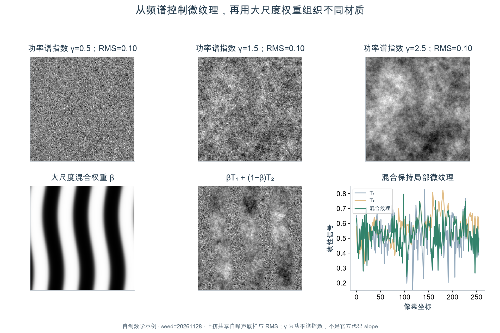

图 9｜自制频谱与混合示例。上排使用相同白噪声底样、相同 RMS 和显示范围，只改变本文定义的功率谱指数。下排展示混合权重及两类微纹理融合；混合结果没有再独立拉伸到与输入相同的方差。

混合后方差取决于 $\beta$、输入方差及相关性。“输入幅度一样”不意味着“混合后幅度不变”。需要精确控制最终幅度时，应在混合后测量，并记录是否做了统一尺度归一化。

纹理比例也应作为数据组成参数，而不是固定真理。过多准周期图案可能带来周期性偏好；纯微纹理又不能补齐规则细线。真实材质、程序化纹理和平坦对照应共同覆盖问题空间。

### 2.3 从展示图到高精度母素材

#### 2.3.1 先解决高精度，而不是最后修改文件位深

若先把弱纹理保存为 8-bit，再转 float32 或 12-bit，丢失的信息不会回来。高精度应贯穿纹理计算、信号混合、几何变换和采样，而不是只存在于最终容器里。

对归一化区间 $[0,1]$，均匀 $b$ 位量化的步长约为：

$$
\Delta_b=\frac1{2^b-1}.
$$

当纹理幅度与步长接近，采样值可能被压成少数台阶，甚至落入同一量化格。结果还依赖均值相对于量化格的位置，不能只凭幅度作绝对判断。

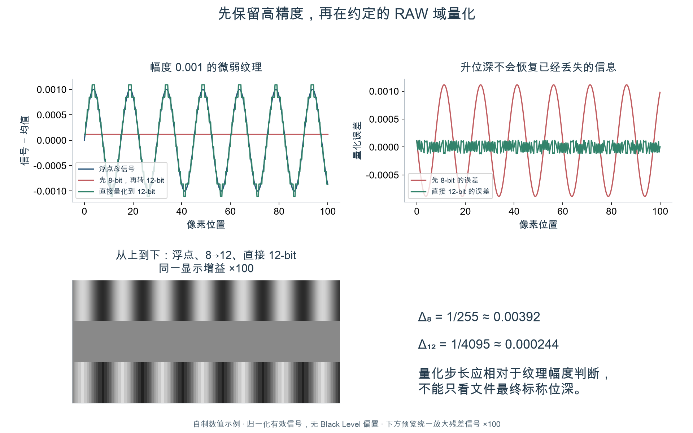

图 10｜自制数值示例。均值选在 8-bit 量化格中心，幅度为 0.001，提前量化的版本因此失去变化。直接量化到 12-bit 保留更多层级。下方条带统一放大残差信号 100 倍，仅用于显示差异，不代表真实亮度或模型结果。

官方生成图可用于观察机制，但默认路径含有 uint8 中间结果。制作微弱 RAW 纹理时，应使用持续保留浮点精度的解析信号或适配后的生成路径，不能把官方 PNG 样例改扩展名后当作高精度素材。

#### 2.3.2 明确“线性信号”的身份

程序化 RGB 不自动等于传感器 RAW。至少要分清：

- 展示 RGB 是否经过 Gamma、色调映射、局部增强和压缩。
- 采样前的三通道信号属于显示色域、相机色域，还是仅为结构实验定义的抽象线性通道。
- 颜色矩阵、白平衡增益、光谱响应和曝光尺度来自标定，还是明确声明的简化假设。
- 是否建模光学模糊、像素积分和抗混叠，而不仅是在离散图上取一个通道。

从已知编码的 RGB 出发，逆传递函数也只是一步，不能恢复已经丢失的高光、纹理或未知处理历史。[Unprocessing Images for Learned Raw Denoising](https://openaccess.thecvf.com/content_CVPR_2019/html/Brooks_Unprocessing_Images_for_Learned_Raw_Denoising_CVPR_2019_paper.html) 讨论了逆相机处理的重要性，具体步骤也可查阅其 [公开实现](https://github.com/timothybrooks/unprocessing)。

没有传感器色彩标定时，可先使用中性或低色度结构研究采样、幅度和时序一致性，但必须标注为**合成线性信号或近似 RAW 域数据**，不能称为已匹配某传感器的实拍 RAW。

## 3 面向时域降噪的训练数据制作

母素材解决“有什么可信结构”，训练样本制作解决“模型实际看到了什么”。这两个阶段应分开，避免一边制作 Clean，一边不可追踪地加入噪声、缩放和运动。

### 3.1 两类素材采用不同的难度控制方式

#### 3.1.1 真实 RAW：优先保留材质，不任意分离纹理

真实图像中的阴影、边界、材质变化和残噪通常混在一起。简单以高斯低通作为背景，再把高频残差乘系数，可能同时改变边界、光照与噪声，不是纯粹的“纹理对比度调整”。

| 操作 | 建议做法 | 需要检查的内容 |
| --- | --- | --- |
| 保留结构 | 从有效区域裁剪原始 Clean | 尺度、连续性和参考残噪 |
| 覆盖不同纹理强弱 | 根据真实内容挑选 ROI，测量局部对比 | 不把噪声估计误差当作真实幅度 |
| 调整曝光尺度 | 在扣黑后的线性信号域缩放 | 截断、饱和、噪声参数和量化变化 |
| 单独改变纹理幅度 | 仅在分离模型可信时使用 | 是否连边缘、阴影和残噪一起改变 |
| 改变结构尺度 | 采用明确、带抗混叠的 CFA-aware 处理 | 细线变形、相位改变和纹理损失 |

真实 Clean 中的残噪也会随信号缩放。参考乘小系数再加新噪声，不会自动等价于真实低曝光采集；既有噪声底、传感器增益和成像条件可能不同。

#### 3.1.2 程序化素材：直接控制生成参数

对明确归一化的纹理 $T$，直接定义 $X=m+aT$，从源头控制背景和幅度；尺度、方向、线宽及采样位置则由几何与相位参数控制。

控制时遵守三个规则：

1. 对照共享母场景、相位及无关参数，只改变所研究的变量。
2. 说明幅度和相对对比度的定义，例如 RMS、峰峰值或相对背景的比例，不能都只叫“对比度”。
3. 在最终 RAW 尺度重新测量幅度和线宽。高分辨率母场景存在的细线，不保证经过光学处理和 CFA 采样后仍可辨。

随机微纹理往往不是有界函数。选择幅度前应检查动态范围，避免大量裁剪；如果进行了截断，需承认它同时改变了边缘与频谱，而非无影响的数值保护。

### 3.2 RAW 域映射、CFA 与量化

设源 RAW 为 $R$，某 CFA 通道的黑白电平为 $B_c,W_c$。必要校正和约定一致时，归一化有效信号为：

$$
x=\frac{R-B_c}{W_c-B_c}.
$$

亮度调整作用于有效信号：

$$
x'=kx,
$$

而非直接计算 $kR$。后者把黑电平偏置也缩放了，改变了暗部和噪声的含义。

若以目标黑白电平 $B_t,W_t$ 保存无噪声参考，一个简化映射是：

$$
Q=\operatorname{round}\!\left(B_t+(W_t-B_t)x'\right).
$$

这里假定 Clean 的有效范围已经检查。存储位宽不等于有效位深，White Level 也未必等于 $2^b-1$。噪声参数从 DN 域到归一化域需要换算；信号缩放后，方差参数也不能不加解释地原样沿用。

对于带噪信号，不应默认扣黑后立刻截断到 $[0,1]$：读噪可能产生负值，提前截断会改变均值。应根据真实 ADC、黑偏置和饱和规则决定截断位置及表示方式。

对程序化三通道线性场景，以 RGGB 为例：

$$
R_B(i,j)= \begin{cases} L_R(i,j),&i,j\text{ 偶},\\ L_G(i,j),&i+j\text{ 奇},\\ L_B(i,j),&i,j\text{ 奇}. \end{cases}
$$

这里 $R_B$ 表示 Bayer 信号，“偶”和“奇”表示坐标奇偶性。这个点采样公式只表达 CFA 通道选择。完整成像还应在之前考虑光学响应、像素面积积分和抗混叠，不能用无限锐利、高频混叠的图案代替合理成像。

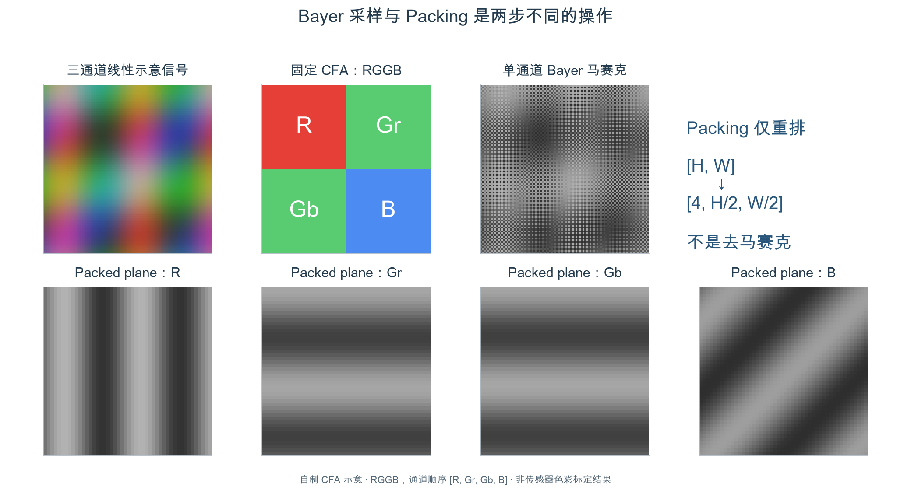

图 11｜自制示意。三通道线性信号先采样为单通道 Bayer，再按四个相位重排为 Packed RAW。Packing 不插值、不恢复缺失颜色，也不是去马赛克；本例通道顺序为 $[R,G_r,G_b,B]$。

不同来源的 Black Level、White Level、通道排列、增益及数值范围应在训练接口前统一，同时保留源元数据。不能仅凭“都是 12-bit RAW”直接合并。

### 3.3 静态与运动序列：从正确的信号层生成

#### 3.3.1 静态序列：相同 Clean，不同随机噪声

对 $T$ 帧静态序列：

$$
X_t=X,\qquad Y_t=\mathcal N(X_t;\theta,\xi_t).
$$

$\theta$ 表示噪声参数，$\xi_t$ 是随机状态。独立随机分量逐帧重新采样，不能每帧加同一张噪声图。模拟固定图样等相关分量时，应显式构造并标记，而非误把种子复用当成传感器建模。

真实 Clean 来自多帧平均时，还需考虑监督残噪与输入噪声的相关性。如果某个输入帧也参与了参考平均，参考便包含它的噪声，不能假定二者独立。可使用独立采集组制作参考，或在可信低噪声参考上生成全新在线噪声，并说明参考仍含有限残噪。

#### 3.3.2 程序化运动：先形成视图，再做成像与 CFA 采样

设高精度母场景为 $L$，第 $t$ 帧几何映射为 $\mathcal W_t$，成像采样算子为 $\mathcal S_{\mathrm{CFA}}$：

$$
X_t=\mathcal S_{\mathrm{CFA}}\!\left[\mathcal W_t(L)\right].
$$

这里 $\mathcal S_{\mathrm{CFA}}$ 包括约定的预滤波、像素积分及 CFA 采样；传感器栅格上的 CFA 排列固定，变化的是它们观察到的场景位置。

可以构造静态、小幅连续平移、平移叠加小旋转等轨迹。相邻运动不宜独立随机抽样，否则会形成不合理跳变。若模拟曝光期间的运动模糊，应在单帧曝光内积分多个时间样本，而非只移动曝光中心的瞬时画面。

二维变换只是平面或近似平面示例，不自动包含真实手持中的三维视差、遮挡变化、滚动快门和动态物体。应按任务选择场景模型，不能将二维旋转序列称为完整真实运动模拟。

#### 3.3.3 真实 Bayer 不能当普通灰度图任意变换

Bayer 中相邻像素通常测量不同颜色。灰度插值会混合这些数值，再把结果解释为特定 CFA 通道，产生错误的颜色及结构关系。

对于 RGGB：

- 偶数行、偶数列偏移的整数裁剪可以保持左上角相位。
- 奇数偏移会改变裁剪后的 CFA 排列，必须更新相位、通道重排或元数据，不能仍按 RGGB 解释。
- 亚像素平移、任意角度旋转和缩放需要专门的 CFA-aware 方法。去马赛克后变换再重采样，是带重建假设的近似，不是无损保留 RAW。
- 对称变换也需检查通道映射，不能只旋转数组而忘记颜色排列。

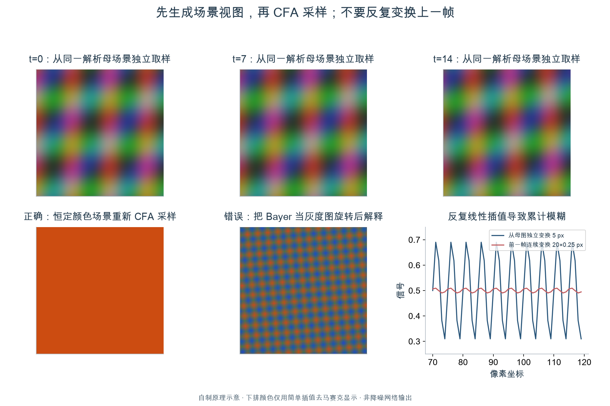

图 12｜自制原理示意。上排从同一解析场景独立生成各帧。下排前两图使用恒定颜色场景：正确重采样保持颜色，直接旋转 Bayer 则破坏 CFA 关系；仅用简单插值去马赛克显示错误。右图说明反复线性插值会削弱细纹理。均非降噪网络输出。

各帧必须**从原始母素材独立生成**。每次变换很小，也可能因反复插值而累积模糊。应保存每帧相对于母素材的完整变换，而非把中间帧当下一帧的新真值。

真实 RAW 的运动轨迹要始终位于有效区域。Mask 需随几何关系映射，并按插值核支持域保守收缩；中心位置有效，不保证整个 Patch 或全部时刻有效。

### 3.4 Clean、带噪输入与监督目标不是同一个概念

| 对象 | 内容 | 是否包含本轮随机噪声 |
| --- | --- | --- |
| Clean 序列 $X_{0:T-1}$ | 各时刻的可信信号 | 不含新合成噪声，但真实参考可能含有限残噪 |
| 带噪输入 $Y_{0:T-1}$ | 噪声模型生成的观测 | 是；相关和独立部分分别处理 |
| 监督目标 | 中心帧、指定参考帧或逐帧 Clean | 由任务定义，不能默认等于整段序列 |

多帧输入、单帧输出时，可用 $X_{\lfloor T/2\rfloor}$ 监督；逐帧输出则使用对应的各帧 $X_t$。运动场景不能将所有时刻都监督到未经配准的同一张图。

用于图示的高斯近似可写为：

$$
Y_t=X_t+\sqrt{\alpha X_t+\beta}\,Z_t, \qquad Z_t\sim\mathcal N(0,1).
$$

它对应指定均值和方差，不等于在低光子计数下严格采样泊松—高斯分布。需要精确的简化泊松—高斯采样时，可在非负线性信号上使用：

$$
\begin{aligned} Y_t&=\alpha P_t+\epsilon_t,\\ P_t&\sim\operatorname{Poisson}(X_t/\alpha),\\ \epsilon_t&\sim\mathcal N(0,\beta). \end{aligned}
$$

两者都不自动包含行列、量化、固定图样和复杂读出效应。实际训练应使用匹配传感器及 ISP 位置的标定模型，说明加噪发生在缩放、Packing 或其他处理之前还是之后。

在线加噪让同一 Clean 在不同训练轮次提供不同观测。固定种子用于复现实验，不代表训练始终复用同一噪声；验证集可以固定随机状态，便于公平比较。

### 3.5 Patch、Packing 与训练接口

#### 3.5.1 按结构与有效性裁剪

Patch 尺寸要与最粗结构、模型感受野一起考虑。过小可能只包含半条线或少量周期，缺少连续性；过大则增加显存和数据成本。

| Bayer RAW 的空间尺寸 | Packing 后的形状 |
| --- | --- |
| 256×256 | 4×128×128 |
| 384×384 | 4×192×192 |
| 512×512 | 4×256×256 |

以上只是可选尺寸，不是最佳配置。若序列长度为 $T=15$，Packed 输入可以表示为 $[15,4,H/2,W/2]$；其他帧数和布局同样可行，关键是与模型一致。

以下只执行重排，不做图像缩放：

```python
import numpy as np

def pack_rggb(sequence):
    # sequence: [T, H, W]；左上角必须是 R，相位已确认。
    assert sequence.ndim == 3
    assert sequence.shape[1] % 2 == 0
    assert sequence.shape[2] % 2 == 0
    return np.stack([
        sequence[:, 0::2, 0::2],  # R
        sequence[:, 0::2, 1::2],  # G_r
        sequence[:, 1::2, 0::2],  # G_b
        sequence[:, 1::2, 1::2],  # B
    ], axis=1)
```

真实序列的裁剪区域应在所有监督时刻有效；需要完整监督时，不能以“有效比例很高”为理由容忍残影像素。部分有效监督需由格式与损失函数明确支持。

#### 3.5.2 把数据契约写清楚

HDF5、NumPy 等容器都可以使用，但容器名不是数据规范。最小契约至少包含：

| 字段 | 必须说明的约定 |
| --- | --- |
| Clean 数据 | dtype、布局、帧数、空间尺寸，是否已经 Packing |
| 信号定义 | 线性域、是否扣黑、归一化、Black/White Level、有效位深 |
| CFA | 排列、裁剪相位、Packed 通道顺序 |
| 监督方式 | 输出时刻、单帧或逐帧监督、对齐关系 |
| 有效性 | Mask 定义、坐标系及训练如何使用 |
| 来源与难度 | 母素材 ID、真实或合成、纹理类别、幅度、亮度、尺度、种子 |
| 时间关系 | 逐帧变换、轨迹单位、曝光假设及有效边界 |
| 噪声接口 | 参数数据域、生成顺序、独立与相关分量 |

例如，一个读取器可以将 target 存为 $[H,W,T]$ 的未 Packing Clean，另一个使用 $[T,4,H/2,W/2]$。两者都需明确转换，不能凭字段名猜测。

若管线包含固定尺寸 Bayer Scaler 或中心裁剪，应测试大 Patch 的读取、前向、损失与反向传播。只切换文件路径，不代表旧尺寸、边界和加噪顺序仍然正确。

还要避免数据泄漏：**训练、验证与测试按母素材或采集场景隔离。** 同一母素材的相邻 Patch、不同亮度版本和运动轨迹，不能分别进入训练与验证，再将结果解释为对新材质的泛化。

### 3.6 训练前检查完整链路

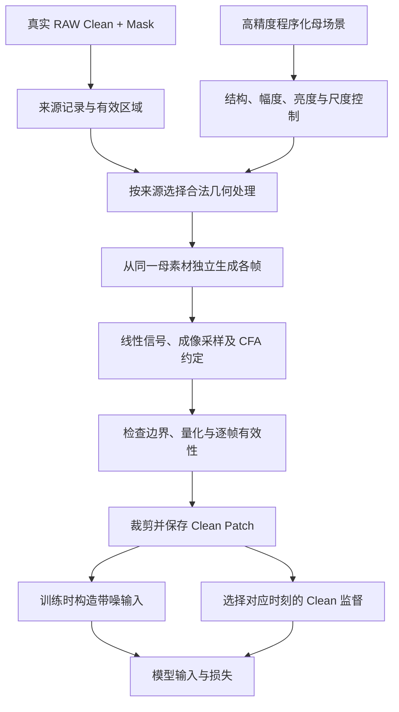

“各帧从母素材独立生成”与“各帧噪声独立采样”是不同要求：前者避免累计重采样，后者控制观测噪声；相关噪声若属于真实模型，则应显式保留。

训练前用少量代表样本检查：

- 查看 Clean、带噪输入、Mask、参考时刻和各 CFA 通道，不只看 RGB 预览。
- 核对 dtype、黑白电平、量化步长、最值和饱和比例。
- 检查最终输入尺寸上的线宽、周期、方向及采样相位。
- 静态序列测量噪声相关性，运动序列核对坐标、目标时刻和边界。
- 实际执行读取、Packing、前向和反向，检查数值、Mask 与尺寸。
- 训练后分别评估平坦区伪纹理、重复结构几何错误和材质保真，不只报告单一全图分数。

这些检查区分“样本更困难”和“样本本身不正确”。后者不能靠扩大数据量掩盖。

## 4 总结

提升弱纹理和细结构恢复能力，数据侧要同时解决三件事：结构覆盖是否充分，Clean 是否可信，以及结构进入模型时的信号与采样条件是否正确。

真实 RAW 提供真实材质与采集关系，但需要稳定帧筛选、多帧平均、结构检查、Mask 与 ROI 共同保证质量。程序化数据补充幅度、尺度、采样相位和组合条件的可控覆盖，但不能把近似线性信号包装成完成传感器标定的 RAW。

核心原则是：**先保证母素材可信；在正确数据域控制难度；从母素材独立生成时序；将噪声、Clean 和监督目标分开；在最终 RAW 输入尺度验证结构。** 纹理越弱，这些细节越不能省略。

### 参考资料与图示说明

- Achddou 等，[*VibrantLeaves: A principled parametric image generator for training deep restoration models*，arXiv v3](https://arxiv.org/html/2504.10201v3)。实验参见 §V-A、Table II，消融参见 §VI-B 与 S14。
- [VibrantLeaves 官方代码 DeadLeavesPlus，固定版本 24abf949](https://github.com/rachddou/DeadLeavesPlus/tree/24abf9493d7502cbbf206690f1724697e53da0f7)，采用 [MIT 许可](https://raw.githubusercontent.com/rachddou/DeadLeavesPlus/24abf9493d7502cbbf206690f1724697e53da0f7/LICENSE)，代码版权为 Raphael Achddou，2025。图 7 为运行该版本获得的样例，没有复制论文图片。
- Foi 等，[*Practical Poissonian-Gaussian Noise Modeling and Fitting for Single-Image Raw-Data*，IEEE TIP，2008](https://webpages.tuni.fi/foi/papers/Foi-PoissonianGaussianClippedRaw-2007-IEEE_TIP.pdf)。用于理解信号相关噪声及截断边界。
- Brooks 等，[*Unprocessing Images for Learned Raw Denoising*，CVPR，2019](https://openaccess.thecvf.com/content_CVPR_2019/html/Brooks_Unprocessing_Images_for_Learned_Raw_Denoising_CVPR_2019_paper.html) 及 [官方实现](https://github.com/timothybrooks/unprocessing)。用于理解 RGB 到 RAW 近似构造中的相机处理关系。

除图 7 外，其余均为本文使用 NumPy、SciPy 和 Matplotlib 自行生成的数学或采样示意，基础种子为 20261128，双纹理混合的第二张底样使用 20261129。显示范围、放大增益和身份均在图中或图注注明。图 7 使用相同种子及独立几何、填充随机流，母画布 1024×1024、半径范围 8–360、2 倍下采样、随机配色；其余以固定版本默认配置为基础，分别切换形状、纹理和景深，不用于宣称复现论文训练分布。
